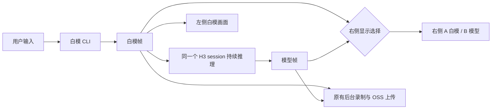

# 白模试玩：连续推理与 A/B 显示接口

## 当前约定

一次试玩只初始化一个白模世界和一个 H3 session。Prompt、参考图和 seed 在开始前设置，此后不修改。白模持续采集并送入同一个模型；A/B 只选择右侧显示，能够任意交替。没有 Reset，也不在切换时重建连接、重发参考图、释放或重新申请 GPU slot。



前端始终接收白模、模型两路 H.264，保留各自最新解码画面；切换直接选择当前缓存，随后继续绘制对应通道。这样不必等待网络往返或新的模型首帧。模型尚未出首帧时，B 显示等待状态。A 的最新源帧一般比 B 更靠近当前时间，切换可能产生这段时间差，不能把它宣称为零延迟或绝对无跳变。

一名玩家在 A 和 B 中都占用一个 GPU slot。多个玩家分别具有自己的模型 session、显示选择、输入序列和资源租约，切换不影响其他玩家。当前真实 CLI 仍只支持单人；未来同 game_id 的 Room 路由约定不变。

## 连接、初始化和控制

连接现有 `/generate?whitebox_control=v1`。二进制控制消息使用 MessagePack。新增协议由 ready 的 `control_protocol: "whitebox-display-v1"` 明确标识；旧 direct-generate 路径保留。

```js
{version:2, type:'init',
 whitebox:{world_id:'...', source_id:'...'}, // game_id 可选，遵循既有加入协议
 prompt:'湖边的小镇', seed:42, render_mode:'whitebox',
 references:[{id:'scene', format:'png', payload:Uint8Array(/* 图片字节 */)}]}
```

参数限制：Prompt 非空且不超过 16384 字符；参考图最多 9 张、总计 8 MiB，PNG/JPEG/WebP，ID 唯一，单图像素不超过 16777216。视频默认 832×480、模型时间轴 24fps。实际采集/输出速度单独测量，不等于声明的 24fps。

`session.ready` 提供两路 `video_stream` / `source_video_stream`，以及 `continuous_model:true`、`model_parameters_mutable:false`、`independent_streams:true`、`play_seconds`、录制和报告信息。世界 ready 与模型首帧是不同阶段。

运行中选择输出：

```js
{version:2, type:'event', kind:'display.configure', payload:{
 request_id:'<UUID>', expected_revision:0, mode:'model' // 或 whitebox
}}
// 服务端回执
{type:'render.status', state:'accepted', request_id:'<UUID>',
 revision:1, accepted_revision:1, mode:'model', model_epoch:'...'}
```

这是显示选择记录，不改变媒体通道的内容或 H3 状态。前端先本地切换，再异步保存选择；不等待回执才绘图。SDK 对快速点击只保留最新尚未发送的选择，最多一个在途命令，避免命令堆积。回执按 request_id 匹配，revision 是显示控制版本，**不能据此丢弃连续模型帧**。

- `expected_revision` 不匹配：`rejected / REVISION_CONFLICT`，按回执的当前版本重试。
- 相同 request_id、相同 payload 重试可返回 `duplicate:true`；不同内容复用 ID 被拒绝。
- 此消息不能携带 Prompt、references 或 reset；初始化之后参数固定。旧 prompt 消息返回 `PARAMETERS_LOCKED`。
- 模型故障或 slot 申请失败会结束本次试玩，不能把白模直出冒充模型成功。
- 按键仍使用现有 `event/input`，带递增 sequence；结束使用 `event/finish`，连接期间取消则关闭连接。结束或断连释放 session 和 slot。

## 媒体、states 与时间轴

左路 `whitebox.frame / stream=whitebox` 永远是白模；模型路 `frame_batch / stream=model` 永远是真实模型输出。A/B 不改任何一路内容。

```js
{version:2, type:'frame_batch', stream:'model',
 output_frame_start:127, num_frames:1, recording_frame_index:159,
 source_frame_index:312, pts_us:13000000,
 encoding:'h264', bitstream_format:'annexb', codec:'avc1.42c01e',
 width:832, height:480, keyframe:true, duration_us:41667, payload:Uint8Array(/* AU */),
 rendering:{mode:'model', revision:0, model_epoch:'...', model_session_id:'...',
   generation_id:'...', worker_id:'...', model_revision:'...'},
 source:{/* 原始 CLI 帧身份 */}, states:{/* 业务不透明结构 */},
 observed_input:{/* 输入及 CLI receipt */}, server_epoch_ms:0, pipeline_ms:0}
```

`output_frame_start` 是实时通道帧号；`recording_frame_index` 是模型对应的存档帧号；`source_frame_index` 关联原始白模采集帧。`pts_us` 是采集时钟的相对时间，允许间隔不均，不能按 n/24 重建录像现实时间。两路实时画面独立推进，不要求同时显示同一源帧。

提交 H3 前可跳过过时的未提交源帧；已提交 H3 的帧遵守连续局部帧号、24fps 模型时间轴与 source contract。原始源身份通过 provenance 映射回采集帧。模型输出持续编码、录制；慢客户端只保留最新尚未发送的完整 IDR，播放回执不会暂停模型输出消费。录制进程仍有有界队列，存储长期变慢仍可能反压，不能声称完全无影响。

独立可靠状态流继续通过 WS 发送：

```js
{version:2,type:'whitebox.states',source_frame_index:312,pts_us:13000000,
 source:{/* CLI 身份 */},states:{/* 原样 */},observed_input:{/* receipt */}}
```

UI 同事按 source 身份/时间关联对应视频帧，不能将最新 states 直接贴到旧模型帧。视频可以丢帧，opaque delta 状态仍可靠、有序；消费者过慢时状态流会反压。本接口只透传 states；平台同事提供的前端 UI 叠加按源时间关联，不改变 H3 或录制链路。

## WebSocket 与可选 WebRTC 路径

试玩页和样例默认使用 **WebSocket**，两路视频、控制及 states 均走 WS。当前页面禁用 WebRTC 选项，不部署 TURN。两路各自发送 `playback_ack`，初始 frame=-1、window=2，后续为各路最后接收帧，protocol=`whitebox-dual-v2`。

保留的可选 WebRTC 实现是 **unordered DataChannel，maxRetransmits=0**，传输 H.264 access unit 和同帧元数据；不是 RTP MediaStreamTrack。启用它需要另外验证网络，WS 此时保留可靠控制、states 和 SDP。

1. WS 发 `rtc.prepare`，收 `rtc.configuration {iceServers}`。
2. 浏览器建立 `whitebox-media-v1` DataChannel，收集 ICE 后发 `rtc.offer {sdp}`。
3. 收 `rtc.answer {sdp}` 并等待 DataChannel open，再发 init。连接失败前不分配世界或模型 slot。
4. RTC 媒体无需 playback ACK。WS 对照路径仍按两路各自发 `playback_ack`，初始 frame=-1、window=2，后续为各路最后接收帧，protocol=`whitebox-dual-v2`。

RTC 包含网络字节序 16-byte header：magic `WBV1`、uint32 消息 ID、uint16 分片序号、uint16 分片总数、uint32 总长度；每片负载最多 12288 字节。拼齐后 MessagePack 解码。发送缓冲预算 512 KiB，满时丢整帧。接收最多 8 帧、8 MiB，拼包超时 200ms；迟到帧按各路 PTS 丢弃。每帧独立 IDR，丢前帧不破坏后帧解码。WS 对照也采用相同编码，避免混入编码策略差异。

服务端启用 `WHITEBOX_WEBRTC_ENABLED=1`，ICE 配置用 `WHITEBOX_RTC_ICE_SERVERS`；自建 TURN 使用 `WHITEBOX_RTC_TURN_URLS` 和 Secret 引用 `WHITEBOX_RTC_TURN_SECRET`。浏览器只获得一小时有效的 HMAC 临时凭证。HTTP Ingress 不会自动开放 UDP；必须验证公网 ICE/relay 连通，不能用本地测试代替。失败明确报错，不暗中回落 WS。

## 录制与 OSS

A/B 不切换录制内容：`whitebox.mp4` 始终是配对的白模，`model.mp4` 始终是连续模型输出，沿用后台编码/元数据/异步上传。存档前缀、输入区间、参考图、states 格式保持既有约定。左侧实时预览可能包含更多未提交模型的源帧，录像仍按模型输出对应源帧成对保存，时间戳相同。

- `inputs.jsonl`：输入区间、固定 Prompt 和参考素材引用；observed.display 可附带用户显示选择，仅作操作记录。
- `states.jsonl`：与录像逐帧配对的状态与源身份；`source-states.jsonl` 保存采集状态历史。
- `references/<sha256>.<format>`：初始化参考图。
- `manifest.json`：配置、帧数、校验和、耗时和上传状态。模型 session/epoch 整段不变；实时丢帧不删除存档帧。实验数据仍标记 `excluded_unvalidated`。
- `session.completed.frames` 是实时模型通道帧数，`recorded_frames` 是存档帧数，可能不同；RTC 还可能在网络丢帧，客户端不能要求两者等于收到的帧数。

## 接入样例与性能测量

见 `examples/interactive-client.mjs`，以及平台 `web/src/whitebox-client.mjs` / `WhiteboxPlaytest.tsx`。只需 `selectOutput('whitebox'|'model')`，不要关闭模型 WS。

`h3_source_to_output` 在收到 H3 原始输出时计时；`model_source_to_delivery` 额外包含编码、存档排队和播放等待。`playback_delivery_wait`、`playback_encode`、`archive_source_encode`、`browser_send` 用于拆分瓶颈。按键延迟必须用 CLI receipt 的 sequence/epoch/simulationTick 映射到实际绘制帧，不用 API 回执延迟代替。

WebRTC 丢帧后的解码适配：平台 `whitebox-live-decoder.mjs` 为已收到的帧建立连续的本地解码序号，回调恢复原始媒体信封；不修改封装的 SDK，也不改源帧、PTS 或存档帧号。
