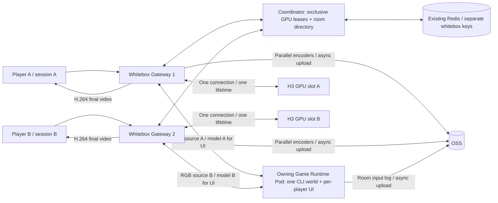

# Whitebox multiplayer integration — local implementation, not deployed

This change is on `white_box`. Deployment is being prepared for a separate test
lane; the multiplayer changes have not yet been accepted online.
The original `generate`, `authorize_generation`, GPU admission, renewal and
release policy remain in the existing gateway/coordinator. Room routing is an
additional, independently configured layer. Account policy stays outside it.



## Identity and ownership

* `game_id`, `player_id`, `stream_id` are server-generated UUIDv4 hexadecimal IDs
  with 122 CSPRNG bits. They require no timestamp, machine ID allocation, Redis
  round trip or global counter to generate. The existing `session_id` is also
  generated by the gateway. A UUID collision cannot overwrite a room: creation
  uses an atomic per-key compare-and-set. It is not a substitute for account auth.
* `world_id` is the canonical `sourceId/worldId` WTP reference when available.
  A different world cannot join an existing game. Frontends never choose a Pod,
  CLI command, endpoint, driver, or slot.
* On creation, rendezvous hashing selects a configured direct Pod origin. The
  directory persists this selection. Joining consults the existing mapping;
  changing the configured runtime list cannot move a running room.
* Every runtime process generates an `owner_epoch`. Redis atomically claims and
  renews the room for that epoch, with a 30-second lease and configurable absolute
  game lifetime. The runtime renews once per second and ends the room on failure.
  A restart cannot adopt an old CLI world. There is no automatic state migration.
* Default maximum game lifetime is 3600 seconds. Each player retains the existing
  startup/play/drain deadlines and H3 lease. Leaving removes that player only;
  the final departure closes the world. An abandoned internal player connection
  is reaped after 45 seconds without RPC activity. Reconnect currently starts a
  new player/session/stream and consumes a new slot; seamless resume is not claimed.
* Each player goes through normal coordinator admission **before** room join.
  Two players in one game consume two slots, just like two separate games.
  Joining does not share H3 context or return another player's worker connection.
  Real H3 workers must advertise only their actual independently servable slots;
  a GPU group holding one H3 session must not advertise spare concurrent capacity.
* `user_id` retains the existing outer gateway identity. On direct `generate`
  it is currently browser/tab-scoped and is not a verified account identity.
  `player_id` distinguishes participants even when they share an account.

## CLI contract and capability boundary

Code inspected at commit `16ac1cda104f581ffe9c25b2cc708eb7563eb22c`, with updated
usage documentation at `cfa9c741dd3a67b65a8dd298eed6d2b84424cb1e`:
[CLI README](https://github.com/seedleap/agent-whitebox-world-sdk/blob/cfa9c741dd3a67b65a8dd298eed6d2b84424cb1e/packages/cli/README.md).
The current `worldkit stream` command supplies a loopback descriptor, VP8 media
WebSocket and JSON control/UI WebSocket. It has one controller and one view.
`worldkit frames` and named input/session operations are implemented. The
`worldkit compose` command and multi-view remain future work. Backend UI rendering
uses the `white_box` SDK's public `stream-player/headless` adapter instead.

Implemented `cli_room:cli_room` starts one process per game, reads its complete
ready JSON, validates loopback/same-origin endpoints, connects the two WebSockets
with the same client ID and local token, consumes configuration/keyframes, decodes
VP8 with PyAV, and forwards keyboard/camera input using the documented protocol.
Control data must catch up to the frame's UI revision/source time. Epoch changes,
generation changes, frame gaps, queue overflow and invalid packets stop the
stream instead of silently mixing timelines. Input receipts and UI messages are
retained without inventing the contents of `states`.

The CLI token and WTP token never enter a browser response, archive or argv. WTP
authentication uses `WORLD_TEST_API_TOKEN` inherited by the process. Shutdown
signals the process group, waits up to 35 seconds, then kills the group if needed.
CLI stderr is not forwarded to browsers or archives.

**Current production capability boundary:** the shipped CLI driver permits one
player per game. Its default `cli_ui:factory` compositor invokes the source-timed
SDK UI renderer in a separate Chromium process. `WHITEBOX_CLI_UI_FACTORY` can
replace this boundary when the official streaming compositor is available. The
shared-room mock supports many views for local verification. Raising the CLI
driver's `max_players` does not implement multiplayer and must not be used as a
workaround. The colleague's future driver should implement:

```python
async def room_factory(*, world_id, spec, trace_id) -> RoomDriver: ...
class RoomDriver:
    max_players: int
    async def join(self, *, player_id, spec) -> PlayerView: ...
    async def close(self): ...
class PlayerView:
    renderer: UIRenderer
    metadata: dict
    def frames(self): ...  # EngineFrame iterator, local contiguous frame/PTS
    async def send_input(self, sequence, payload): ...
    async def finish(self): ...  # only this view, including release of held keys
    async def close(self): ...  # idempotent, does not terminate other views
```

The compositor factory receives `descriptor` and `spec`, exposes `metadata`,
`consume_ui(message)`, `render(rgb, frame, spec)`, and idempotent `close()`.
It must reuse the SDK's public UI renderer/history and render the exact
`frame.provenance.cli_frame_header.source` and `uiRevision`, including animations
at source time. It must bound history by model delay and fail on unavailable
history. Rendering the newest UI state or replacing the UI with a mock overlay
is not acceptable. The original descriptor is private to this local adapter.
The `frame.states.ui_events` envelope contains unmodified SDK UI messages;
domain state keys are unrestricted. A later driver may use any JSON state payload.

Camera policy currently maps pointer deltas to radians at 0.002 radians/pixel.
World key bindings remain SDK-owned. Browser pointer buttons are not implicitly
translated into game-specific actions. New semantic actions should extend the
driver using the documented `input.action` contract and retain action receipts.

## Media and data alignment

Default is **832×480 at 24 fps** (480p, dimensions divisible by H3's 32).
CLI wire format is VP8; internal model input is packed RGB24; browser output is
H.264 Annex B; all three stored videos are H.264 in MP4 containers.

Each player's whitebox/model/UI videos use the same local `[0,N)` frame sequence
and rational 24 fps PTS. Source native timestamps are retained separately: CLI
throughput is a target, not a guarantee, and converting captured frames to this
CFR timeline does not claim the wall-clock source ran at exactly 24 fps. No
source frame is deliberately dropped or duplicated by this adapter.

Different players can join at different times. Cross-player association uses
`game_id`, room time, source `simulationTick`, `worldRevision`, `presentationId`
and `sourceTimeUs`; local player frame 10 is not another player's frame 10.
`room_seq` is the single owner's receipt order. It does not assert application
order inside the CLI. Input receipt evidence is preserved separately, and frames
without a provable effective input mapping remain `unknown_input_frames`.

```text
white_box_game_record/<world_key>/<game_id>/
  manifest.json                 # room identity, all participants/stream prefixes
  inputs.jsonl                  # all players' ordered received events
  streams/<stream_id>/
    manifest.json               # identity, H3 config/worker/slot, hashes, status
    inputs.jsonl                # this view's effective input/prompt/ref intervals
    states.jsonl                # opaque UI + local frame/PTS + original source
    references/00.png ...       # exact original images (up to 9, independent roles)
    whitebox.mp4
    model.mp4
    ui_rendered.mp4
```

`world_key` is the first 32 hexadecimal digits of SHA-256 of the canonical world
reference, avoiding unsafe path segments. Both manifests retain the original
`world_id`. Game UUIDs prevent different games from sharing a prefix. Room events
include `game_id`, `player_id`, `session_id`, `stream_id`, `user_id`, `room_seq`,
`room_time_us`, `kind`, `payload`. `inference.init` references the player's image
paths and stream prefix, rather than embedding image bytes. Prompt updates are
recorded when received; the per-stream intervals use H3's actual output event ID
to select the effective prompt. Reference changes during a live H3 session remain
unsupported by the existing interface; choose references at initialization.

Reference records retain the client's role/order ID and also include a global
content identity `asset_id=sha256:<digest>`; the latter is independent of which
gateway or player uploaded identical bytes.

Three encoders and uploads remain asynchronous. A player's archive can complete
while other players continue. The room index is finalized after the last player
leaves; it links independent player manifests and is not proof that every upload
has finished. Object checksums are verified before upload; each manifest publishes
last. Local spools must be persistent for retries. Abrupt process/storage loss
cannot promise a complete MP4 or a complete final room index.

The recording API requires that player's report capability and exposes only their
stream's prefix, signed manifest and signed video links. It does not expose other
players' playback capabilities. Signed URLs expire; the existing poll refreshes
them. The room ID acts as an unguessable invitation within the current test entry;
account membership and production authorization can be added in the outer layer.

Recording status still uses the existing gateway-local spool/capability store.
For the current deployment keep one Whitebox Gateway replica, or explicitly route
each player's recording HTTP requests to its original gateway with persistent
storage. Room routing supports multiple gateway callers; it does not introduce a
distributed recording-status database. The two-gateway local test queries each
recording on its owner. Unqualified round-robin HTTP routing across gateway-local
spools and automatic report failover are not supported by this change.

## Configuration (prepare only; do not deploy in this task)

Existing coordinator, using the existing Redis connection:

```dotenv
WHITEBOX_ROOM_OWNERS='{"runtime-a":"http://runtime-a:8092","runtime-b":"http://runtime-b:8092"}'
WHITEBOX_ROOM_KEY_PREFIX=whitebox:rooms:v1:
WHITEBOX_INTERNAL_TOKEN=<shared-private-service-token>
WHITEBOX_GAME_SECONDS=3600
```

Every owner URL must address exactly one Pod/process; a load-balanced Service is
incorrect here. New rooms may hash to any configured healthy deployment target;
there is currently no automatic unhealthy-owner selection/retry. Failed startup
returns an error and releases its GPU slot. Existing mappings are never rehashed.

Each Game Runtime runs one Uvicorn process with a unique configured owner ID:

```dotenv
WHITEBOX_ROOM_OWNER_ID=runtime-a
WHITEBOX_ROOM_COORDINATOR_URL=http://whitebox-coordinator:8090
WHITEBOX_INTERNAL_TOKEN=<same-token>
WHITEBOX_ROOM_DRIVER=sglang.multimodal_gen.runtime.realtime.whitebox.room_mock:shared_mock_room
WHITEBOX_ROOM_SPOOL=/var/lib/sglang/whitebox-rooms
WHITEBOX_OSS_PREFIX=white_box_game_record
WHITEBOX_WIDTH=832
WHITEBOX_HEIGHT=480
WHITEBOX_MAX_PLAYERS=8
WHITEBOX_MAX_ROOMS=16
WHITEBOX_PLAYER_IDLE_SECONDS=45
```

After supplying those environment values to the process:

```sh
python -m sglang.multimodal_gen.runtime.entrypoints.whitebox_room_server
```

Real CLI instead selects `...whitebox.cli_room:cli_room` and supplies an absolute
`WHITEBOX_CLI_ENTRYPOINT`, `WORLD_TEST_API_TOKEN`, and `WHITEBOX_CLI_UI_FACTORY`.
Optional `WHITEBOX_NODE` / `WHITEBOX_CLI_RENDERING` select the runtime. Pin the CLI,
Node, Playwright and Chromium versions; model/GPU/color/latency acceptance remains
separate from CPU fixture tests.

Whitebox Gateway:

```dotenv
WHITEBOX_ENABLED=1
WHITEBOX_ENGINE_FACTORY=sglang.multimodal_gen.runtime.realtime.whitebox.room_client:room_engine_factory
WHITEBOX_UI_FACTORY=sglang.multimodal_gen.runtime.realtime.whitebox.room_client:bound_room_renderer
WHITEBOX_ROOM_COORDINATOR_URL=http://whitebox-coordinator:8090
WHITEBOX_INTERNAL_TOKEN=<same-token>
WHITEBOX_WIDTH=832
WHITEBOX_HEIGHT=480
WHITEBOX_STARTUP_SECONDS=150
WHITEBOX_PLAY_SECONDS=60
```

The bound renderer is obtained from the player's engine; it never makes another
CLI process. Both runtime and gateway retain the existing `WHITEBOX_OSS_BUCKET`,
`WHITEBOX_OSS_ENDPOINT`, `WHITEBOX_OSS_REGION` and credential-chain configuration
when actual upload is enabled. These examples do not provision or write Redis/OSS.

Platform: keep the existing gateway URL, set
`WORLD_TEST_WHITEBOX_MULTIPLAYER=1` only for a multiplayer-capable room driver and
`WORLD_TEST_WHITEBOX_SOURCE_MODE=cli`. The existing `browser_mock` is explicitly
single-player and cannot represent a shared authoritative world.

## Local verification

```sh
PYTHONPATH=python SGLANG_LIGHTWEIGHT_RUNTIME=1 .venv-whitebox/bin/python -m pytest \
  --confcutdir=python/sglang/multimodal_gen/test/unit/realtime \
  python/sglang/multimodal_gen/test/unit/realtime/test_whitebox.py \
  python/sglang/multimodal_gen/test/unit/realtime/test_whitebox_rooms.py -q
```

Tests start only loopback services, use in-memory coordinator/directory/archive
stores, real HTTP/WebSockets and real VP8/H.264 codecs. They verify two gateways,
two independent H3 sessions/slots, one shared room, capacity rejection, one player
leaving without ending another, server deadline, input association, archive hashes,
three-video frame/PTS alignment, archive capability, remote timing visibility,
owner fencing and the current CLI transport envelope. No real CLI delivery, GPU,
Redis, WTP API or OSS endpoint is contacted by these tests.

### Repeatable real single-player acceptance

With a checkout at `benchmark/whitebox/sdk-revision.txt`, installed dependencies
and Playwright Chromium, run:

```bash
WHITEBOX_TEST_CLI_SDK=/absolute/sdk PYTHONPATH=python SGLANG_LIGHTWEIGHT_RUNTIME=1 \
  python -m pytest python/sglang/multimodal_gen/test/unit/realtime/test_whitebox_cli_integration.py \
  --confcutdir=python/sglang/multimodal_gen/test/unit/realtime -q
```

This test compiles the SDK's `streaming-ui` world and serves a loopback sealed WTP
fixture. Two real CLI/UI instances use two independent rooms and dedicated mock
H3 sessions; the third request is rejected. It checks manual/timed finish,
release, three H.264 recordings with identical PTS, room input identities and
archive/report metadata. Uploads stay in memory; no cloud credentials are used.
The native two-game cases remain opt-in. The required shared SDK member
poll/display case in the same file fails when `WHITEBOX_TEST_CLI_SDK` or its
shared WhiteboxClient module is missing; it does not silently skip. This Node
client-envelope test uses original CPU member/RTC owners and needs no browser.
The pure CPU AREA media suite is independent of this SDK checkout.

The Room image runs this acceptance as an unprivileged user in its build gate.
Its source is pinned and fetched by CI; API tokens are runtime Secret references.
See [CLI lane review](deployment/CLI-LANE-REVIEW.md) for the isolated rollout.
