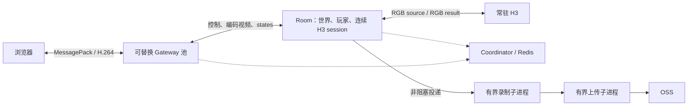

# Room-owned 试玩链路

实现开关：`WHITEBOX_ROOM_PIPELINE=1`。同一份 `white_box` 代码保留旧链路供回滚；切换实现只影响新会话。H3 权重、推理协议和进程不随这次外围发布更新。

## 职责和边界



- `room_pipeline.py` 在 Room 内调用现有 `RoomRuntime` 和 `InteractiveSession`，持有 H3 租约及原始帧关联。与 CLI 的访问是本进程调用，不再逐帧经过 Gateway HTTP RGB RPC。
- `room_proxy.py` 只查询 Room owner、转发控制和编码数据。Gateway 无录像目录依赖，无 H3 会话所有权，客户端可通过任意 Gateway 恢复同一 Room 会话。
- `async_recording.py`、`async_journal.py` 接收非阻塞投递。两路已编码视频的封装、输入日志、文件校验和 OSS 上传在独立子进程完成。
- 每个玩家仍是一条独立 H3 session；A/B 只切显示，A 模式也持续向 H3 送帧。默认 B。参数在 init 时固定，不增加 reset 或运行中更换参考图。
- 当前真实 CLI 仍只允许一个玩家；上线配置保持一个 Room、一个活跃 H3 会话。多玩家数据结构与隔离测试不代表真实多人已支持。

## 客户端连接与恢复

继续使用现有入口：

```text
wss://<gateway-prefix>/v1/realtime_video/generate?whitebox_control=v1&user_id=<user_id>&trace_id=<trace_id>
```

所有消息为 MessagePack 二进制。鉴权仍由部署外层负责；不要把可自填的 `user_id` 当作鉴权凭证。

首次发送原有 init，例如：

```javascript
{
  type: "init",
  prompt: "A lakeside village",
  references: [],
  render_mode: "model",
  whitebox: { source_id: "br-...", world_id: "world-..." }
}
```

新 Room 先返回 `session.attached`，客户端应立即保存本连接的恢复票据；CLI 和 H3 初始化完成后继续返回 `session.ready`、`render.status` 和媒体。即使在初始化时 Gateway 断开，也可用票据恢复。票据只保存在当前试玩内存，不写日志、地址栏或 OSS。

`session.attached` 新增字段：

| 字段 | 含义 |
| --- | --- |
| `session_id`、`game_id` | 整次试玩不变 |
| `resume_token` | Room 生成的不可预测恢复能力凭证 |
| `owner_epoch` | Room 实例代次，Room 重启后失效 |
| `connection_generation` | 每次附着递增；旧连接不能继续控制 |
| `reconnect_grace_seconds` | 默认 15 秒，超过则结束该试玩并释放 H3 |
| `last_input_sequence` | Room 已完成提交给 CLI 的最后输入序号，初始 -1 |

断线后连接任意 Gateway，发送：

```javascript
{
  type: "resume",
  session_id: ticket.session_id,
  resume_token: ticket.resume_token,
  owner_epoch: ticket.owner_epoch,
  control_sequence: lastAppliedControlSequence,
  whitebox: { source_id, world_id, game_id: ticket.game_id }
}
```

保持相同用户身份及世界引用。不要用新的 init 代替 resume。恢复不会重建世界、H3 或录像，不延长试玩期限；`session.ready.play_remaining_seconds` 为服务端剩余时间。

`session.ready` 还提供：

- `room_pipeline_protocol: "room-pipeline-v1"`。
- `display_revision`、`display_mode`，用于恢复 A/B 控制状态。
- `report_path`：相对于 `/v1/` 的录像查询路径；例如 `whitebox/owners/whitebox-th-room-0/recordings/<stream_id>`。与原 `report_token` 配合使用。应保留部署 ingress 前缀，不能直接拼接服务器内网地址。

当前平台客户端已实现这套恢复逻辑。旧 Gateway 没有恢复票据时，仍使用原行为。

## 输入确认、状态和媒体

输入保留单调递增的 `sequence`。Room 完成 CLI 输入调用后发：

```javascript
{ type: "whitebox.input_committed", sequence: 17 }
```

该回执表示调用完成，不等于画面已经呈现。客户端重发断线前未确认输入时必须保持相同序号及 payload；Room 对最近 256 条输入去重。同序号不同 payload 被拒绝。已有 `whitebox.input_received` 不能作为已应用确认。平台客户端最多保留 128 条未确认输入，避免无限缓存。

`whitebox.states`、`whitebox.control`、`whitebox.capture` 带递增 `control_sequence`。客户端仅在成功应用后推进游标，恢复时 Room 重放后续记录。历史最多 16 MiB；过旧游标返回 `STATE_HISTORY_EXPIRED`，不静默套用错误 UI 状态。

每次附着都必须重新配置 H.264 解码器，并为两路发送初始 credit：

```javascript
{
  type: "event", kind: "playback_ack",
  payload: { protocol: "whitebox-dual-v2", stream: "model", frame: -1, window: 2 }
}
// whitebox 路也发送一条。随后 ACK 每个成功处理的 output_frame_start。
```

媒体仍为 `whitebox.frame` 和 `frame_batch`，携带 H.264 access unit、关键帧标志、原始帧关联及 states。区别：

- `output_frame_start` 是本次连接的连续投递编号，重连从 0 开始，用于 ACK。
- `media_sequence` 保留 Room 的原始媒体编号；录制/源帧/model epoch 不随连接重置。
- `connection_generation` 可用于丢弃旧解码器回调。
- `pts_us` 沿用采集时间轴，不能用接收序号除以 24 替代。

解码器丢失参考帧或过载时，停止接收后续 P 帧，等待 IDR，并可发送：

```javascript
{ type: "event", kind: "playback.keyframe", payload: { stream: "model" } }
```

Room 将同路请求合并、限制为每 250 ms 至多一次。浏览器当前限制为每 500 ms 一次。每路订阅最多 8 个媒体包，合计最多 2 MiB，最旧等待超过 250 ms 即清理依赖链并恢复至新关键帧。不能随意丢弃一个 P 帧后继续解码后续 P 帧。

## ABAB 控制保持兼容

```javascript
{
  type: "event", kind: "display.configure",
  payload: {
    request_id: crypto.randomUUID(),
    expected_revision: currentRevision,
    mode: "whitebox" // A；B 为 "model"
  }
}
```

收到 `render.status` 的 accepted 回执后采用返回的 revision。断线可补发相同 request_id；不得生成新的模型 session。左侧一直是白模，右侧按选择显示。两条后台生成链路与原始存档不因 A/B 改变。

主动结束使用原有 `event / finish`。关闭 WS 表示断线，只有保留期到期才释放；不再把关闭 WS 当作立即结束。

Room 丢失返回 `ROOM_SESSION_LOST`，保留期结束返回 `RECONNECT_EXPIRED`；没有世界快照热迁移。Gateway 替换允许短暂播放中断，不承诺连接本身不中断。

## 录像与资源预算

Room 在有界模型输入容量内统一选择白模帧，分配连续的配对序号 n。选中帧立即编码并发布白模 H.264，同时把原始 RGB 送给 H3；发布白模不等待对应的模型结果。原始 CLI 帧号保留在 `source_frame_index`，`model_pts_us=spec.pts(n)` 使用模型 24fps 逻辑时钟。两路录像均使用相同的采集 PTS，保持实际 VFR 时长。

源与模型各只有一个 H.264 编码器，同一 AU 分别用于实时播放和录像。源 AU 与模型 AU 成对非阻塞投递；录制进程只封装，不再编码源 RGB。失败后停止本次归档接收，释放仅为录像保留的 AU，H3 关联身份继续保留至输出完成。成功存档逐帧配对；失败留下连续前缀并标记失败，不补帧、不跳过缺口。

`WHITEBOX_PAIRING_MAX_BYTES` 默认 384 MiB，`WHITEBOX_PAIRING_MAX_AGE_SECONDS` 默认 90 秒。每个选定帧的名额跨 H3、模型输出排队和编码一直保留到发布完成，协商容量为 17～34 帧；字节预算无法容纳最小 17 帧窗口时拒绝启动。预算包含 RGB、序列化副本、两路 AU 和至多 1 MiB 的源元数据。超龄即终止失败会话，不允许无限保留。指标与 manifest 记录容量、字节上限和在途帧高水位。

默认预算：

| 项目 | 默认限制 |
| --- | --- |
| 每录像投递队列 | 24 项 / 64 MiB / 最旧 5 秒 |
| 录制并发 | 2（含收尾），超过预算则录像失败 |
| 子进程 | nice +10、单 CPU 亲和性（可用时）；Linux 地址空间 2 GiB |
| 单录像磁盘 | 2 GiB，剩余空间至少 1 GiB |
| 写入节流 | 每录像约 16 MiB/s，在后台进程执行 |
| 游戏输入日志 | 128 项 / 8 MiB 队列，单文件 64 MiB |
| 上传 | 1 个独立进程，最多 16 待处理，总期限 120 秒（含排队），每对象最多 2 次尝试 |
| 录像查询磁盘读取 | 最多 2 个操作，3 秒响应期限；实时状态优先使用内存 |

亲和性/nice/地址空间限制不等于独立 cgroup，仍受整个 Room Pod 配额约束。现场须实测 CPU/I/O 竞争；不能仅凭异步实现宣称实时性能不受影响。

队列满、工作进程死亡、磁盘预算耗尽或超时：录像标记 `failed`，停止归档投递并释放缓冲，试玩继续。查询包含 `archive_failure`、`last_successful_frame`、`missing_frame_range`、`recording_queue`、`upload_queue` 和 `upload_statistics`。极端磁盘故障下失败信息可能只能在内存/日志中保留，不能保证失败 manifest 本身一定落盘。

`session.completed` 与归档完成分别报告；`recording_pending=true` 时继续轮询录像查询接口。模型租约释放不等录像上传。服务关闭也不应把已经正常结束的归档改标为 runtime_stopped。

现有 OSS 目录和输入/帧关联格式保留。迁移旧 Gateway 存档前必须做复制及哈希校验，保留原盘；只有一个配置好的 Room owner 时兼容旧 `/v1/whitebox/recordings/<id>` 地址。

## 发布参数与验证边界

Room：`WHITEBOX_ROOM_PIPELINE=1`、`WHITEBOX_ROOM_PIPELINE_CAPACITY=1`、`WHITEBOX_RECONNECT_GRACE_SECONDS=15`，补齐原 Gateway 的启动/试玩/模型描述参数。Gateway：相同开关，加 `WHITEBOX_ROOM_OWNERS` 的固定内部地址白名单。

`WHITEBOX_ADMISSION_PAUSED=1` 仅暂停该白模 Gateway 的新试玩，录像查询仍可访问，用于短时迁移。停用后恢复准入。

`WHITEBOX_PLAYBACK_GOP` 支持 1～24；GOP 6 是上线对照候选，不是已证实最优。离线相同视频结果保存在发布证据中；现场仍需对比 GOP 1/6 的编码、实际 FPS、帧年龄、恢复时间与码率。不使用 B 帧和额外 lookahead。本轮未实现硬件编码。

`WHITEBOX_SOURCE_MAX_BITRATE` 默认 800000，独立于模型的 `WHITEBOX_PLAYBACK_MAX_BITRATE`（默认 1500000，部署可配置为 4000000）。manifest 的每条视频轨道记录实际 profile、像素格式、CRF、VBV、GOP、码率预算、帧数、关键帧数及复用标记；不能仅用 CRF 判定质量。

CLI 的 `WHITEBOX_CLI_FPS=60` 只设置采集目标，不改变模型和播放器的 24fps 时间基准，也不承诺实际达到 60fps。`WHITEBOX_CLI_RESOURCE_TRANSPORT=cdn` 通过官方 CLI 下载并校验同一份 playable publication，复用 SDK 管理的游戏缓存与常驻浏览器；不回退 OSS。未派生的 publication 仅在 CLI 明确返回未就绪后触发一次平台准备，未知 POST 结果不重试，等待过程校验原 publication 身份。默认 `auto` 沿用 CLI 的发布选择规则。`archive` 保留原封存交付物路径供兼容与回滚。

官方 CLI 的会话参数由 Room 传入，部署环境可覆盖：

| 环境变量 | 默认值 | 用途 |
| --- | --- | --- |
| `WHITEBOX_CLI_RESOURCE_TRANSPORT` | `auto` | 当前发布选择；显式 `cdn` 不回退 OSS，`archive` 保留封存包路径 |
| `WHITEBOX_CLI_SERVICE` | `auto` | 常驻实例策略，支持 `required` / `off` |
| `WHITEBOX_CLI_SERVICE_MODE` | 未设置 | 保留已部署 Room 的同义配置；`off` 使用 Room 自有进程。两项同时设置时必须相同，否则启动前拒绝，避免重复进程 owner |
| `WHITEBOX_CLI_SERVICE_NAME` | `whitebox` | 同进程用户的常驻实例名称 |
| `WHITEBOX_CLI_STARTUP_TIMEOUT_SECONDS` | `420` | 启动、必要的平台准备和首次就绪共用的截止时间 |
| `WHITEBOX_CLI_IDLE_TIMEOUT_SECONDS` | `60` | 无外部连接后的回收宽限期；不是无键盘输入时长 |
| `WHITEBOX_CLI_CONNECTION_TIMEOUT_SECONDS` | `30` | WebSocket ping/pong 检测预算，健康空闲连接不会因此断开 |
| `WHITEBOX_CLI_MAX_DURATION_SECONDS` | `0` | 就绪后的最大会话时长；`0` 不限时 |
| `WHITEBOX_CLI_GAME_CACHE_DIRECTORY` | SDK 默认目录 | 与资源预取共用的完整游戏管理缓存；其次读取 `WORLDKIT_GAME_CACHE_DIR` |

三个运行期时长参数为非负整数秒，`0` 关闭对应策略。旧
`WHITEBOX_CLI_CACHE_DIRECTORY` 保留原文件，新的完整游戏缓存放在其 `games/`
子目录；首次可能重新下载旧对象，不自动删除旧缓存。
`WHITEBOX_CLI_DOWNLOAD_CONCURRENCY` 仅控制资源预取，流启动沿用 SDK 的下载并发默认值。
Room 自身的浏览器心跳、重连宽限和 owner 空闲规则仍独立生效。SDK pin 尚待本次共享源
CI 完成后固定；这些参数不能配合历史旧 pin 部署。

本地验证覆盖真实 CLI + 替身 H3、两个真实 TCP Gateway 的替换恢复、输入去重、ABAB 会话一致、录像队列/进程/磁盘/上传故障及 GOP 恢复。真实 H3 帧年龄和延迟、ACK↔PAI 网络、Linux CPU/内存限额以及云端历史录像迁移须在部署后另行验收。
