# MinWM 启动期 KV Cache Pool 设计

> 状态：已实现，硬件验收待按本文矩阵完成
> 适用范围：MinWM realtime causal pipeline、天鹏 `window=32` / `sink=8` 配置
> 设计目标：把确定性的 KV 显存申请从首请求搬到 worker 启动期，并在时间不重叠的 session 之间复用

## 1. 背景与结论

旧路径在请求到来后才创建 causal self-attention K/V、cross-attention cache，
并在第一次使用时创建 `rotated_k`。H100 SP1 的旧 profiler 样本显示，这段初始化
约占 90 ms 量级；其中可直接归因到首请求 cache/allocator 路径的可消除收益约为
67--80 ms。该样本只用于证明优化方向，不能作为当前实现的最终验收数据，原因见
[第 12 节](#12-profiler-证据与收益口径)。

当前方案的核心结论如下：

1. 每个 MinWM worker/rank 在对外 ready 前创建固定大小的 KV cache pool。
2. 每个 slot 只保留一份按本 launch profile **最大启用分辨率**分配的物理 backing；
   480p 和两种 720p 不各自重复占一份显存。
3. 请求 acquire slot 后，只把逻辑窗口切换为本次精确分辨率对应的 token 数；物理
   K/V/`rotated_k` 地址保持不变。
4. 同一 session 的多个 chunk 持续持有 lease，以保留 causal history；session 结束、
   重启或超时回收时归还 slot。归还不执行 `cudaFree`、`empty_cache` 或大张量清零。
5. 当前天鹏 launch profile 把每 worker 并发和 pool size 都固定为 1，因此同一时刻
   每 rank 只有一个 lease owner。后续若提高并发，必须同时扩大 pool 并重新验收显存。

## 2. 目标、非目标与不变量

### 2.1 目标

- 在 worker ready 前完成大块 self K/V 和 `rotated_k` 显存申请，避免把 allocator
  开销摊到首请求。
- 允许时间不重叠的 realtime session 复用同一物理 cache slot。
- 通过 launch profile 显式控制可服务的精确分辨率，保证显存预算可预测。
- 对不匹配 startup contract 的请求 fail fast，禁止悄悄退回每请求动态扩容。
- 保持模型权重、采样步、attention 语义、RoPE、window/sink 和输出画质不变。
- 同时支持 5090 的 32 GiB 边界和 H/B 高显存卡的多分辨率服务。

### 2.2 非目标

- 不做任意宽高的通用显存 allocator。
- 不在请求期增加 bucket、扩容 slot 或动态调整 pool size。
- 不支持同一 session 中途切换分辨率。
- 当前版本不增加跨 CUDA stream 的 KV 并发访问。
- 当前版本不为所有分辨率和 prompt 永久缓存多份 CUDA Graph。
- 不通过清零整块 K/V 实现安全隔离；当前隔离依靠 cursor/reset 使旧数据不可达。
  如威胁模型要求物理 zeroization，应单独设计并接受对应时延。

### 2.3 必须保持的不变量

- 天鹏对齐配置为 `window_frames=32`、`sink_frames=8`、
  `rope_position_mode=block_relative`、`rope_max_frame_gap=12`，并启用首帧 pin。
- pool slot 的物理容量必须大于等于请求 bucket 的逻辑容量。
- pool size 必须大于等于 `realtime_max_sessions_per_worker`。
- 已 acquire 的 lease 只能由所属 session 使用，且 release 必须幂等。
- pool 模式下禁止 cache growth；任何 dtype、SP/head、window/sink 或 RoPE contract
  不匹配都必须在执行 denoising 前报错。

## 3. 精确分辨率与 launch profile

本文中的“480p/720p”只是兼容别名，服务 contract 始终使用精确输出宽高。

| CLI 兼容别名 | canonical bucket | 输出宽高 | VAE latent 宽高 | patch tokens/帧 | 32 帧 cache tokens |
| --- | --- | ---: | ---: | ---: | ---: |
| `480p` | `832x480` | 832 x 480 | 52 x 30 | 390 | 12,480 |
| `720p` | `1248x704` | 1248 x 704 | 78 x 44 | 858 | 27,456 |
| `720p-wide` | `1280x704` | 1280 x 704 | 80 x 44 | 880 | 28,160 |

`720p` 保持指向历史已有的 `1248x704`；启用 `1280x704` 不会改变该别名含义。
`1280x720` 不在 contract 内，因为 `/16` VAE 后的 latent 高度不能满足 DiT 2x2
spatial patch 对齐。

launch profile 是唯一的 bucket 所有者：

| 场景 | profile | 启动期 bucket | 请求行为 |
| --- | --- | --- | --- |
| RTX 5090 32 GiB | `sm120-32g-speed` | `832x480` | 仅接受 480p；两种 720p 都在请求调整阶段拒绝 |
| H100/H200/B200/B300 | `resident-speed` | 全部三个 canonical bucket | 接受 480p、1248x704、1280x704 |
| SM120 >= 64 GiB | `sm120-highmem-speed` | 全部三个 canonical bucket | 与 H/B 高显存 profile 相同 |

profile 同时固定 `pool_size=1`、全局/每 worker admission 为 1，并写入天鹏
window/sink。硬件选择仍以实测 compute capability 和可见显存为准，不能仅根据商品名
推断；完整门槛见 [`HARDWARE_PROFILES.md`](../../../../../benchmark/minwm_realtime_parity/HARDWARE_PROFILES.md)。

## 4. 总体架构

```mermaid
flowchart LR
    A[worker 构建 pipeline] --> B[解析 launch profile]
    B --> C[计算每个 bucket 的 policy]
    C --> D[选择 token 数最大的 bucket]
    D --> E[每个 slot 分配 K/V/rotated_k]
    E --> F[CUDA synchronize + READY JSON]
    F --> G[worker ready]
    G --> H[请求精确分辨率校验]
    H --> I[session acquire FIFO slot]
    I --> J[应用逻辑 bucket + reset cursor]
    J --> K[同 session 多 chunk 复用]
    K --> L[session dispose/restart/timeout]
    L --> M[release，slot 回到 FIFO]
    M --> I
```



对象所有权：

| 对象 | 生命周期 | 所有者 |
| --- | --- | --- |
| `RealtimeKVCachePool` | worker 启动到退出 | MinWM denoising stage，每个 rank 一份 |
| physical slot | pool 生命周期 | pool |
| `RealtimeKVCachePoolLease` | 一个 realtime session | `RealtimeCausalDiTState` |
| logical bucket policy | worker 启动到退出 | denoising stage，只读 |
| causal cursor/history | session/chunk 生命周期 | lease 中的 cache + session state |

不同 GPU rank 不共享 slot 或指针。SP=N 时，每个 rank 都独立启动、独立分配一份本 rank
需要的 pool，并各自输出 startup log。

## 5. 启动生命周期

### 5.1 配置解析和 fail-fast

pipeline 创建 denoising stage 时立即初始化 pool，发生在 worker ready 之前：

1. 未配置 `pool_size` 时功能默认关闭，保留非 pooled/非 session 的旧动态路径。
2. 只配置 buckets 没有 size，或只配置 size 没有 buckets，启动失败。
3. pool size 非正数，或小于 per-worker admission，启动失败。
4. bucket 为空、未知、alias 归一化后重复，启动失败。
5. 输出分辨率不能整除 VAE factor 16，或 latent 不能整除 2x2 patch，启动失败。
6. 未提供有界 window 且模型 local attention 无界时，启动失败。

该行为保证“worker 已 ready”意味着完整的静态 pool contract 已满足；startup OOM 时
不会发布一个部分可用的 pool。

### 5.2 policy 计算

每个 canonical bucket 都生成独立的逻辑 `CausalDMDCachePolicy`，包含：

- batch size 1；
- 当前 rank 的 SP/head 分布；
- 精确 `expected_cache_tokens` 和 `expected_sink_tokens`；
- `allow_growth=False`；
- 天鹏 window/sink/RoPE 相关参数。

最大 bucket 按 `expected_cache_tokens` 选择，而不是依赖配置字符串顺序。当前三个 bucket
全部启用时，物理 backing 选择 `1280x704`。

### 5.3 物理分配

每个 slot 为全部 30 个 transformer block 分配：

- causal self-attention `k`；
- causal self-attention `v`；
- 与 `k` 等大的 `rotated_k`；
- cross-attention cache 对象及其初始 K/V backing。

每个 slot 创建后，stage 的临时 cache 引用会被清除，唯一长期 owner 是 pool。全部 slot
创建完成后执行一次 CUDA synchronize，再统计唯一 tensor storage，并发布 pool。

需要特别说明：self K/V/`rotated_k` 是真正稳定且占主要显存的 startup backing；当前
`CrossAttentionKVCache.store()` 会把 K/V 引用重新绑定到 prompt projection tensor。
因此不能把 cross-attention prompt projection 宣称为“永远使用同一预分配地址”。

### 5.4 readiness 日志

每个 rank 输出一条 `MINWM_KV_CACHE_POOL_READY_JSON`，至少包含：

- `allocated_bytes`、`initialization_ms`、`slots`；
- `buckets`、`max_bucket`、最大 `cache_tokens`；
- `output_width` / `output_height`；
- `rank`、`sequence_shard_enabled`、`num_attention_heads_per_rank`；
- `window_frames`、`sink_frames`；
- `rotated_k_buffers` 和 `rotated_k_preallocated`。

该 JSON 的实测 `allocated_bytes` 是显存验收的权威输入；本文中的公式只做预算。

## 6. 请求和 session 生命周期

### 6.1 请求进入与双层校验

请求先在 `MinWMSamplingParams._adjust()` 根据 launch profile 生成的允许列表中校验精确
宽高。5090 对 720p 的拒绝发生在 VAE/denoising 工作前。

denoising stage 再根据真实 latent `(batch, height, width)` 映射 canonical bucket，形成
defense-in-depth。随后逐项核对 dtype、SP/head、cache tokens、sink 和完整 cache kwargs。
任一字段不等于 startup policy 时直接失败，不允许请求期动态补分配。

### 6.2 第一个 chunk

当 `batch.session` 存在且 pool 已启用时：

1. 从 `RealtimeCausalDiTState` 读取 lease；第一个 chunk 尚无 lease。
2. 从 pool FIFO acquire 一个 slot，并把 canonical bucket 写入 lease。
3. 把 max-sized physical K/V 的逻辑 `cache_size`、attention window、sink 设置为该 bucket
   的 policy；物理 tensor 不裁剪、不重分配。
4. 将 lease 的 self/cross cache 引用绑定到 session state。
5. reset self cache cursor、cross `is_init`、chunk frontier。

reset 不对大 K/V 做 zero-fill。旧内容因为 local/end cursor 回到初始状态而不可被
attention plan 选中，因此不会影响输出。

### 6.3 后续 chunk

同一 session 的后续 chunk 继续持有同一 lease：

- 不重复 acquire，不重新申请 K/V 显存；
- causal cursor 和 history 按天鹏 32-frame window 前进；
- prompt switch/scene cut 使用已有的 cross reset 和 RoPE 标记语义；
- 若请求宽高映射到不同 bucket，立即报错，要求客户端新建 session。

`block_idx=0` 的显式 session restart 会 reset cache frontier。若同一 session id 被一个
新的 session 对象替换，旧对象会先 dispose 并归还其 lease。

### 6.4 释放与复用

以下路径最终都调用 `RealtimeCausalDiTState.dispose()`：

- WebSocket session 正常清理或异常退出；
- session cache 显式 release；
- stale session prune；
- 相同 session id 在 `block_idx=0` 被新 session 替换。

`lease.release()` 先清除自身 slot 引用，再由 pool 把 `in_use` 置为 false，并把 slot
追加回 FIFO。重复 release 是 no-op。整个过程不销毁 tensor，也不调用 CUDA allocator，
所以下一个时间不重叠的 session 可以复用原地址。

如果请求没有 session，或 pool 没有启用，则继续走既有动态 cache 路径。这是兼容路径，
不是 pooled realtime session 的隐藏 fallback。

## 7. 多分辨率为何只需一个物理 slot

H/B profile 同时支持三个 bucket，但 `pool_size=1` 时并不是常驻三套 K/V：

```text
一个 slot
  physical capacity = max(12,480, 27,456, 28,160) = 28,160 tokens
  480p lease         -> logical capacity 12,480
  1248x704 lease     -> logical capacity 27,456
  1280x704 lease     -> logical capacity 28,160
```

物理容量校验是 `physical >= logical`。因此 480p 可以使用 1280x704 backing 的前部逻辑
范围，既避免重复显存，又不会让 480p attention 读取或计算完整 28,160 tokens。

5090 profile 只声明 `832x480`，所以它只分配 12,480-token backing；不会为了代码层面的
720p 能力在 32 GiB 卡上预留 720p 显存。

## 8. 显存预算与并发扩展

以当前 MinWM 5B：30 层、24 heads、head dim 128、BF16、text length 1024 为例。
SP1 单 slot 的近似预算为：

```text
self bytes  = layers * cache_tokens * heads_per_rank * head_dim * 2 bytes * 3(K/V/rotated-K)
cross bytes = layers * text_len * full_heads * head_dim * 2 bytes * 2(K/V)
slot bytes  = self bytes + initial cross bytes
```

| 最大 bucket | SP1 单 slot 理论值 | 说明 |
| --- | ---: | --- |
| `832x480` | 约 6.78 GiB | 5090 profile 只常驻该规格 |
| `1248x704` | 约 14.49 GiB | 不含 wider 720p 时的参考值 |
| `1280x704` | 约 14.85 GiB | H/B profile 当前最大 backing |
| `1280x704`, SP2 每 rank | 约 7.60 GiB | self heads 减半、初始 cross cache 仍按 full heads 预算 |

从 `1248x704` 扩到 `1280x704` 增加 704 tokens，理论上增加约 371 MiB/SP1 slot，
或约 186 MiB/rank@SP2，远小于再分配一整套 720p slot。

注意：

- 这是 cache storage 的理论值，不等于进程峰值；模型权重、activation、workspace、CUDA
  Graph、VAE/T5 和 allocator reserve 都需纳入实测。
- startup pool 把 steady-state 原本必需的动态 cache 前移，并非在正常 steady state 上
  额外叠加同规格 cache；但启动/首请求瞬时峰值仍必须在目标 SKU 上验证。
- pool size 从 1 提高到 N，slot 显存近似线性乘 N。仅提高 admission 不提高 pool size
  会在运行时得到明确的 capacity error。
- 5090 的硬门槛是进程峰值 `< 30,720 MiB`，不能用 32 GiB 的名义容量替代验收。

## 9. SP、CUDA stream 与 CUDA Graph 假设

### 9.1 Sequence Parallel

- 每个 rank 一份独立 pool；Ulysses 下 self KV heads 按 rank 切分。
- 当前 Ring degree > 1 不支持；head 数必须能被 Ulysses degree 整除。
- SP>1 的 sequence-sharded MinWM forward 当前绕过本地 CUDA Graph runner。
- “一份 pool”指每个 worker/rank 一份，不是整台多卡机器共享一个地址空间。

### 9.2 CUDA stream

当前 pool 明确服务于一个串行 GPU worker compute stream。天鹏 profile 的 admission=1，
DiT KV 只在该 compute stream 上读写；异步 VAE/输出阶段不访问该 KV。因此依赖同 stream
顺序即可，pool release/acquire 间不额外记录 CUDA event。

如果未来允许多个 session 并发或跨 stream 访问 KV，必须同时引入：

- 明确的 slot owner 和 in-flight 状态；
- release 前的 CUDA event/fence；
- pool size、worker admission 和调度队列的一致性；
- 新的竞态、显存和吞吐验收。

在这些条件实现前，不得只修改 admission 参数宣称支持并发。

### 9.3 CUDA Graph

CUDA Graph key 包含 self/cross cache 指针、attention plan、latent、prompt、timestep 和 action
tensor signature。`1248x704` 与 `1280x704` 的 shape/key 不同，不会误 replay 同一 graph。

当前每个 stage 只有一个 `_MinWMCudaGraphRunner`：shape/key 切换时会替换并可能重新
capture。因此交替请求两种 720p 的 correctness 安全，但可能有 recapture 冷启动开销。
这是当前性能限制，不是 pool correctness 问题。

Graph 只在 bounded cache 已饱和、block-relative RoPE plan 稳定、cross cache 已初始化等
条件满足时捕获。未来若做 per-bucket graph cache，还必须解决 prompt 更新时 cross cache
tensor 地址重新绑定的问题，否则可能重新 capture 或长期持有多套 prompt tensor。

## 10. 异常路径与防御

| 场景 | 预期行为 |
| --- | --- |
| startup bucket 非法/重复 | worker 启动失败 |
| startup OOM | worker 不 ready，不发布半成品 pool |
| 请求分辨率不在 profile | sampling adjust 早拒绝；stage 再次校验 |
| 请求 policy 与 startup 不一致 | acquire/forward 前失败，不动态分配 |
| physical slot 小于 logical bucket | 报错并归还刚 acquire 的 lease |
| pool 已耗尽 | 明确 capacity error |
| 同 session 切换分辨率 | 明确报错，要求新建 session |
| session restart / stale prune | dispose 旧 state，幂等 release |
| double release | no-op，不重复入 FIFO |
| pool 关闭或请求无 session | 保留旧动态路径 |

## 11. 画质与行为不变的依据

该优化只改变 cache storage 的**分配时机和所有权**，不改变：

- 模型 checkpoint 和权重；
- 输入 resize/latent shape；
- DMD/UniPC 采样步和 seed；
- attention backend、cache token 选择、window/sink；
- RoPE、scene cut、prompt switch；
- VAE decode 和输出编码。

逻辑 reset 与旧实现相同，只省略对不可达 backing 的整块 zero-fill。最终仍必须用相同
checkpoint、request、seed、backend 和软件镜像做 lossless payload 比较；仅靠单元测试或
肉眼视频对比不能完成“画质不变”验收。

## 12. Profiler 证据与收益口径

旧 H100 SP1/1280x704 采样位于：

```text
/Users/chenshengdong/workspace/sglang/profiler_artifacts/minwm_kv_pool_h100_20260824
```

该轮 Nsight Systems 与 SGLang profiler 交叉观察到：

- 旧 pool startup 约 10.02 GiB、约 20.3 ms；
- 首 payload 可消除部分约 66.8 ms；
- session 级收益约 80 ms，allocator API 开销同步下降；
- 原问题在 profiler 中呈现为约 90 ms 量级的 init-KV 路径。

这些数据只作为方向性基线，因为旧样本：

1. 只跑了 1280x704，没有覆盖当前三个精确 bucket；
2. 当时只预分配 K/V+cross cache，未预分配 `rotated_k`；
3. 不是当前 commit、当前 startup JSON schema 和完整 Tianpeng profile 的同版本 A/B。

因此 720p H 卡端到端的当前预期是：首请求/新 session 边界减少约 67--90 ms；steady
chunk 不应声称同等收益，因为旧路径的主要 allocation 只发生在初始化边界。最终数字必须
由同卡、同镜像、同请求的 on/off A/B 给出，并分别报告：

- worker startup 增加的时间；
- init request / TTFF 改善；
- 首个 payload 改善；
- 完整 session 端到端改善；
- steady chunk p50/p95；
- 进程 peak/reserved memory。

Profiler 中一次正常 chunk 会看到 5 次 transformer forward，但准确语义是 **4 个 DMD
denoise timestep + 1 个 clean-latent cache commit**，不是 5 个 denoise timestep。前 4 次
来自 `for i, timestep in enumerate(timesteps)`，最后一次来自
`_update_causal_context_cache()`，用于把最终 clean latent 写入 causal history。分析 SGLang
profiler 或 Nsight timeline 时应按这个边界标注，避免把 commit 误计入采样步。

## 13. 验收方案

### 13.1 功能矩阵

| 硬件/profile | SP | 必须成功 | 必须拒绝 |
| --- | ---: | --- | --- |
| RTX 5090 / `sm120-32g-speed` | 1 | 832x480 | 1248x704、1280x704 |
| H100/H200 / `resident-speed` | 天鹏实际配置，至少 SP1 | 三个 bucket 各自独立 session | 任意未声明宽高、同 session 改宽高 |
| B200/B300 / `resident-speed` | 天鹏实际配置 | 三个 bucket 各自独立 session | 同上 |

CUDA Graph 开启时另跑 1248x704/1280x704 交替 session，验证 key 隔离及是否发生 recapture；
不能用默认 Graph 关闭结果代替。

### 13.2 显存与生命周期

- ready 日志存在且 `rotated_k_preallocated=true`。
- `allocated_bytes` 与 bucket/SP/pool-size 理论关系一致。
- ready 后第一请求不再出现 self K/V/`rotated_k` 大块 allocation。
- 连续创建、结束至少 3 个不重叠 session，slot id/地址复用，acquire/release 计数闭合。
- 运行 restart、异常断开和 stale prune，均无 lease 泄漏。
- 5090 连跑至少 3 次，峰值均 `<30,720 MiB` 且无 OOM。

### 13.3 正确性与画质

- pool off/on 使用同一 checkpoint digest、seed、prompt、首帧、action、attention backend。
- 每个精确分辨率比较 lossless payload；bitwise lane 要求 SHA/数组完全一致。
- prompt switch、scene cut 和至少一个跨 window 的长 session 分别回归。
- H/B 的天鹏 window/sink runtime alignment JSON 无 violation。

### 13.4 性能

- Nsight Systems：检查 CUDA allocation API、timeline gap、kernel/stream 顺序。
- SGLang profiler：按 init、4 个 DMD timestep、1 个 clean-cache commit、VAE/output 阶段
  切分，交叉验证 wall time。
- 每个配置先 warmup，再至少 3 次 measured repeat；报告中位数、p95 和波动。
- A/B 除 pool 开关外保持 GPU、镜像、代码、权重、请求和 admission 完全相同。
- 收益验收以端到端 TTFF/session wall time 为主，单个 NVTX range 只用于归因。

## 14. 可观测性和运维

startup 侧使用 `MINWM_KV_CACHE_POOL_READY_JSON` 验证“ready 前已分配”；request 侧使用
`MINWM_RUNTIME_ALIGNMENT_JSON` 验证逻辑 bucket、物理容量、window/sink/RoPE 和 rank
policy。建议监控至少包括：

- pool size/available、acquire/release count、capacity error；
- session active 数及 stale/restart release；
- startup allocation bytes/time；
- TTFF、首 payload、完整 session、steady chunk latency；
- GPU process used/peak/reserved memory；
- CUDA Graph capture/recapture 次数（启用时）。

如果 startup JSON 缺失、`rotated_k_preallocated=false`、runtime alignment 失败或 profile
允许列表与请求面不一致，应视为 deployment 配置错误，而不是降级继续服务。

## 15. 回滚与后续演进

回滚方式是由 launch profile 同时移除 pool size 和 buckets，恢复旧动态路径。不要只移除
其中一个参数，因为这是刻意的启动失败配置。

后续演进按优先级包括：

1. 完成 5090、H、B 的当前 commit 硬件矩阵并把实测数据回填到硬件文档。
2. 如 shape 交替的 recapture 成为可见瓶颈，设计有容量上限的 per-bucket CUDA Graph
   cache，并先解决 cross-attention pointer 生命周期。
3. 只有业务确需并发时，才扩展多 slot + stream fence；显存、调度和 release 协议必须
   作为一个整体变更。
4. 如需要更细粒度显存利用，可评估多个逻辑 view 共享 backing；不得破坏单 owner 和
   physical >= logical 不变量。

## 16. 代码索引

- 精确 bucket registry：
  `python/sglang/multimodal_gen/configs/minwm_resolution_buckets.py`
- launch profile：
  `python/sglang/multimodal_gen/tools/minwm_profile_launcher.py`
- pool/lease：
  `python/sglang/multimodal_gen/runtime/realtime/causal_kv_cache_pool.py`
- startup、bucket binding、CUDA Graph：
  `python/sglang/multimodal_gen/runtime/pipelines_core/stages/model_specific_stages/minwm/minwm_causal_denoising.py`
- session state/release：
  `python/sglang/multimodal_gen/runtime/realtime/states/causal.py`
- session cache/restart/stale prune：
  `python/sglang/multimodal_gen/runtime/realtime/session.py`
- 请求分辨率早拒绝：
  `python/sglang/multimodal_gen/configs/sample/minwm.py`
- 硬件门槛与稳定 profile：
  [`HARDWARE_PROFILES.md`](../../../../../benchmark/minwm_realtime_parity/HARDWARE_PROFILES.md)
