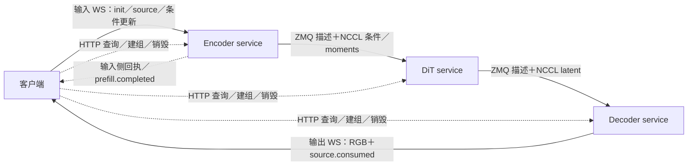

# Zing 分离部署接入指南

本文面向上游客户端开发，说明本次分离部署改造的背景、接入影响与部署流程。HTTP 请求字段、响应状态和错误规则见 [Worker 通信组接口协议](specs/WORKER_CONNECTION_API.md)。

## 目录

- [1. 修改背景与接入影响](#1-修改背景与接入影响)
- [2. 整体链路与调用流程](#2-整体链路与调用流程)
- [3. 启动参数与管理地址](#3-启动参数与管理地址)
- [4. 相关文档](#4-相关文档)

## 1. 修改背景与接入影响

### 1.1 为什么修改

原有流式业务入口接收请求后，协调 DiT、Encoder 和 Decoder，再向调用端返回输出。输入、推理、输出及连接生命周期绑定在一起，不方便将三个角色部署到独立实例，也不方便由上游按需组合机器或调整配对。

现在三个 worker 独立启动、加载并保留各自模型，启动时不自动连接其他角色。客户端查询每个 service 的可用接口，再显式建组、使用和拆组。客户端可以是上游服务，也可以是测试程序。

### 1.2 角色与复用范围

| 角色 | 职责 | 当前部署约束 |
|---|---|---|
| Encoder | 接收输入；执行 Qwen、参考图 VAE、source VAE 条件准备 | 一个 worker 可启动多个 service，共用模型 |
| DiT | 接收条件与 source latent，维护 prefix KV，执行采样 | 一个 worker 一个 service；支持 SP1／SP2 |
| Decoder | 解码 DiT 输出，通过输出 WS 返回 RGB 和消费进度 | 一个 worker 可启动多个 service，共用模型，各 service 的会话 cache 分开管理 |

模型加载、量化、采样、分块、条件准备和解码继续复用原有实现。改动集中在调用位置、队列接入、输入输出传输和连接生命周期，不要求上游重新实现模型处理。

每个 service 同时只接受一个活跃业务会话；通信组内可以先后执行多个会话。Encoder／Decoder 多 service 各自拥有独立连接和状态，可以分别与不同 DiT 建组；service 数量不需要相同。

### 1.3 上游需要适配什么

| 项目 | 新模式的行为与接入要求 |
|---|---|
| 业务连接 | 建立两条 WS：向 Encoder 发送输入，从 Decoder 接收 RGB 和 `source.consumed`。旧单 WS 客户端需要适配；发送与接收应独立推进。 |
| 输入协议 | 沿用原有 init、source、prompt／参考图更新等业务协议；输入侧确认仍从 Encoder 返回。`accepted` 表示接受更新，不代表视频已使用该更新，实际生效以输出的 `event_id` 为准。 |
| 通信组身份 | `worker_group_id` 标识 service 配对；`session_id`／`generation_id` 标识业务会话，不能混用。 |
| 连接生命周期 | 业务请求结束不自动拆组。客户端 可保留连接处理后续请求，也可调用三个 service 的 `destroy_group` 释放或调整配对。 |
| 就绪状态 | `/health` 表示 worker 健康，不表示空闲。`session.ready` 也不代表 Qwen／prefix KV 已预热；正常生成的条件准备仍依赖首批 source 中的首帧。 |
| 显式预计算 | 使用 Encoder 业务 WS 端口上的 `/v1/realtime_video/prefill`，提供原协议要求的 `source_frame`；`prefill.completed` 由 Encoder 返回，表示 L1 可用且临时请求已清理，不等待异步 L2 落盘。 |
| 缓存管理 | `/v1/zing/cache` 系列外部接口位于 Encoder，要求已建组，操作当前组对应的 DiT。断连保留 DiT L1／L2 缓存。 |

### 1.4 与 main 功能的整合

独立入口沿用 main 的模型配置、采样策略和 `ChunkPlan`，保留 source／target 几何与参考图缩放语义。条件计算移到 Encoder 后，prefix KV 仍由 DiT 的原缓存 owner 管理：Encoder 使用共用的 key 生成逻辑查询 DiT，命中时跳过相应条件计算，未命中时准备条件并传输；source VAE 仍正常执行。

显式 prefill、缓存 status／preload／unload、写入策略、标签及分页 L1／L2 继续使用原有实现，不另设缓存格式。通信组的建立和销毁不等于清空缓存。旧共享 API 自动选择多个 DiT 的候选池入口已注释停用；本指南描述的是显式 worker 建组模式。停用原因及验证范围见[部署说明](deployment_zing_h3.mdx)。

## 2. 整体链路与调用流程

一组 service 的业务链路如下。HTTP 用于健康检查和通信组管理，业务输入输出使用 WS；worker 之间沿用 ZMQ 控制／描述与 NCCL 张量传输，上游不直接操作这些传输连接。



```text
启动 encoder、DiT、decoder
通过命令行确定各 worker 的 service 数量和管理 HTTP 基础端口
                  ↓
客户端 查询候选 service 的 get_connection_status
                  ↓
各选择一个返回 available 的 encoder、DiT、decoder
取得各自的 10 秒预留、token 和连接信息
                  ↓
使用三个查询响应中的 service 信息组成完整拓扑
                  ↓
在各 service 的预留期内，分别发送 build_group
                  ↓
确认三个 service 均返回建连成功
                  ↓
连接 encoder 输入 WS、decoder 输出 WS
发送业务请求并接收结果
                  ↓
一条业务请求完成
        ┌─────────┴─────────┐
        ↓                   ↓
继续保留通信组          需要释放或调整通信组
处理后续请求                ↓
        │             分别调用三个 service
        │               的 destroy_group
        │                   ↓
        └─ 持续使用      查询连接状态，直到返回 available
```

通信组可以在一条业务请求结束后销毁，也可以一直保留、连续处理后续请求，直到需要释放资源或调整配对。**业务请求结束不自动销毁通信组。**

如果只取得部分预留，放弃使用的预留会自动到期。如果部分 service 建连成功、其他 service 建连失败，客户端 需要对成功部分调用 `destroy_group`。

客户端 使用查询结果组合拓扑及逐 service token 的请求示例见[建立通信组](specs/WORKER_CONNECTION_API.md#4-建立通信组)。

## 3. 启动参数与管理地址

service 数量通过启动命令行参数指定：

```text
--service-count N
```

例如，decoder 启动两个 service：

```text
<decoder 启动命令> --service-count 2 --http-port 36000
```

`--http-port` 指定管理 HTTP 的基础端口。service 从 `0` 编号：

```text
service i 的管理 HTTP 端口 = http-port + i
```

| service index | 示例管理 HTTP 端口 |
|---|---:|
| 0 | 36000 |
| 1 | 36001 |

Encoder、Decoder 支持通过 `--service-count N` 启动多个 service，默认 `N=1`；同一 worker 的 service 共用模型，每个 service 有独立的管理 HTTP 地址。DiT 当前仅支持 `--service-count 1`，并行 rank 数量不等于 service 数量。

三个角色的管理 HTTP 地址均按上述 index 规则确定。请求哪个管理 HTTP 端口，就操作哪个 service，无需在请求中额外指定本地 service。

输入 WS、输出 WS、ZMQ、TCPStore 等地址均通过查询获取，客户端 不推算这些端口。

### 3.1 DiT 的 SP 启动参数

独立 DiT 通过 `--sp-degree` 指定序列并行度，当前允许 `1`、`2`，默认 `1`。该值必须等于启动进程的 `WORLD_SIZE`；SP2 使用 `torchrun` 启动两个 rank，每个 rank 使用一张可见 GPU。

SP1 示例：

```sh
CUDA_VISIBLE_DEVICES=0 python -m \
  sglang.multimodal_gen.runtime.pipelines_core.stages.model_specific_stages.zing_h3.dit_worker \
  --model /path/to/serving-checkpoint \
  --sp-degree 1 --service-count 1 \
  --http-port 33000 --advertise-host 10.0.0.12
```

SP2 示例：

```sh
CUDA_VISIBLE_DEVICES=0,1 torchrun --standalone --nproc-per-node=2 --module \
  sglang.multimodal_gen.runtime.pipelines_core.stages.model_specific_stages.zing_h3.dit_worker \
  --model /path/to/serving-checkpoint \
  --sp-degree 2 --service-count 1 \
  --http-port 33000 --advertise-host 10.0.0.12
```

以上仅展示启动与连接相关参数；模型、pipeline、采样和精度按实际部署配方补齐。`--http-host` 控制 HTTP 监听地址，`--advertise-host` 必须填写其他 worker 和 客户端 可访问的本机地址；跨实例部署不能沿用默认的 `127.0.0.1`。

SP2 的两个 rank 共同构成一个 DiT service，仅 rank 0 对外通信。客户端 仍只查询并建连一个 DiT HTTP 地址，不需要提交两个 rank 的地址，也无需在 `build_group` 请求中重复指定 SP。

## 4. 相关文档

- [Worker 通信组接口协议](specs/WORKER_CONNECTION_API.md)：健康检查、查询预留、建组与销毁的请求／响应定义。
- [测试客户端使用说明](../../../../benchmark/zing_h3_causal/WORKER_GROUP_MASTER.md)：测试启动参数、数据读取、收发与结果保存。
- [Zing 部署指南](deployment_zing_h3.mdx)：模型配方、硬件配置、验证范围和旧入口停用说明。
