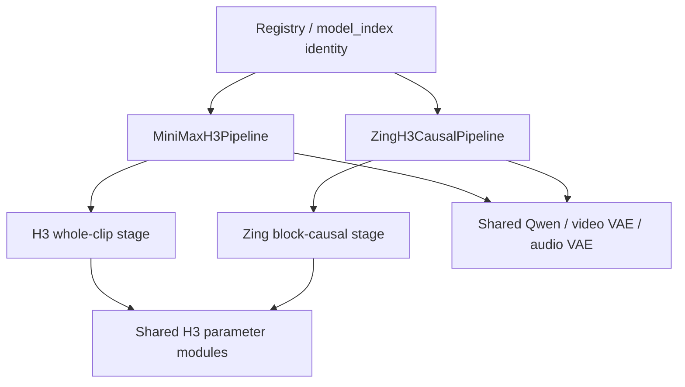

Zing 作为独立 pipeline 接入，同时复用 H3 参数模块和媒体组件。Zing 只保留因
四模态训练、block-causal attention、pre-RoPE KV transaction 和 AR 调度产生的差异。

## 证据边界

- 训练实现参考 `seedleap/zing` 的 `a0f45389ae959c9ca6c1c2a710531a681c10c1a6`。
- 最初接入时的 SGLang H3 基线为 `5936f69fe774c0f4755db70d38437f9a03d1149c`。
- 张量结构曾用真实 AR 导出的 merged `generator/model.pt` 读取验证；当前训练源格式已经切换为
  DCP，发布前应由 Zing 仓库按明确的 generator/EMA component 导出 portable `model.pt`。
- baseline 首先保证 dense eager 路径正确；SP、FSDP、稀疏 attention、量化和 compile 在独立
  性能 PR 中引入并单独验收。

## 结构与执行差异

| 部分 | H3 | Zing1 AR | SGLang 处理 |
| --- | --- | --- | --- |
| 主干 | 50 层、hidden 5376、56 heads × 128、FFN 14336、2 层 token refiner | 相同 | 直接继承 H3 DiT，复用 projection、refiner、norm、MLP、time embedding 和 output head |
| 媒体 | visual 24 channels，patch `(1,2,2)`；audio 32 channels；text 5120 | 相同 | 复用 H3 Qwen、video VAE、audio VAE 的配置、模型和 loader |
| block AdaLN | video/text/audio 3 组，输出 `96768` | 新增 source_visual，第 4 组，输出 `129024` | 把共享 H3 block 的 modality count 参数化；H3 默认仍为 3，Zing 配置为 4 |
| final AdaLN | `2 × 5376 = 10752` | 相同 | 继续复用，不随 block modality 扩展 |
| checkpoint 布局 | serving fused QKV；MLP `[gate,value]` | `backbone.*`、独立 Q/K/V；MLP `[value,gate]` | 复用 H3 Diffusers 映射、QKV fusion 和 SwiGLU half swap |
| 精度 | 主干 BF16，input/time/output 有 FP32 island | 相同约束 | 导出器按 schema 保留 FP32 参数，避免全模型强转 BF16 |
| row 语义 | packed tensor、token tags、update mask | `row_role/block_idx/position_ids` 与 compact video/audio/context | Zing 单独 packing adapter，避免污染 H3 双向输入合同 |
| attention | 整段 packed 双向或 FastH3 稀疏执行 | block-causal；当前 target 读取 clean history，同 block 内双向 | Zing baseline 使用 rectangular SDPA；不能套 token triangular mask |
| KV | H3 无 Zing transaction 接口 | 保存 QK-norm 后、RoPE 前的 K 和 V | Zing request-owned cache；prefix/source/final 提交，active 不写入 |
| scheduler | 整段 denoise | prefix → source → active 多步 → clean commit | Zing 独立 stage；H3 pipeline 行为不变 |
| CFG | 发布 H3 常用单 positive branch | positive history lane + target-only unconditional lane | Zing 独立 sampling params 和 cache 规则 |

第四组 AdaLN 是必要的参数差异。原始 H3 配置的 `num_modalities=3`，因此把 block 构造从固定
常量改为 `arch.num_modalities` 对 H3 的张量形状没有影响；Zing 将其设为 4 后，同一个
`MiniMaxH3DiTBlock` 才能装载训练得到的 `[129024,2688]` 权重。相比复制一份 H3 block，
参数化字段能继续复用 loader、量化入口、offload hook 和后续性能优化。

## 复用边界

`ZingH3DiTModel` 继承 `MiniMaxH3DiTModel`。共享层包括 video/audio patch projection、QKV、
QK norm、output projection、token refiner、AdaLN projection、MLP、RoPE、time embedding 和
final output head。Zing 的 forward 仍通过共享 block 的 `Module.__call__` 执行，因此 layerwise
offload/FSDP forward hook 不会被绕过。

不能直接复用的是 attention 可见性、row packing、history KV 生命周期和 block scheduler。
H3 把一段 clip 当作一次双向输入；Zing 每个 target block 要读取已提交的 clean history，
denoise 期间不能把 noisy target 写进 cache，失败时也不能部分提交 transaction。把这部分硬塞进
H3 forward 会增加 H3 回归面，因此单独放在 Zing adapter 和 stage 中。

## causal KV 契约

row role 与 AdaLN modality ID 是两个概念：

| row role | compact storage | AdaLN modality |
| --- | --- | ---: |
| CONDITION_TEXT | context | text = 1 |
| CONDITION_VISUAL | context | video = 0 |
| REFERENCE_VISUAL / TARGET_VISUAL | visual | video = 0 |
| REFERENCE_AUDIO / TARGET_AUDIO | audio | audio = 2 |
| SOURCE_VISUAL | visual | source_visual = 3 |

每个 logical row 携带 `position_ids[S,3]`、`block_idx[S]`、`row_role[S]` 和 `t[S]`；video、
audio、context 按各自 role 紧凑保存。K 在 QK norm 后、RoPE 前写入 cache，读取时根据绝对位置
重新应用 RoPE。SP1 保存 `[rows, all_heads, head_dim]`；Ulysses SP 保存
`[all_rows, local_heads, head_dim]`，因此无需在 commit 后 gather K/V，且 SP4 每卡 KV 占用为
SP1 的 1/4。prefix 始终保留，source 与 target 作为一次 transaction 提交：

1. `prefix`：clean `t=1`，提交文本和 reference static KV。
2. `source`：提交当前 clean source 到 pending transaction。
3. `active`：noisy target 作 query，读取 clean history，不持久化当前 KV。
4. `final`：生成结果以 clean `t=1` 再 forward，原子提交 source + target。

## checkpoint 边界

Zing DCP checkpoint 包含训练拓扑下的 sharded component 和 optimizer sidecar，不能直接当作
SGLang safetensors。DCP → merged `model.pt` 的模型构造、reshard 和 generator/EMA 选择由 Zing
仓库的 `src/scripts/export_model_pt.py` 负责；SGLang 的 `export_checkpoint.py` 只负责 H3 serving
布局转换和 model package 组装。两步边界可以避免 SGLang 依赖训练仓库，也避免 optimizer 或错误
EMA component 被静默发布。完整命令见[推理与导出说明](/docs/sglang-diffusion/zing/overview)。

## 历史优化规划与验证边界

以下是最初 baseline 的分阶段规划，不代表每项都尚未实现。当前分支已包含 Ulysses SP
和有限会话流式输出；此处保留当时的顺序与证据边界。性能结论仍需匹配具体版本与硬件。

1. 使用 H3 已有的 FSDP placement 与 Ulysses all-to-all，把大 DiT 分布到多卡，同时保持 Zing
   pre-RoPE history KV 语义；这是单卡 layerwise offload 的首要替代。
2. 复用 H3 AdaLN cache、直接 GPU 权重加载和 component residency，降低约 17 分钟的冷启动与
   每步重复 time/AdaLN 计算。
3. 对固定 shape 评估 regional compile/CUDA graph；必须先证明跨 block KV transaction 不被捕获
   为错误的静态状态。
4. 在真实 Zing attention pattern 上验证 VSA-H3，再启用稀疏 attention。FastH3 的 sparsity 和
   4-forward 蒸馏配置不能直接套到 50-sigma AR checkpoint。
5. 最后评估量化和流式 decode；每一项都需要同 checkpoint、seed、request 的 latent、成片和
   分阶段性能验收。

SP4 实测放在独立优化 PR：H100 上从单卡 layerwise 的 1253.28 秒降到四卡 FSDP + Ulysses4 的
53.65 秒，观测 wall speedup 为 23.36×。这个比值包含 placement/offload 变化，不是纯 SP4
scaling；详情应在性能 PR 中评审，不作为本 baseline PR 的验收结论。

## H3 复用边界（#89 review 后续修复）

- H3 与 Zing 共用媒体 `type`/`uri` 解析和非负有限时间校验；Zing 新增
  H3 风格的 `task/conditions/target` 入口，task 只支持 `ref2va`，旧
  `messages` 入口保留为兼容适配层，reference 和 source 走同一媒体描述校验。
  source 的配对关系和 causal KV 生命周期属于 Zing；实时 source append 尚未接通，
  当前只支持固定 source 的分块输出，见[实时输出边界](/docs/sglang-diffusion/zing/realtime-streaming)。
- H3 按 `17n+5` 对齐输出帧数；Zing 新入口复用 H3 校验与空间尺寸解析，
  但按播放时间轴精确换算帧数，旧入口继续接受显式帧数。H3 reference image 按 2048 短边缩放（允许放大），
  Zing 采用训练配置指定的面积上限与不放大选桶。保留这些策略是为了不改变
  checkpoint 输入，不能据此推导出基础媒体解析不能共享。
- Zing 的 patch-major rows 通过薄布局适配复用 H3 patchify/unpatchify；
  Euler 复用 H3 的 FP32 插值；音频 codec 共用 posterior mean 编码核心。
  visual posterior seed、FP16 舍入、单帧解码以及 source 对齐仍由 Zing 适配层持有。
- SRT、Qwen 与 diffusion 使用同一个低依赖 `default_weight_loader`。
  量化 backend 的延迟导入保留；它只隔离可选依赖，不代表 Zing 启用量化。
  标准 GPU 路径仍要求可用的 sgl-kernel，缺失或 ABI 加载错误应立即报错，
  不自动为所有 SRT 模型切换到 PyTorch fallback。
