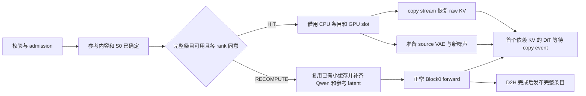

# Block0 CPU 缓存与请求提前分流

状态：2026-10-27，基于 `df0f677e97` 的工作区 MVP 已接入，默认关闭，GPU 对照进行中。
一个部署同时一个活跃会话；首版只保留一个完整 CPU 条目。

## 当前 MVP

服务启用原有 KV pool 后，用 `SGLANG_ZING_BLOCK0_CACHE_MODE` 选择：

| 值 | 准备路径 | KV 恢复时机 |
| --- | --- | --- |
| `off`（默认） | 原路径 | 重算 Block0 |
| `late` | 仍调用 `codecs.prepare`，使用已有小缓存 | 首个 prefix 消费处恢复；对照组 |
| `early` | 完整命中直接恢复已准备结果 | 用条目中已确定的容量描述租用原 pool slot，恢复完成后继续初始化 |
| `overlap` | 与 `early` 相同 | 提交恢复后继续初始化/source 工作，首个 prefix 消费处等待 copy event |

key 包括请求内容、实际参考图内容、有序媒体声明、S0、source 几何和会话窗口策略；
固定模型及处理配置由常驻 stage 实例隔离。条目保存 CPU condition/row roles、参考 latent、
归一媒体、准备元数据、已确定的 pool request、prefix positions 和每 rank raw KV。
每个请求仍生成自己的噪声和会话。单槽 CPU KV 在服务初始化时按 pool 的 prefix 上限
分配 pinned 内存；命中借用数据，不 clone 整份 KV，也不新增 GPU KV 副本。

MISS 复用现有准备流程和 prefix forward。首个 RGB 输出返回后的下一次 dispatch
开始 D2H；复制完成才发布条目。会话关闭或 prefix 更新前等待尚未完成的复制。
不缓存更新后的滚动 prefix。日志 `zing_block0_cache` 记录命中、准备跳过、恢复耗时、
消费时 copy 是否已完成以及 CPU KV 容量。

对照使用相同 `early_key`；`late` 不包含旧隔离实验的完整 packed-prefix SHA256 开销。
原始材料位于工作区外 `exports/early-block0-h100-20261027-r1/`。

下文保留原设计的内容身份与时序分析；多条目 LRU、普通内存 staging 等扩展未纳入本次 MVP。

## 缓存的对象

Block0 是完整 condition + reference 的双向 attention prefix，经过 50 个 DiT
transformer block 后保存的每层 K/V；它不是第一个生成视频块，也不是仅第一层 KV。
当前 continuous source 把第一份已接受的 RGB 中的首帧 S0 作为 Qwen 的 `<Video 1>`。
因此相同 prompt 和参考图、不同 S0，不能共用整个 Block0。

| 产物 | 足以确定产物的输入与执行版本 | 不需要作为独立键的内容 |
| --- | --- | --- |
| 参考图预处理 | 实际文件/载荷内容、格式及解码版本、选桶/resize 版本、canvas multiple、max short edge、reference max area | URI、case 名称、prompt、生成 seed |
| Qwen condition | 完整 prompt、经过预处理的有序媒体类型与像素（含 S0）、有效 presentation、Qwen/tokenizer/processor 权重与配置、数值执行 profile | 后续 source 帧、生成噪声 |
| 参考 VAE latent | 预处理后的像素、VAE 权重版本、encode dtype/mode/tiling、posterior seed、latent mean/std、相关数值执行配置 | prompt、媒体 ID、生成 seed |
| Block0 K/V | 完整 Qwen 输出和 reference latent、它们的顺序与 modality/row role、完整 packing/position/mask/timestep、DiT 权重/数值执行版本、KV dtype 与 head shard 布局 | 后续 source latent、target 初始噪声、不会改变 prefix 配置的后续采样步骤 |

实际键可以保守多包含配置，以少量重复条目换取简单的有效性检查。分辨率变化只有在
改变 S0、媒体预处理或 prefix layout 时必然改变 Block0；第一版仍按解析后的请求几何
分开。不得只比较 tensor 地址、形状、图片 URI 或 case ID。原始字节不同但解码像素相同
可以产生保守的 miss，不影响正确性。

这里的“确定”须区分语义与逐位结果：VAE performance 模式不保证跨进程逐位重现。
完整条目要保存同一次已接受准备过程产生的 condition、latent 和 KV，作为不可变的
结果版本；严格可重算的逐位契约需要冻结数值环境/输入或确定性编码，并独立验证。
`posterior_seed` 是参考 VAE 的内部采样 seed，不能与请求的生成 seed 混淆。

## 在编码前决定路径

最早的可靠决策点是：请求校验及单会话 admission 完成、配置默认值解析完成、参考图
实际内容可识别、S0 像素已接受。它位于 `source_session.initialize` 调用
`codecs.prepare` 之前；不能在只拿到可变 URI 时宣称命中。

复用现有小缓存的内容身份，额外维护完整条目的输入索引。索引键是原始参考图内容摘要、
S0 摘要、prompt、conditions/media 声明及顺序、预处理/模型/packing profile 等的规范化摘要。图片 decode
得到的 shape、bucket 与后续 prefix rows 放在条目 manifest 中，第一次计算后发布。
固定资产可在准备阶段保存可信内容摘要；可变路径仍须读字节或验证不可变内容版本。

一个完整条目必须同时拥有：

- Qwen condition 与 row roles、reference latent，以及重建 `H3InferenceInputs` 的准备元数据。
- 已归一的 CPU `condition_media`（含 S0 和参考图）、conditions/media 顺序、几何与
  max-area 配置。后续 prompt/reference 更新仍使用这些像素，不能仅保存 latent。
- prefix positions、rows、每层 K/V shape/dtype、权重/执行版本与 SP/head shard 布局。
- 各 DiT rank 的独立 CPU raw K/V；不保存 GPU slot 地址、旋转 K scratch 或其 publication。

完整条目以一次成功的准备和 prefix forward 为单位发布。SP 所有 rank 的摘要、就绪
状态一致，且条目及 GPU slot 均成功借用后，当前请求固定走 HIT 或 RECOMPUTE。
命中判断本身不应发起 Qwen 编码、VAE 编码或构造完整 DiT 输入。
恢复 condition 时同步建立当前请求的 conditioning identity/positive 状态；复用产物，
不复用旧请求的可变 session 对象。缓存内容仍按原有请求校验与容量限制准入。

RECOMPUTE 指重新计算 Block0，不要求抛弃已经命中的 Qwen/参考缓存。完全冷请求与
部分准备命中仍可在这一条路径内处理，避免组合大量互相独立的运行分支。完整 HIT
也必须继续编码变化的 source、生成新噪声、执行后续 DiT 和 Decoder。

## 搬运与时序

现有 pooled lease 在首个 source latent ready 后才申请。要与 source VAE 重叠，需用
条目 manifest 的 prefix rows 和已解析 source/target geometry 提前执行原有 pool
admission 并借用同一 slot。不能为了预取再分配一份 8 GB GPU KV。

HIT 用独立 copy stream，首个 source/target DiT forward 的 compute stream 等待完成
event。条目及 staging buffer 在 DMA 完成前不可淘汰、覆盖或释放；取消/失败时先完成
相关 event 的回收，再归还 slot。只有该依赖点之前的独立工作能隐藏搬运。
主线程必须在提交后继续推进 source；普通 CPU 条目的 staging 循环也需异步推进。
metadata 提前搬入，prefix commit 放到消费端的完成依赖之后，避免在提交端调用
会等待该 event 的阻塞 `.to()` / `.cpu()`。仅给大 tensor 加 `non_blocking=True` 不够。
异步传输和重叠的条件参考
[CUDA Best Practices](https://docs.nvidia.com/cuda/cuda-c-best-practices-guide/index.html#asynchronous-and-overlapping-transfers-with-computation)。

普通 CPU LRU 可以配两个按 layer 大小分配的 pinned staging buffer，CPU 拷贝下一层
时 DMA 上一层；也可给少量热点条目单独设置 pinned 字节预算。每 rank 的 18 GiB 实验
LRU 是实验参数，不是生产默认。不要照搬 `ConditioningCache.get()` 的整条目 clone，
8 GB 级 KV 应借用只读条目；仍复用现有字节计账、淘汰顺序与统计约定。
完整条目可引用已有准备产物，但引用的生命周期必须覆盖该条目与正在执行的 DMA；
不能只记小缓存的 key，随后将已被小缓存淘汰的产物当作完整命中。预算按实际保留字节计账。
staging 宜按已接纳的最大 prefix rows 在部署预热时分配，避免切换 shape 时在请求内
重新 pin 内存；全量 pinned 热条目也应使用有预算的预分配 slot。

MISS 的 D2H 填充可以尝试与后续计算重叠，但占用链路、内存带宽和 GPU slot 生命周期。
完整 DMA 成功后才能把条目标记为 ready。生产实现须记录填充暴露在首帧上的成本；
不能用已经预热的 hit 结果代表冷请求收益。
以 TTFF 为优先目标时，可在首帧交付后开始后台填充，让冷请求先按正常路径出首帧；
仍须测量对首帧后吞吐的影响，并在会话归还 slot 前完成或安全取消填充。

重叠后仍暴露在关键路径上的恢复延迟为 `max(0, T_restore - T_independent_work)`。未重叠时净收益近似为
`T_prefill - T_restore - T_extra_lookup`，实际 TTFF 还受准备、source、Decoder 和传输
影响，必须使用完整请求对照。序列后续使用的 KV 持续留在 GPU，不逐个 denoise step 回读。
已有路径里 source Encoder 开始到首个 DiT span 的间隔只能作为候选窗口；它可能包含
将被早命中删除的准备工作，不能全部当作优化后仍存在的独立计算时间。

## 当前实验与后续接入边界

隔离实验使用原生 `ZingH3KVCache` pooled store 和 prefix commit，但通过专用 benchmark
launcher 替换 `_apply_prefix`；生产进程不会加载该 hook。所有组都在 Qwen/参考准备后
对完整 packed Block0 求摘要。因此测得的是晚恢复的实际成本，尚未验证提前跳过准备、
与 source VAE 重叠、Graph replay、prompt 切换 prefix 以及 736 完整服务。

实验冻结及原始结果：工作区外 `exports/block0-kv-h100-20261026-r1/`。
每组两次预热、三次正式请求、另进程三次阶段诊断；warm hit 清空目标 GPU K/V 后恢复，
用 `torch.equal` 逐元素比较所有 50 层 K/V；A→修改 prompt 的 B→A 检查跨请求保留与
内容变化失效。完整 RGB 用 SHA256 与冻结对照逐字节校验；实际通过项以实验回执为准。
部署入口只维护简要结果及验证边界。
