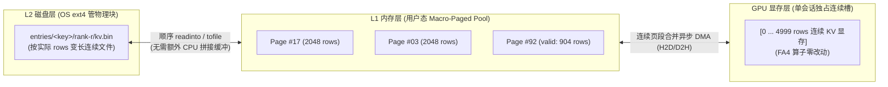

# Zing Block0 粗粒度分页 L1 缓存（Macro-Paged L1）设计提案

## 1. 要解决的问题与 Non-goals

### 1.1 要解决的问题（Problem Statement）
改造前的 `Block0PreparationCache`（L1）在服务启动时按 **固定最大行数 `zing_kv_pool_max_prefix_rows`** 将 Pinned CPU 内存等分为定长槽位（以下以 `12,288` 行、SP=2 为例，每槽位约 `17.6 GB`，800 GB 预算固定切出 `45` 个槽位；已核对的泰国历史部署上限为 `57,344` 行）。

随着业务参考图上限扩展（如 `zing_reference_max_images=21`，每张图约占 `1,700` prefix rows（示例值，随编码分辨率变化）），定长槽位设计面临严重的**容量坍塌与内部浪费**：
1. **上限扩容导致槽位数暴跌**：为容纳 21 张参考图 + 文本，需将 `max_prefix_rows` 从 `12,288` 提升约 3.3 倍至 `~40,960`。定长切分下，单个 L1 槽位体积膨胀至 `~58.7 GB`，800 GB 内存可容纳的条目数从 **`45` 条暴跌至 `13` 条**。
2. **长尾小请求严重浪费**：仅有少量参考图或纯文本切换的请求（以实际仅需 `2,000 ~ 8,000` rows 为例），在定长池中仍被迫独占一个 `40,960` rows 的完整大槽位，内存有效利用率不足 `20%`。

**目标**：在不引入运行时 `pin_memory` 分配延迟、不产生外部内存碎片、不改动 GPU Attention 算子与 L2 磁盘文件格式的前提下，支持 L1 按实际 `prefix_rows` 弹性占用内存。

---

### 1.2 Non-goals（明确不做什么）
1. **不把 GPU 显存 KV Pool 改为 PagedAttention**：
   Zing 实例为**单活跃会话（`max_sessions=1`）**，同一时刻 GPU 上仅运行 1 个会话，不存在多并发长短请求交替造成的 GPU 显存外部碎片。GPU 侧保持每层 K/V 行连续存储，**FlashAttention-4 (FA4) 算子零改动；稳态推理 FPS 影响待端到端验证**。
2. **不把 L2 本地磁盘文件（`kv.bin`）做应用层分页**：
   L2 当前已按实际行数 `[:rows]` 变长落盘，无按 `max_prefix_rows` 定长占槽的浪费；且底层 `ext4` / `xfs` 文件系统通过内核 `inode` Extent Tree 天然完成了磁盘块的非连续块管理与回收，无需在用户态重复实现磁盘页分配器。
3. **不做跨 `cache_key` 的前缀子串（Sub-prefix）共享**：
   Block0 采用双向/联合注意力（Joint Forward），增减任一参考图都会改变同层其余 Token 的 K/V 值，不存在 LLM 自回归式的局部前缀树（RadixTree）复用语义。

---

## 2. 重要设计（Core Design）

### 2.1 分层抽象边界：L1 粗粒度分页 + L2 连续文件 + GPU 连续槽位



### 2.2 粗粒度大页（Macro-Page）规格与预分配池
不同于 LLM 逐 Token 生成使用的细粒度小页（16/64 rows），Block0 前缀一次性成批生成且单张参考图约 `1,700` rows（示例值），因此采用 **粗粒度大页（Macro-Page，`PAGE_ROWS = 2048`）**，并采用 **“占用表扫描分配 + 同层页连续布局 + 连续段 DMA”** 减少大前缀提交开销：

- **单页物理大小**：以 SP=2、50 层 BF16、单卡 28 heads (`head_dim=128`) 为例：
  $$\text{Page Bytes (per rank)} = 50 \times 2 \times 2048 \times 28 \times 128 \times 2\text{ B} \approx \mathbf{1.468\text{ GB}}\text{（双卡合计 } \mathbf{2.936\text{ GB/Page}}\text{）}$$
- **启动时一次性预分配与同层页连续布局（Intra-layer Page-Contiguous Layout）**：
  将 `(layers, 2)` 置于最外维，使同一层 K/V 内的所有物理页在内存中紧邻排列：
  ```python
  # 单卡 400 GB 预算 -> 预分配 num_pages = 272 个固定 Page
  self.pages = torch.empty(
      (layers, 2, num_pages, PAGE_ROWS, local_heads, head_dim),
      dtype=dtype, device="cpu", pin_memory=True,
  )
  self.free_pages: list[bool] = [True] * num_pages
  ```
- **占用表扫描分配（Occupancy-Bitmap Scan）与零外部碎片**：
  任意实际行数为 `rows` 的条目仅申请 $K = \lceil \text{rows} / 2048 \rceil$ 个 `page_id`（无需全局连续；每次从 `0 .. num_pages - 1` 顺序扫描空闲占用表取前 $K$ 个空闲页，天然保证 `page_ids` 严格升序且相邻空闲页自动贴合，归还时校验防重）：
  - **2 张图（~4,000 rows）**：占 `2 Pages`（5.87 GB），800 GB 可存 **136 条**（原方案仅 13～45 条）；
  - **6 张图（~12,000 rows）**：占 `6 Pages`（17.6 GB），800 GB 可存 **45 条**；
  - **21 张图（~40,000 rows）**：占 `20 Pages`（58.7 GB），800 GB 可存 **13 条**，且支持大小条目任意混布，若尾页有效行数近似均匀分布，最后 1 页平均内部碎片约 `0.734 GB/rank`（SP=2 合计约 `1.468 GB`）。

### 2.3 数据传输与磁盘 I/O 适配（连续段 DMA）
1. **GPU $\leftrightarrow$ L1 连续段异步 DMA（`restore` / `fill`）**：
   - 在 `(layers, 2, num_pages, PAGE_ROWS, ...)` 布局下，`PagedKV.slices()` 将 `page_ids` 中相连的页号区间 `[p_start, p_start + count)` 合并为零拷贝连续视图 `self.pages[layer, part, p_start : p_start + count].flatten(0, 1)[:valid_rows]`（`valid_rows = min(count * PAGE_ROWS, rows - logical_start)`，`logical_start` 为该段对应的逻辑起始行）。
   - **减少大前缀 CUDA 提交背压**：`40,960` 行（20 页）若按页逐个提交将产生 `50 × 2 × 20 = 2,000` 次 `cudaMemcpyAsync`，在本轮 H2D 组件实验中测得 Host 提交耗时 `~262 ms`，与约 1024 个未完成 copy 的有效窗口模型吻合（队列背压为高置信推断，不是已确认的单 stream 硬件上限；`fill` 阶段对后续算子发射的影响尚未实测）。合并连续页段后，若分为 `1 ~ 3` 段，仅需 **`100 ~ 300` 次** DMA 提交，`host_submit` 的实际改善待测；完全散页时仍需 2,000 次提交。同时保持单条 `self.stream`，沿用硬件 DMA 搬运，不引入自定义 SM 拷贝算子。
2. **L1 $\leftrightarrow$ L2 无额外 CPU 拼接的散聚读写（`_read_kv` / `_write_kv`）**：
   - 磁盘 `kv.bin` 格式保持 `(layers, 2, actual_rows, heads, dim)` 连续字节流不变。
   - 读写时直接复用合并后的 `slices()`，将文件句柄按连续大段 `readinto` / `tofile` 到对应 `memoryview` 切片中，无需额外 CPU Staging Buffer，同时减少小块系统调用次数。

### 2.4 页面复用生命周期、LRU 淘汰与 `preload` 预检
1. **覆盖 DMA 与后台写盘的双重生命周期（写盘事件继续归属 `entry`）**：
   - **后台写盘同步**：由于淘汰与 `unload` 始终以**整条 `entry`** 为单位执行，写盘完成事件 `disk_task: threading.Event` 直接保存在 `PreparationEntry` 上（无需维护 `page_id -> Event` 映射表）。当某条 `entry` 被淘汰、同名覆盖或 `unload` 时，在将其 `page_ids` 标记回 `free_pages` 前调用 `entry.disk_task.wait()`（后台线程 `finally` 块保证异常时亦 `set()`），确保回到空闲占用表的页面均已完成写盘。
   - **DMA 传输同步**：沿用现有单 `self.stream` 规则——GPU $\leftrightarrow$ CPU 的 `restore`（H2D）与 `fill`（D2H）在同一 CUDA copy stream 上天然按序执行；当 CPU 侧从磁盘读取数据写入页面（`_promote_from_disk`）或 `unload` 回收页面前，继续调用 `self.stream.synchronize()` 等待在途 H2D 传输结束，防止覆写正在被 DMA 读取的页面。
2. **循环按页 LRU 淘汰与异常回滚**：
   - 当新条目需要 $K$ 个 Page（若 $K > \text{total\_pages}$ 直接拒绝，不触发淘汰）而当前空闲页数 `< K` 时，循环整条淘汰最久未使用的非保护 `entry`（等待其 `disk_task` 与 `stream` 后回收 `page_ids`），直至凑够 $K$ 个空闲页。
   - 若从 L2 磁盘读取某条目的过程中发生异常（缺分片、校验失败或 I/O 错误），在 `except` 块中将该条目已申请的全部 `page_ids` 立即退回空闲占用表。
3. **`preload` 容量预检（L1 优先 + L2 补充）与 `status` 返回值**：
   - **容量预检**：加载前逐个计算选中 `keys` 所需页数——**已在 L1（`self.entries`）中的 key 直接读取其 L1 实际驻留页数 `len(entry.page_ids)`**（即使对应 L2 磁盘文件已被删除仍可正常复用）；**不在 L1 中的 key 查询 L2 磁盘 `manifest.json` 的 `geometry.prefix_rows`** 换算所需页数 $K_i = \lceil \text{rows} / \text{PAGE\_ROWS} \rceil$（若磁盘缺失或元数据无效则计为 `0` 页，留待逐项执行时按现有契约记录 `"status": "missing"`，部分 SP rank 缺失同样视为整条 `missing`）。
   - 仅当有效需求总页数 $\sum K_i > \text{total\_pages}$ 时，在加载前直接拒绝并返回 `HTTP 409 / cache_capacity_exceeded`；否则顺次加载、顺次 LRU 淘汰，并在完成后沿用 `status(keys)` 对所有 SP rank 的最终实际驻留状态进行复查。

---

## 3. 备选方案及其缺点（Alternatives Considered）

| 备选方案 | 方案描述 | 核心缺点（放弃原因） |
| :--- | :--- | :--- |
| **方案 A：不预分配，按需动态分配 `pin_memory=True`** | 每次缓存写入或 `preload` 时，按实际 `rows` 动态调用 `torch.empty(..., pin_memory=True)`，淘汰时直接释放 Tensor。 | 1. **锁页耗时极高**：实测单次 `cudaHostAlloc` 锁页分配 ~15 GB 内存耗时 **3.2～3.5 秒**（比 GPU 直接重算 Block0 的 1.05 秒还慢 3 倍）。<br/>2. **释放同步与生命周期风险**：`cudaFreeHost` 会触发隐式 CUDA 同步，且易与在途异步 DMA 流或后台写盘线程发生竞争。 |
| **方案 B：使用普通可分页内存（Pageable CPU Tensor）+ 小块 Pinned Staging** | L1 使用普通 `pin_memory=False` 的动态 Tensor 规避锁页耗时，恢复到 GPU 时经由固定 `317 MiB` Pinned 缓冲区中转。 | **恢复延迟劣化 3.2 倍**：隔离实验（`df0f677e97`）实测 CPU $\rightarrow$ Pinned Staging 的内存拷贝耗时中位数达 **480.5 ms**，导致 Block0 恢复总耗时从 **150.3 ms 劣化至 488.5 ms**。 |
| **方案 C：预分配单一大块连续 Pinned 内存（Contiguous Arena），按任意行数变长切分** | 启动时预分配一整块 `max_total_rows` 的连续 Pinned 内存，用区间分配器（如 First-Fit / Buddy）按请求实际 `rows` 切出连续段。 | **严重的外部内存碎片（External Fragmentation）**：多个小条目（如 4,000 rows）与中条目交替淘汰后，空闲空间被分割成不连续的空洞；当 21 张图的大条目（40,000 rows）到达时，即便总空闲行数充足也无法分配，而 CPU 端搬移几十 GB 内存做 Compaction 代价过高且受在途 DMA 阻塞。 |
| **方案 D：手写 Gather/Scatter Copy 算子 或 拆分为多条 Copy Stream** | 为规避 `40,960` 行逐页拷贝（2,000 次 `cudaMemcpyAsync`）出现的提交背压，改用自定义 CUDA/Triton 算子一次性搬运，或拆为多条 `torch.cuda.Stream` 分摊队列。 | 1. **自定义算子抢占 GPU SM**：当前同 dtype 连续切片拷贝沿用硬件 DMA，而自定义算子走 UVA Zero-Copy 会占用 GPU SM，可能与主流计算（如 Source VAE）争抢算力，影响 Overlap。<br/>2. **多条 Copy Stream 需要重新建立跨流同步**：若仅增加 stream 而不修改现有同步，页面复用可能出现读写竞态；不同 stream 也可能共享硬件工作队列，形成伪依赖，具体取决于连接数配置和运行时映射。 |

---

## 4. 最小测试闭环（Test Closure）

1. **非整除行数、连续页段合并与跳号页拼接/防脏校验**：预先向全部 Page 填入脏值（如 `NaN`），分别验证连续页段（合并为单次 slice）与不连续页号（如 `[0, 1, 4]`）写入非整除行数（如 `2 * PAGE_ROWS + 13`）的条目，验证 H2D 恢复与 L2 落盘重读后有效行数值完全一致，且半块尾部脏数据不写入磁盘、不越界污染 GPU 相邻显存。
2. **占用表扫描分配守恒、升序贴合与读盘异常回滚**：验证先后淘汰再分配时按 `0 .. total_pages - 1` 扫描返回严格升序页号并自动贴合相邻空闲页；在 `fill` / `preload` / `unload` / 淘汰及注入磁盘中途读取失败（如坏文件、单 rank 缺失）后，断言所有存活 `entry.page_ids` 互不相交、无重复归还（Double-Free），且 `free_page_count + sum(len(e.page_ids) for e in entries.values()) + pending_pages == total_pages`（`pending_pages` 为尚未发布的 D2H 条目占页数，无 pending 时为 0）。
3. **小条目连踢凑大页与超限保护**：池内驻留多条小条目时写入一条大条目，验证按 LRU 顺序连续淘汰多条直至凑足页数；若单条需求页数直接大于 `total_pages`，验证提前拒绝且不误踢已有条目。
4. **DMA 与写盘双生命周期等待**：验证被淘汰/卸载条目的后台写盘未完成时，复用其页面的新写入必须等待 `entry.disk_task` 完成（且写盘异常退出不死锁）；CPU 读盘覆写页面与 `unload` 回收前等待 `self.stream` 同步。
5. **`preload` 混合容量预检**：构造“部分 key 已在 L1（即使 L2 已删）+ 部分 key 在 L2 + 部分 key 缺失”的组合，验证按页数总和准确放行或提前返回 `409 cache_capacity_exceeded`。

验证回执见 [BLOCK0_PAGED_L1_VALIDATION](../../../../../benchmark/zing_h3_causal/BLOCK0_PAGED_L1_VALIDATION.md)。
