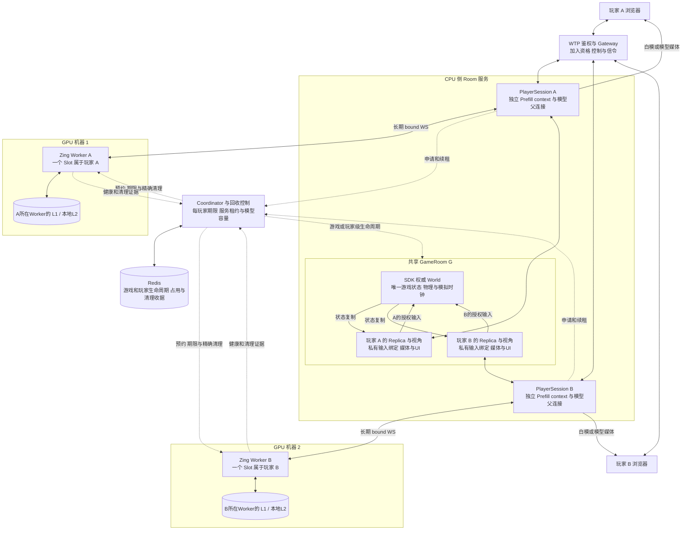
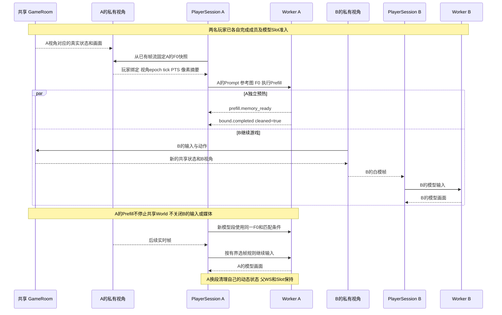
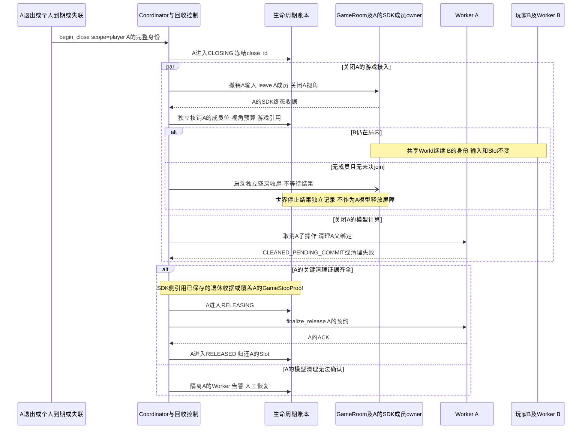

# 共享联机世界与每玩家 Prefill 的目标拓扑

状态：最终方案对应的目标架构，尚未实现或部署。更新：2026-11-02。以[多人试玩与每玩家 Model Slot 生命周期最终方案](/docs/sglang-diffusion/zing/plans/ROOM_SLOT_LIFECYCLE_RECOVERY.zh)为准。

一个 GameRoom 共享一个 SDK 权威世界，可以容纳多个玩家；平台不设置整局最长时间。每个玩家拥有独立 PlayerSession、私有视角、输入授权和一个 Zing Worker 的 Model Slot。Prefill 是各玩家独立的模型计算，不共享玩家生命周期、不暂停共享世界，也不要求所有玩家同时预热。

## 1. 总体拓扑

下图为一个区域内的一局双人联机。多个 GameRoom 可重复此结构；玩家模型 Worker 可以位于不同 GPU 机器，每 Worker 同时最多服务一位玩家。



GameRoom是共享世界，不是每玩家的推理会话。SDK管理权威模拟和成员，各视角使用只读副本/独立相机渲染，不推进第二个玩法时钟。CLI托管执行可以包含Node、权威浏览器和逐玩家视角资源，不能只根据PID数量定义一个世界实例。

浏览器使用已为自己建立的私有媒体/control连接；不能为接入模型再创建一个RoomClient或重复join。WebRTC媒体逻辑上从Room媒体端到浏览器，不经过Coordinator/Redis；具体ICE和中继沿现有部署。录像和诊断异步归档到OSS，非计算归档不阻止Slot回收。

同一游戏的A和B分别拥有一个Worker，因此两名可随时切换模型的玩家需要两份可用模型容量。CLI支持多人，不代表单个Zing Worker可以服务多人。

## 2. Prefill 是逐玩家独立的



A、B均可在各自Worker上预热，只有同一玩家的子计算串行。每位玩家的source/model session、context_id、视角绑定、帧身份和请求结果都隔离。共享的是游戏状态，不是一个所有玩家共用的Prefill任务。

现有单人capture hold只能用于独占世界。多人使用逐玩家F0快照，保留真实capture时间；过旧、视角重建、场景或条件身份改变时，只重做该玩家的准备。不能把更晚的新帧悄悄替换旧key的F0，也不能因World每一tick变化就让所有缓存全失效。

静态前缀可按合法完整内容key复用；动态KV、近期latent、RNG、编码/解码状态按每段创建和清理。一个玩家预热失败不应影响另一个玩家的模型Slot。

## 3. 玩家离开与整局关闭是两个作用域



个人清理需要“A成员、输入与视角已退出”的证据，不要求共享CLI进程停止。SDK确认退休后成员位/视角预算可独立归还，故障GPU不能将它们永久锁住；模型Slot仍按自己的确认协议释放。空房收尾独立运行和记录world_stop_complete；A已有个人SDK终态收据时，不等待共享世界关闭或GameStopProof才释放A的模型Slot。一个玩家返回页面、个人期限到达或浏览器关闭，都不能被解释为解散整局。

明确授权解散、游戏已有结束事件、SDK共享权威故障或owner租约丢失时，GameRoom先关闭新成员准入，再并发关闭全部PlayerSession和共享世界。world_stop_complete与所有玩家模型容量已释放分别记录；个别Worker隔离不伪装为已恢复，也不要求继续运行没有玩家的世界。GameStopProof可作为SDK侧终态确认，不能代替各模型Worker的清理和最终释放ACK。

创建者离开默认只退出自己。最后玩家离开与新join竞争时，使用同一GameRoom状态版本和pending join登记，防止世界刚关闭又出现孤儿玩家。

## 4. 每玩家限时，世界按成员存活

```text
player_expires_at = 该玩家成功预留 Model Slot 的时间 + 个人配置 T
```

| 对象 | 目标规则 |
| --- | --- |
| 上海 PlayerSession | 初值 1800 秒；只结束该玩家 |
| 泰国 PlayerSession | 初值 7200 秒，发布前核对进程配置；只结束该玩家 |
| GameRoom | 没有平台统一最长时间；还有有效玩家就可持续存在 |
| 服务 owner | 短租约和心跳持续续期，用于发现失联和隔离旧 owner |
| 新建世界/pending join | 有界启动与补偿；无人加入不能永久常驻 |
| 浏览器重连 | 外层宽限初值 15 秒，首次合格恢复协商最多 13 秒；不越过个人期限和 SDK 原成员有效期 |

A 10:00、B 10:20 准入且 T=30 分钟时，分别在 10:30、10:50 结束。A 到期不关闭 B；最后玩家真正离开且没有未决加入时，才关闭共享 CLI。当前代码的 WHITEBOX_GAME_SECONDS 固定房间上限需移除，服务租约和清理账本仍保留，不能把 Redis 记录消失当作 GPU 已释放。

Prefill 是可选能力，多组预热、白模、热更新、换段和重连都不续个人期限。未来游戏可自行触发结束，本次不新增游戏时限配置或通用策略体系。

可新增玩家数受剩余成员位、CPU 视角容量和兼容空闲 Worker 共同限制；每 Worker 一个玩家，以多 Worker、多机器支持多人。硬故障仍隔离告警、人工恢复，不自动重启；健康玩家和 Worker 继续服务。

## 5. CLI现状与需要接通的部分

- 当前上海安装包包含worldkit room多人命令；room命令模块与本轮SDK main对应模块SHA一致。
- 默认worldkit stream适配器仍为一个玩家视角，不能据此否定CLI本体的多人房间能力。
- 仓库已有WorldkitRoom、成员/视角适配以及实际双玩家CLI测试源码和交接记录。
- 上海现网Gateway已挂载room-control和玩家媒体路由，createRoom/admitPlayer/leavePlayer的服务端执行链已部署。CLI成员resume尚无Gateway控制action和运行时调用，按用户确认本次只保留底层扩展位置，不适配接口；当前试玩WS重连不能等同于该能力。此现网挂载状态与本工作树RoomProxy存在差异，须以部署读回为准。
- 当前Prefill分段客户端的已有game_id加入限制需要改造；把已认证的玩家视角接到其自己的ModelBinding，不重造Prefill算法。
- 多人F0获取不能使用独占World的时钟暂停；这属于源输入桥接调整，不是Prefill要跨玩家协调。
- 本轮没有运行现网双人CLI＋两台Zing Worker的完整验收，不能把命令存在或源码测试当作生产链路已验收。

本文只描述目标架构；未修改运行代码、并发配置或云资源，未启动新的联机/GPU测试。

## 6. 实施边界

复用现有 Gateway/Coordinator/Room/SDK/bound 协议，补齐联合准入、浏览器重连、每玩家期限及真实回收。CLI resume 仅保留已有扩展位置，不新增接口适配。成员仍有效时恢复原连接；成员已失效则结束旧试玩并回收。开发在 worktree 中完成，所有部署源码和内嵌 CLI/SDK 统一来自各自远端 white_box 的准确提交；地区只用配置区分，禁止热补丁。

部署须另行明确授权。验收遵循统一发布规范：5 个当前正常 case、每个正式玩家会话从首个可见模型画面起至少 180 秒，与旧版同条件逐项比较性能、实际缓存召回、延迟及画质，记录失败/未覆盖和所有恶化。联机创建/加入、状态同步、输入与视角隔离、退出/浏览器重连必须通过；CLI 成员 resume 明确为本次范围外。容量不足就标验收未完成，不能以单人测试替代。短 TTL 专项不能代替正式时长。
