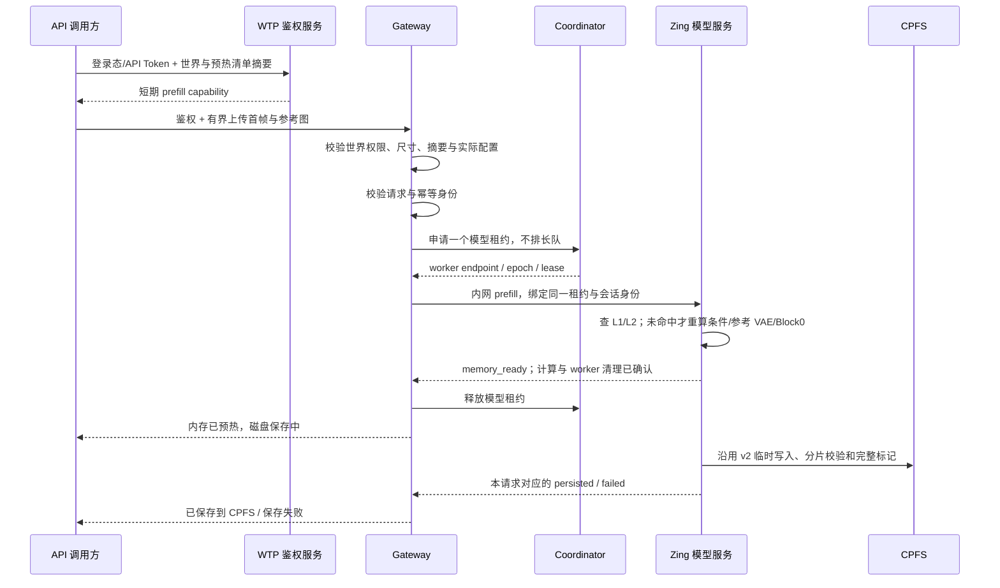

# 上海 Prefill API、共享 CPFS 与阶段计时方案

状态：2026-10-29 设计稿。`main@4adab592c602f89e87717277a3c0b29af667b35f`
合入当前 `codex/shanghai-output-gap-20261027`；本轮只做本地合并、兼容回归和设计，
不部署模型、Gateway 或前端，不创建挂载点，不修改运行中的 PAI 任务。
2026-10-29 修订：只提供 API、不添加页面按钮；磁盘缓存跨实例共享；增加完整阶段计时。
同日纠正：直接沿用 SGLang 已有 v2 内容目录、generation 校验、文件锁和 LRU，
撤回另建 v3/权威索引/独立 GC 协议的预设方案。

## 实施边界更新（2026-10-29）

用户已授权先 H100 实测，再发布现有 H200 单 Slot。本轮已实现独立尺寸 RGB24 首帧、
原生持久化回执、Gateway 有界上传/准入/状态查询及 WTP 签发接口；目前本地验证通过，
H100/H200 的真实验收结果仍待补齐，不能把本节作为上线回执。
CPFS 已通过官方 cpfs-nfs 客户端挂载到 CPU/H100，实际路径 `/mnt/prefill-cpfs`。

**按用户最新分工，锁机制由其他同事负责，本次不修改。** 下文锁语义讨论保留为历史设计背景，
不作为本轮改造事项。目录格式、现有锁和 LRU 继续沿用主线；本轮只验证正常读写与串行
跨实例复用，不据此声明多机并发写入安全。新增共享锁模块和参数已经撤回。

以 [Prefill 调用接口](../specs/shanghai-prefill-api.md) 为实现合同。上传为 MessagePack
内联图片字节与 RGB24，不提供 PNG S0 自动转码端点。GPU 计算在内存就绪并确认清理后
释放；已接受请求与观察连接分离，断开观察不会重复或取消请求，状态保留一小时。

## 目标与现状

调用方（同事本地前端、脚本或后端）通过 API 提交 prompt、参考图和白模首帧，提前生成
Block0 缓存并保存到上海 CPFS。现有 Web 试玩页面不增加按钮、不自动触发预热。
之后任何兼容实例使用一致条件启动试玩时，先查本实例 L1，再查共享 CPFS，未命中正常计算。
预热不创建白模 CLI、Room、录像或新 GPU 作业；一个模型部署仍只允许一个活跃任务。

| 项目 | 当前代码/资源状态 | 本方案需要补齐 |
| --- | --- | --- |
| 模型 prefill | 原生二进制 MessagePack WebSocket `/v1/realtime_video/prefill` 已在 main | Gateway 租约身份接入、独立尺寸 S0、持久化回执 |
| CPU/磁盘缓存 | L1/L2、v2 内容目录、generation/完整标记、根锁和 LRU 已在 main | 同一物理根目录与一致预算、挂载锁语义验收、后台写盘背压和持久化结果 |
| CPFS | `cpfs-01d85984bc5f3970`，上海 L，通用版 2.4.5，3,600 GiB，360 MB/s；本轮只读确认 `Running` | 挂载点、客户端挂载与真实读写验证 |
| API/Gateway | 现有 capability、Catalog 权限检查、Coordinator 严格释放可复用 | 专用 prefill capability、路由、状态/计时查询；无页面改动 |
| 原生完成回执 | `prefill.completed` 保证 L1 发布、临时资源释放；不保证 L2 写盘完成 | 增加持久化结果，不能将原回执当成写盘成功 |
| 阶段统计 | 有 cache lookup/restore 和 opt-in stage spans，部分只在 dispose 记录 | 每请求/每启动阶段结构化结果，区分 L1/L2/miss 与 Host/CUDA |

本方案的公网路径、字段和开关均为**拟新增接口**，不是已上线能力。

## 请求拓扑



Gateway 不挂载 CPFS，也不接收客户端指定的磁盘路径、模型地址或资源预算。
真正写 KV 的仍是模型 worker。接收上传、磁盘落盘等待与 GPU 计算租约分别计时。
缓存 key 直接复用模型现有 preparation_key 与模型/layout 指纹，不在 Gateway 重写
另一套算法。客户端清单摘要只用于上传完整性/请求幂等；最终命中层级由模型查询后报告，
Gateway 不按游戏 ID 或近似 key 提前宣布命中。

## CPFS 挂载与共享边界

### 挂载位置

目标计算环境：上海现有 NVIDIA CUDA/Linux PAI DLC 部署。文件系统与现有
`world_model_vpc` 在同一 VPC；生产容器当前只配置了 OSS 数据源，不能把已有 `/cpfs`
目录或普通 `mkdir` 当成新增文件系统的挂载证据。

建议使用新的挂载路径 `/mnt/prefill-cpfs`，避免覆盖旧模型、数据或既有挂载。
同一可信应用范围内所有兼容实例的 `--zing-block0-cache-dir` 指向 CPFS 上的同一个
实际目录，例如 `/mnt/prefill-cpfs/zing-cache/shanghai/`。不再额外拼 slot 或实例目录。

目录结构**完全沿用当前 SGLang**，不是本方案重新定义：

```text
<cache-root>/
  .index.lock
  lru_index.json
  .tmp/<uuid>/
  v2/<model-fingerprint>/<layout-fingerprint>/<key[:2]>/<key>/
    manifest.json
    .complete
    rank-0/conditions.pt
    rank-0/kv.bin
    rank-1/conditions.pt
    rank-1/kv.bin
```

生成函数为 `Block0DiskCache._entry_dir()`；generation 已存在于 manifest 与 rank 元数据，
不需要另造 `v3` 或 `generations/` 子目录。临时写入、完整分片校验、发布和淘汰沿用主线。
不同租户如有隔离要求，可以由部署配置不同 cache-root；同一游戏的兼容副本必须共享
同一个物理根目录，不能按 slot 分开。

`world_id/asset_revision` 用于查询与日志分组，不替代内容 key。相同游戏若 prompt、
参考图、S0 像素/尺寸、FPS、模型权重或 layout 改变，现有代码会保守 miss。
跨 GPU 型号/执行实现默认仍按 main 的严格身份隔离，不擅自放宽数值兼容条件。

- A 预热后，B/C 可以按相同模型/layout/key 从现有目录读取各自 rank 分片。
- L1 pinned CPU 仍属于各实例。B 首次从 CPFS 加载是 L2 命中，后续可成为 B 的 L1 命中。
- 一次落盘成功不表示所有实例的内存都已预热；回执区分持久化与实际 L1 覆盖。
- 所有 SP rank 校验通过后才报告逻辑命中，保留主线跨 rank 投票与 miss 回退。

### 通用版接入方式与现有并发保障

本次购买的是 CPFS 通用版。先验证真实挂载方式能在现有 PAI DLC 中使用，
数据源 URI/Options 必须来自真实挂载点，不捏造可直接提交的配置。

当前 main 已经有以下保护，直接复用：

1. 根目录 `.index.lock` 用 `flock` 保护索引、发布、淘汰和完整 KV 读取。
2. 唯一临时目录、原子 rename、generation 和 `.complete` 校验避免读取半条目/混合分片。
3. 读取前重新校验 generation/分片；条目变化或损坏时回退 miss。
4. 根目录范围的字节 LRU。所有共享实例必须配置一致的 `disk-gb`，不能各自视为私有额度。

这些代码支持共享存储的前提是文件锁在**实际挂载方式下跨机器生效**。
CPFS-NFS 文档列出不支持 NLM 锁；因此“已写 flock”不是当前 CPFS 跨机安全的验收结果。
需实测两台客户端互斥、并发发布、读取期间淘汰、异常退出后恢复和实际 IO 性能。
不得把 `nolock` 或本地锁当作多机保护，也不能因为 API 预热串行就忽略普通试玩的回写与 LRU。

本阶段不预设 Redis 权威缓存索引、独立 GC 或新磁盘格式。若实际挂载不满足跨机锁要求，
则暂停共享多写者上线；基于实测结果选择支持所需锁语义的接入方式，或在现有
`Block0DiskCache` 读/发布/淘汰边界提出最小协调修补。任何 TTL 锁方案都必须证明
过期 owner 不会继续修改共享文件，不能只替换锁调用就宣称完成。

并发同 key 重复预热可能仍会产生重复工作，这与能否复用完整缓存是两个问题。
Gateway 首先实现相同调用方/request_id 的幂等，不把全局内容 single-flight 当成本轮
跨实例读取的前提；如验收证明重复计算明显，再单独补充去重。

新挂载是否能进入已有 DLC 容器，取决于该任务的权限、客户端和卷配置。
只重启模型 Python 进程不保证能获得新卷；若平台要求变更任务模板或重建容器，
必须在部署方案中明确记录，不能承诺纯热更新，也不在本轮停止现有 H200 任务。

### 预算

沿用 main 的四个参数：`--zing-block0-cache-mode on`、
`--zing-block0-cache-host-gb`、`--zing-block0-cache-dir`、
`--zing-block0-cache-disk-gb`。这些都是部署参数，不允许浏览器覆盖。

- `*-gb` 为十进制 GB。3,600 GiB 约为 3,865.47 GB。
- 初始所有共享实例统一配置 `disk-gb=3000`；它限制同一个根目录的正式条目总量，
  不是每个实例各占 3,000 GB。沿用现有加锁 LRU，另外限制 `.tmp`/在途写入字节，
  并预留约 865 GB 文件系统余量；当前主线的磁盘预算尚未覆盖全部 staging。
- CPU pinned 预算先根据最大 prefix 行数、SP 分片、层数和 dtype 计算每槽字节数，
  结合容器可用内存确定。不能照抄 main 文档面向特定 H100 的 800 GB 示例。
- L1 预算不包含全部条件张量、进程 RSS 和文件系统页缓存，需另留内存余量。
- 实际读写吞吐尚未测量。按配置的 360 MB/s 估算，10 GB 数据单次传输下限约
  27.8 秒，且还没算其他读写与元数据开销；所以实时启动应尽量命中 L1，CPFS 用于
  持久保存与重启后预热，不能把磁盘命中宣传成零等待。

## 仅 API 的调用契约

### 鉴权

在 WTP 上海泳道拟新增：

```text
POST /whitebox-shanghai/api/whitebox/prefill-ticket
WSS  <Gateway origin>/v1/realtime_video/prefill
GET  <Gateway origin>/v1/realtime_video/prefill/requests/{request_id}
```

票据沿用现有 `whitebox-rtc-auth.mjs` 的 Catalog 登录态/API Token 验证方式，
但使用独立 `aud=whitebox-prefill`，限定 submit/status 操作、用户、source/world、
应用共享范围、模型配置版本、请求清单摘要、有效期和 jti。不能用 RTC 票据直接调用预热，也不消耗正式试玩的 create capability。
浏览器先在 WSS 首条消息中交票据，不把 WTP 长期 Token 或签名放进 URL 日志。
Cookie 调用校验 Origin；同事本地页面使用现有 API Token 授权流程及相应 CORS 规则。

一个票据绑定一个有界请求；共享 Gateway 副本通过 Coordinator/现有 Redis 做
请求去重和归属记录。GET 状态同样校验调用方与请求归属，过期后可重新授权查询，
不得凭 request_id 枚举他人的缓存或图像。相同 request_id 与相同清单重试查询已有状态，内容变化返回
`PREFILL_REQUEST_CONFLICT`，不能自动重复计算。

### 输入

调用方复用现有 S0 v2 的首帧截图、参考图清单和摘要校验，不重新启动 CLI 录制。
上传可复用现有 1 MiB 有序分片协议；Gateway 在总字节预算内组装后，再给原生模型
发送完整 MessagePack 请求。慢客户端上传期间不持有模型租约。

| 字段 | 来源和校验 |
| --- | --- |
| request_id | 客户端生成，绑定用户和 payload digest |
| source_id / world_id | Catalog 已验证可访问的世界 |
| prompt / references / seed | 与该次正式试玩相同；参考图 ID、顺序、字节内容固定 |
| initial_frame | PNG、原生宽高、encoded/RGB SHA256；复用 S0 v2 解码器 |
| source_stream / size | 来自服务端确认的实际入模 FPS 与尺寸，不从页面“目标播放 FPS”推算 |
| persist | 第一版固定 required，不能把内存就绪误报成持久保存成功 |

原生 prefill 目前只接受与 source stream 同宽高的一帧 RGB24。正式适配时扩展为
显式 preview geometry，保留旧请求的默认行为，并使用与 S0 v2 相同的尺寸/解码限制。
Gateway 将规范化 RGB24 转发给模型，不接收任意本地路径或任意 URL 抓取指令。

模型最终重新计算内容 key：prompt、参考内容与 ID/顺序、首帧像素与尺寸、source
width/height/fps、执行策略与模型身份均参与。不能只按 world_id 命中。
调用方保存并复用同一份预热素材；正式试玩中条件变化就正常 miss，绝不强行套用旧 KV。
没有 S0 的原生预热请求不自动启动 CLI，返回明确输入错误；正式试玩不传 S0 的能力保留。

### 模型准入与代理

新增小型 Gateway prefill handler，复用 Coordinator 的 admit/renew/verified-release。
只申请模型资源，不调用 Room join、CLI、录像或试玩生命周期回调。
上传完成后才申请；`wait_for_capacity=false`，已有试玩或预热时返回
`PREFILL_BUSY`，不维护无界 GPU 排队，也不抢占或取消其他会话。

原生 `zing_prefill.py` 目前自行创建连接 session_id，需要扩展内部 Gateway 模式：
校验 Coordinator token、worker epoch 和目标模型版本，使用租约绑定的
session_id/generation_id，衔接原有 worker session 注册、清理和释放回执。
不能只把 generate URL 中的路径替换成 prefill，就视为完成准入适配。

采用请求、计算、持久化分别有界的截止时间；断连、取消、worker 重启和超时均保留
归属验证。GPU 清理未确认时隔离该资源并返回失败，不提前宣布 Slot 可用。
内存已完成后浏览器断连，已启动的后台写盘可以继续；客户端通过受权状态查询恢复结果，
不能因为回执丢失而自动重新提交。持久化状态记录设置 TTL，不保存完整图像或 Token。
同一幂等请求被重连查询时，查询连接不能取消原执行者的任务；取消仅针对经过归属校验的
执行请求，完成正常 worker 清理。后台持久化的状态不能从连接是否存在推断。

多个兼容实例共享同一 L2 条目，正式试玩不要求固定回原实例。调度可将 L1 已热实例作为
软偏好，但不能让同游戏跨实例复用依赖粘性路由。回执列出共享 generation 与实际 L1 覆盖，
B 实例从 A 生成的文件加载必须记录为 L2 命中；若指纹不兼容，给出 miss reason。

## 落盘完成语义

保持原生 `prefill.completed` 对旧客户端的含义，新增可协商的持久化能力。
对外 API 使用下列状态，避免把现有原生回执直接透传为最终成功：

```text
accepted → computing → memory_ready → persisting → persisted
                              └─────────────────→ persistence_failed
```

`memory_ready` 表示本次计算所在实例 L1 已发布且计算清理完成，不代表其他实例已预热。
`persisted` 才表示所有 SP 分片、conditions 和 manifest 写入完成、完整标记可验证。
回执包含 request_id、opaque cache key、共享 generation、模型/配置 fingerprint、
实际 L1 覆盖、保存字节数、各阶段耗时和命中层级，不包含绝对 CPFS 路径或内部异常。
如果模型命中共享 L2 并完成加载，返回真实的 `l2_hit` 与复用状态；仍需独立校验持久化
条目，不能仅由 L1 命中推断文件尚在。原生内存完成与新增磁盘完成的边界保持分开。

需要修改缓存写盘管理：

1. 从全局 `wait_for_disk()` 改为可查询**本条 key/generation** 的写入结果。
   异常必须传回结果对象，不能只有日志和一个已完成 Event。
2. 每个 rank 沿用 main 的原生 KV/conditions 文件写入和关闭；所有 rank 同一 generation
   完成后，沿用现有 manifest/完整标记发布，并检查文件长度。2026-10-30 按用户要求
   撤销整份 KV 的 SHA-256 和新增强制 fsync，避免在大文件读写上增加串行扫描。
   main 原有 JSON 元数据同步、身份/形状/完整标记检查和锁保持不变。记录失败或超时，
   不把尚未结束的阻塞 IO 宣告已取消；persisted 不额外承诺断电场景的全量数据强制刷盘。
3. GPU/Coordinator 租约在计算清理后释放；磁盘等待在后台持久化管理器中进行，
   不在 scheduler 的 GPU 推理调用里等待全部磁盘 IO。
4. 限制后台任务数与在途字节，确保 IO 不会耗尽全部可复用 L1 槽。
   新预热在无持久化额度时拒绝；普通试玩的可选回写可跳过，不让慢盘反向阻塞试玩。
5. 第一版不对成功保存的条目无限期保留。LRU 淘汰后状态返回 evicted/miss；
   “持久保存完成”只证明该时间点完成，不能承诺永久驻留。
6. 限制临时目录容量；仅清理已确认无活跃 owner 的本服务过期临时目录。
   不扫描删除其他服务文件，不接触模型权重和录像。

上面需要补充的持久化状态、限额和回执**尚未实现**；v2 目录与已有并发保护来自 main。

## 调用方集成方式

交付接口文档与最小 Python/JavaScript 调用示例；不修改现有试玩页面、不增加按钮、
不强制预热，也不让开始试玩自动等待 CPFS 写盘。示例负责申请票据、上传、消费状态、
查询重试结果和读取阶段统计；同事自行决定在其前端或后端何时调用。

素材变化使原 key 失效，正常未命中仍可试玩。重试遵循幂等与退避，不自动高频占用模型。
记录 API 状态与可读的英文错误码/消息；不能把推理采样 Host 时间或写盘吞吐当成模型 FPS。

## 阶段计时与统计

### 统一关联和计时边界

每条预热/试玩日志携带 `trace_id`、`request_id`、`session_id/generation_id`、
world/asset revision、scope、模型与 layout fingerprint、case key、cache generation、
worker/rank、分辨率、输入 FPS、结果状态。缓存键和 trace 只进入受权明细，不作为
Prometheus 高基数标签；图片字节、prompt 正文和 token 不进入指标。
启动与后续条件切换都带 `segment_id/prompt_version/preparation_id`，按一次条件准备
统计；不能把后续 ABAB 切换的 cache miss 混算成整场首次启动。

各进程用 monotonic clock 计算自己的 duration。Gateway API 总时长、Room 首个 RGB
返回耗时、调用方端到端时长各自使用同一侧时钟；跨进程用父子 span 和因果事件串联，
不直接相减两台机器的时间戳。CUDA event 只测本设备/stream，异步收集结果，不为统计
每帧插入 synchronize。嵌套或 overlap 阶段保留 start/end，不相加冒充总耗时。

### Prefill 阶段

| 指标 | 边界/含义 |
| --- | --- |
| `upload_ms` | Gateway 接收素材首字节→完整接收，包含客户端供数等待；不是纯网络单程 |
| `validate_ms` | 校验票据、尺寸、摘要与规范化素材；必要时拆 PNG decode |
| `cache_lookup_ms` | 模型确定 L1/L2 或 miss；拆分根锁等待、索引和 manifest 查询 |
| `dedup_wait_ms` | 同一幂等请求重连等待已有结果；不能算 GPU 计算 |
| `admission_ms` | Coordinator admit 请求→取得租约/拒绝；无界等待禁止 |
| `worker_queue_ms` | worker 接收可执行请求→开始处理 |
| `worker_prepare_ms` | worker 开始条件准备→L1 发布完成，包含真实依赖与 D2H 等待；不是纯 GPU 算子时间 |
| `qwen_prepare_ms` | 文本/视觉条件准备；远端 RPC Host span 与 Qwen CUDA span 分开 |
| `reference_vae_ms` | 参考图 VAE；与 source VAE 区分 |
| `block0_forward_ms` | 静态前缀 forward，记录 Host 与可用的 CUDA 值 |
| `d2h_ms` / `l1_publish_ms` | GPU KV→CPU 完成、L1 发布；与模型 forward 分开 |
| `compute_cleanup_ms` | 计算状态释放、worker 清理确认；与磁盘等待分开 |
| `disk_queue_ms` | 写盘额度/后台队列等待 |
| `conditions_serialize_ms` | 条件文件序列化；避免混入 KV IO |
| `kv_write_ms` / `conditions_write_ms` | 各 rank 实际文件写入及关闭；不额外强制全量 KV fsync |
| `publish_wait_ms` / `manifest_commit_ms` | 等待其他分片、根锁、完整性校验与现有 manifest/标记发布 |
| `prefill_to_memory_ms` | Gateway 完整校验请求→收到 L1+计算清理确认 |
| `prefill_to_persisted_ms` | 同一起点→收到共享条目持久化确认，是主要预热总耗时 |
| `api_observed_total_ms` | Gateway 首条请求消息→终态响应发送；含上传，不能宣称浏览器端到端 |

各阶段提供状态 `executed/skipped/not_observed/error`。命中后未运行的 Qwen/Block0
记 skipped，不填 0 冒充一次零耗时计算。对幂等重连调用，等待已有请求的时间与
原请求的计算时间分别返回；关联信息仅在相同授权范围内可见。
主线现有 `prefill.completed` 没有这些完整统计；本节列的是待补充的契约。

### 试玩时的缓存与首次模型输出

必须区分以下逻辑结果，不只给一个 hit 布尔值：

| cache result | 需要单独统计的工作 |
| --- | --- |
| `l1_hit` | 本地查找、条件转移、KV H2D、消费前等待 |
| `l2_hit` | 根锁/索引查询等待、conditions 读取/反序列化、KV 大小检查及读取、L1 发布、H2D、消费前等待；不扫描 KV 摘要 |
| `mixed_hit` | 某些 SP rank 为 L1、另一些为 L2；逐 rank 保留原始层级，不能归为纯 L1 |
| `miss` | miss 查询成本＋Qwen、reference VAE、Block0 重算；可选后台写盘不算首帧路径 |
| `bypass` | 主动关闭/不适用缓存；单独分组，不混入正常 miss |

miss reason 区分 `not_found`、`build_in_progress`、`evicted`、`incompatible`、
`corrupt`、`read_error`、`partial_rank_miss`。不能把临时网络失败误判为永久损坏并全局删缓存。

额外记录 `condition_ready_elapsed_ms`、`prefix_ready_elapsed_ms` 和各执行/等待 span：
Qwen 条件就绪与完整 Block0 可消费不是同一时刻。冷路径可能要等输入依赖才能跑 prefix，
因此 elapsed 包含等待，不能直接等同于算子时间。H2D 使用异步 stream 时，单独记录
`restore_submit_host_ms`、`restore_cuda_ms`、`restore_wait_at_consumer_ms`。
保留现有 `ready_at_consumer`；现有 `restore_lead_host_ms` 不是消费前阻塞时长，不能改名复用。

首个模型 RGB 在 Room 的实际接收侧记录 `room_model_init_to_first_rgb_ms`，
并保留现有 source-frame→RGB 的同帧耗时与首个输出身份。CLI 启动、首帧供数、后续 source VAE、
DiT 去噪、Decoder、RGB 回传分别关联；避免缓存命中后把 source 采集等待归咎于读盘。
需要“首次可见/按键到画面”时消费已有客户端呈现回执；缺少客户端回执就标未观测，
不以服务端发出时间代替真正显示。本轮不增加前端统计面板。

### 结果交付与聚合

- Prefill 终态事件与受权 GET 状态接口返回版本化 `timing_schema_version`、
  `cache.result/miss_reason/generation`、`timings.gateway/worker/storage` 和逐 rank 明细。
  日志在 memory_ready/persisted/first_rgb 等边界立即输出，不等试玩结束 dispose 才能分析。
- CUDA 结果尚未完成时返回 pending；最终统计通过状态查询/追加 telemetry 更新。
  不为了让首个回执字段齐全而阻塞正常输出。
- 试玩沿用 trace 查询链路输出 `cache.lookup`、`cache.restore`、`block0.prepare`、
  `model.first_rgb` 事件，开放给具有相应世界/会话权限的调用方。现有无鉴权 legacy trace
  路由不能因此直接暴露到公网。
- Prometheus 使用有限标签（阶段、分辨率、结果、部署版本等），统计 count、P50/P95/P99、
  失败率、L1/L2 命中率及字节吞吐；跨 SP 的逻辑命中每个会话计一次，不能重复算 rank。
  同一操作的并行 rank 显示各 rank 时间和最慢 rank，不求和当总延迟。
  明细聚合可提供观测窗口内最大值与慢请求 trace；不以 histogram bucket 上界代替实际最大值。
- 缓存收益只做同游戏/素材、同模型、同 FPS/分辨率、同 GPU 类型与同网络条件的冷/L2/L1
  对照。报告各组 TTFF 的 P50/P95、对应分位数差值和样本数，不把一次命中的耗时估成
  同一次请求未命中的反事实。L2 读盘可能慢于重算，要如实保留负收益。

## 代码范围与实施顺序

| 阶段 | 组件 | 拟修改位置 |
| --- | --- | --- |
| 1 | 挂载验证 | CPFS 协议服务/导出目录、PAI 数据源与启动预检；只在部署授权后执行 |
| 2 | 共享配置/兼容验证 | 同 CPFS 根目录、一致预算，验证主线锁/发布/淘汰；不另建缓存格式 |
| 3 | 模型缓存 | `zing_h3/disk_cache.py`、`preparation_cache.py`：现有格式上的落盘结果、字节背压与阶段统计 |
| 4 | 模型 API | `zing_prefill.py`、`zing_h3_source_adapter.py`：租约身份、preview geometry、能力协商与持久化事件 |
| 5 | Gateway | 独立 prefill handler，接入 `realtime_gateway_server.py`；复用现有准入与释放协议 |
| 6 | WTP API/文档 | 专用 capability、白名单路由、调用示例与受权状态查询；不修改页面 |
| 7 | 可观测性 | 复用 stage timing/trace，补 cache-layer、执行/等待、CPFS IO 和分组聚合 |

CPFS 挂载/读写语义先通过，再实现依赖它的生产模式；否则先显式关闭 Block0 缓存，保留
现有正常计算路径，不用普通本地目录冒充 CPFS。

## 回归和上线门槛

本地 CPU 契约测试覆盖：请求校验、独立尺寸 S0、key 相等/不等、缓存身份、分片完整性、
单活跃准入、租约清理、乱序/重放、断连取消和磁盘失败。不能代替真实 CUDA/CPFS 验收。

部署后按以下顺序验证，且不占用正在试玩的实例：

1. **挂载门槛**：核对文件系统 ID/真实 mount、容量、权限、rename/fsync 与跨实例读取可见性，
   以及断连错误；证明没有写到根盘。核对 DLC 数据源实际落地，不只看配置 JSON。
2. **持久化门槛**：两 rank 文件齐备、摘要一致；强制缺少一个分片时不得 persisted；
   **A 实例 prefill→B 实例空 L1 命中同一共享 generation→B 再次 L1 命中**；
   B 重启后仍从 L2 命中，证明不依赖 slot 粘性或原内存。
3. **权限门槛**：未登录、无世界权限、错误 audience、过期票据、不同内容复用 request_id、
   任意 worker URL/路径全部拒绝；多 Gateway 重试不得创建重复计算。
4. **稳定性门槛**：已活跃试玩时预热 busy；预热结束或中断后下一场可用；慢盘/满盘/权限丢失
   可观测失败且不得污染正常试玩；同时到来的写入有字节上限。并发同 key 不混合 SP
   分片，读取与淘汰互斥；缺少有效跨机锁时不得开启多实例共享写入。重复工作单独统计，
   不把“没有误命中”宣称为“完全没有重复计算”。
5. **命中门槛**：同素材的 prefill→S0 v2 正式试玩命中；参考图顺序、首帧尺寸、FPS、
   模型版本任一变化必须 miss；无 S0 正常试玩继续可用。
6. **效果/性能门槛**：固定权重、硬件、分辨率、动作与输入，对比冷计算、L2、L1 三组，
   480 与 736 分开；记录 TTFF、FPS、按键延迟、source-to-output、ICL、Encoder/Qwen/
   reference-VAE/source-VAE、DiT、Decoder 的 Host/CUDA 时间与显存。缺项标未测，
   不承诺某个毫秒收益，不把写盘带宽理论值当实测。
7. **画质门槛**：相同 seed/输入做冷与命中输出一致性检查；GPU 数值容差按模型基准确定，
   同时检查前一分钟动作连续性、源帧身份与播放平滑性。

8. **计时门槛**：每个关键阶段有 start/end/status，L1/L2/miss/mixed/bypass 明确；
   skipped 与未观测不写成 0；重复查询不重复计数；后台写盘与 CUDA 统计不拉长首帧。
   关闭/开启计时做小规模同条件对照，量化采集开销，不能只证明字段存在。

首次上线只开放 API，调用方自主决定预热时机。当前页面保持不变。
回滚先关闭 Gateway prefill 入口，再将模型缓存设为 off 或回到已验证镜像；不删除 CPFS
文件，保留旧模型和配置，避免回滚再次冷下载。

## 合并验证记录

此次 main 合并保留上海的 S0 v2、远端渐进解码、输出边界与三路归档相关代码。
兼容修改包括：统一 API→worker 调度字段、prefill/live 共用策略 key、S0 原生尺寸参与
key、合并 Encoder overlap 的三结果槽，以及同时保留两侧回归用例和 CI 历史记录。

本地 macOS/Python 3.13 CPU 回归共 19 个测试文件：**1,609 passed、3 个 passing
subtests、4 个 CUDA-only skipped**，耗时 105.77 秒。使用已有 CPU bootstrap；
不会因此证明真实 NCCL/CUDA 执行或 CPFS 挂载语义。Python/JSON 语法和 E9/F63/F7/F82
静态检查通过。通用 Ruff 全规则检查存在旧代码风格告警，本轮没有进行无关的全仓清理。
随后补齐显式 deferred-final 与远端渐进 q0 的兼容条件，相关 adapter/source-session
套件再次通过 **1,006 项**（含两个新增用例），不与上面的重叠用例累加。
文档导航、frontmatter 与新增内部链接已静态验证；本机没有 Mintlify CLI，未运行整站构建。
本地证据记在 `.planning/shanghai-prefill-cpfs-design-20261029/`。
本轮未执行 GPU、实际 CPFS 挂载/读写或公网浏览器验收。

## 依据

- [原生 prefill 契约](/docs/sglang-diffusion/zing/specs/block0-prefill-websocket)
- [Block0 默认配置与预算](/docs/sglang-diffusion/zing/plans/BLOCK0_CACHE_DEFAULTS)
- [阿里云 CPFS 通用版容器卷限制](https://help.aliyun.com/zh/cpfs/cpfsonecs/user-guide/cpfs-volume-overview)
- [阿里云 CPFS 协议服务限制](https://www.alibabacloud.com/help/en/cpfs/cpfsonecs/product-overview/limits-1)
- [PAI NAS/CPFS 挂载说明](https://help.aliyun.com/zh/pai/use-nas)
