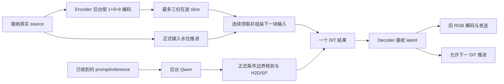

# Source 流水线调度修正设计

状态：A 已实现，CPU 与获授权的 B300 480 GPU 复测见第 9 节；已定位旧空轮消失，但 FPS/切换未显著改善，仍有 joint lookahead 等待；736 与数值等价未验证。2026-10-28 更新：PR #410 已合入 main，本分支 `codex/zing-source-pipeline-scheduling` 对齐 main 的 `387f693f306e601586afdfebae938e823317620a`，PR #417 以 main 为 base，仅审阅 Source 调度增量。原开发基线为 #410 的 `87c544b9a8ef634b669411f8d8c5df8996a87478`；下文保留各次验证的受测版本，不将历史 GPU 结果视为最新 main 集成验收。

2026-10-28 冲突整合：保留 main 的 Disaggregation Encoder/Decoder 端口注入及通用 transport；保留本 PR 的三槽、有界追加输入、纯进度快进及 credit 合并。唯一文本冲突是 Source adapter 测试文件末尾的并行新增，已保留双方用例。相对新旧 main 的 Python 增量逐行核对一致（忽略空行位置），没有增加 quantum=2 或放开 q1 限制；新 main 上的 GPU/性能未重测。本次 Source/credit/Decoder/NCCL/角色启动九文件 CPU 回归 1037 passed / 0 failed / 0 skipped（135.47s，2 条既有 pytest 警告）；9 个 Python 文件 AST、Ruff、format、isort 和 diff 检查通过。

## 1. 要解决什么

现有四卡布局为 DiT 两卡、Source Encoder＋Qwen 一卡、Lynn Decoder 一卡。#410 已支持 Qwen 提前编码及独立 Decoder 与下一块 DiT 重叠，但仍出现“下一块所需 latent 已编码好，DiT 却没有开始”的周期空泡。

本方案让一次正式推进围绕**产出至多一个真实 DiT 结果**组织：允许接纳所需新输入、连续领取多个 Encoder slice；纯进度返回不再占用 RGB 输出等待边界。同时把 Encoder 的提前生产额度改为三份 slice。

不要求所有块间隔完全相同。8/9 帧块、VAE 的 1+8+8 分片、输入到达、Qwen 共卡竞争和真实网络背压仍有不同耗时。目标是消除已定位的无效依赖，而不是承诺每个空泡归零。

### 用户怎么用

继续沿用现有服务/profile 和三个异步开关：Source `mode=overlap`、`cross_dispatch_prefetch=true`，以及 `--zing-conditioning-prefetch`、`--zing-source-decoder-overlap`；单活跃会话，`SGLANG_ZING_EXPERIMENTAL_SOURCE_WORK_QUANTUM=1`。不新增面向用户的队列调参开关，不调整模型、采样步数、prompt joint、部署卡位或播放缓冲。

三槽仅在 remote Encoder overlap 模式生效；允许续推补输入还要求 cross-dispatch prefetch 与 q1。纯进度快进及 credit 合并由既有独立 Decoder overlap 开关控制。本地/serial Encoder 保留现有输入入口。回退使用上一部署版本；也可关闭对应 overlap 开关恢复原同步路径，但回退后的性能须重新解释。

## 2. 实测事实与原因

数据来自 `D:/sglang-all-async-b300-20261025-r4/completed/`，产品提交 `428cd48295` 加七处 T033 部署覆盖。实际设备 L20D/CC10.3，Thai r10，832×480；不能视为纯 HEAD 或 H200 的验收。

同一条稳态时间线，时间均相对原图起点，单位 ms：

| 时间 | 实际发生的事 | 暴露的问题 |
| --- | --- | --- |
| 6.12 / 84.68 | `[43,51)` 的 8 帧及 `[51,52)` 的 1 帧编码完成 | 两份 slice 占满两槽 |
| 244.10 | worker 领取前一份，归还额度 | 后续 8 帧直到 244.66 才开始编码 |
| 411.44 | `[52,60)` 编码/传输完成 | 下一 DiT 所需 1+8 已准备好 |
| 467.00 | 前一块 DiT 结束 | 计算依赖已经满足 |
| 483.45 | 一次续推只领取首 1 帧对应 latent | 正式接纳仍到 52；`more_work` 又禁止携带新输入 |
| 随后约 71 | 零 RGB 结果等待旧输出 | 真正下一 DiT 被输出等待挡住 |
| 636.33 / 641.18 | 下一轮正式接纳后领取后 8 帧，随后开始 DiT | 前后 DiT 间隔 174.18ms；另一处为 170.68ms |

余下空泡还包含 scheduler/传输、输入复制、领取与准备，不能全部归因于上述 71ms，也不能保证修改后省掉整个 174ms。证据见 `SOURCE_QUEUE_GAP.md`、`STEADY_GAP_ANALYSIS.md`、`SCHEDULING_REVIEW.md` 和原始时间线。

阶段耗时提供背景预算，不能拼成修改后的预测时间线：

| 稳态阶段，P50/P95 ms | 8 帧块，n=60 | 9 帧块，n=57 |
| --- | ---: | ---: |
| Source 服务含传输，按所需 slice 求和 | 159.71 / 160.18 | 240.66 / 242.04 |
| DiT rank0 CUDA 块驻留 | 219.58 / 229.24 | 230.24 / 238.69 |
| Decoder 开始到 RGB 发布 | 75.09 / 77.93 | 109.54 / 113.60 |

`source_wait_host_ms` 是会话首帧等待，不能用其最大 8.977ms 解释每块供给。另一个容易混淆的点：`RemoteEncoderSession.ready` 由正式接纳水位和 latent 几何判断，**不是 GPU 结果队列已经完成的证明**；`pop` 仍可能等待实际结果。

## 3. 方案总览与实施顺序

| 改动 | 决策 | 直接目的 |
| --- | --- | --- |
| Encoder 结果额度 | overlap 两份改三份，计算中也占额度 | 允许 8+1+8 同时在途，避免首 1 帧挤掉后 8 帧 |
| 正式推进 | `more_work` 不再禁止追加输入，按实际余量有界接纳 | 复用 worker 连续消费 slice 的现有循环，避免仅处理 1 帧的空轮 |
| 输出边界 | 纯进度绕过旧 RGB 等待，credit 合并到既有发送路径 | 不增加后台发送任务，保留输出顺序和容量 |

**本次独立改动只实施 A：上述三项及必要观测。** B 的重复 RGB 传输精简单独留作后续改动，不纳入本次验收。A 不新增调度器、下一依赖预测协议、credit 后台任务或用户配置项。

下面是目标依赖关系，箭头不表示已测得的毫秒数：



旧 RGB 与下一 DiT 可以重叠；交付下一份真实输出前仍等待旧输出。纯进度不走这条输出等待链。

## 4. A1：三份 slice 额度，不合并 VAE 计算

`remote_encoder.py` 同时修改 `results` 队列容量和 overlap `permits` 初值为 3。沿用现有 permit 获取/归还位置，串行模式不增加提前生产能力。额度覆盖“已获许可、正在计算/传输、等待消费”的结果，不只统计已入队数量。

clip17 的三份完整 slice 是 1+8+8，对应 1+2+2 latent；跨边界可排列成 8+1+8。三槽解决当前按 slice 限流造成的停产条件。它不是任意 chunk plan 下“永远准备好两块 DiT”的保证；其他分块或 EOS 尾部仍按实际依赖推进。

采用三槽比“1 帧与后 8 帧共用一个槽”改动更小：后者需要定义聚合对象、半完成状态和归还时机，跨 clip 时还涉及两个缓存周期。这里保留现有 VAE shape、缓存重置和数值语义，不把 1+8 合成一次 VAE forward。

保留输入帧数、字节、bridge 和 sampler 容量。新增预算最多一份 Encoder 结果，以实际 moments shape/dtype 计算字节；生产者临时 tensor、SP rank 副本、bridge 所有权转移产生的副本分别计量，不能把“三槽”当成全链总显存上限。取消、失败、队列满时必须能退出，避免重复归还额度。

## 5. A2：解除 `more_work` 对追加输入的禁止

### 只增加一个容量提示，复用现有推进状态

当前 `more_work` 同时承担“可以继续推进”和“API 不准带新输入”两种含义。保留既有 `zing_source_more_work` 表示前者，去掉 `prepare_next_request` 中由它决定不携带 appends 的限制。

worker 只增加内部返回值 `zing_source_append_capacity_frames`：本轮返回后，正式输入缓冲还可接纳多少帧。由 `RemoteEncoderSession.append_capacity_frames` 按正式 retained frames、帧数上限及字节上限共同计算；固定尺寸 RGB 下，字节容量换算为帧数后取较小值，再减 retained frames。它不是生产线程 queue.qsize，也不是 GPU 完成进度。两个 SP rank 按相同正式状态计算；worker 接纳时仍再次执行原有容量检查。

不再新增 `accepted_frame_end`、`can_advance` 的副本，也不让 API 根据一个新的 `next_required_frame_end` 协议重建 sampler/joint 的需求预测。API 已有正式派发计数，worker 已有 `_next_bridge_count`、bridge 和 sampler；第一版只需要安全地允许补输入。既有 `_joint_wait_target` 的输入等待策略保留，`more_work=true` 时不为凑批额外等待。

### API 选输入，worker 连续领取

1. 首请求沿用已有受限接纳路径和真实 source 首帧 presentation；取得 worker 返回后再使用容量提示，不猜测初始无限额度。
2. 后续无论 `more_work` 是否为真，都可按顺序选择已经收到的完整 packet。沿用现有 clip 批量目标，但每取一个 packet 前检查总帧数不超过容量提示及现有单请求上限（当前最多两个 clip）。不切 packet、不改变 client_seq、不越过队首。
3. 没有可放入的 packet 但 `more_work=true` 时，可以空 appends 推进并释放容量；有可用输入时不再被强制为空。若有效队首 packet 永远放不进容量，需要明确拒绝不兼容配置，不能忙轮询或放宽容量。
4. worker 已有 `while pixels.ready and _within_work_budget()` 循环：正式校验/接纳后连续 pop、加入 bridge、尝试生成。本轮复用它；`quantum=1` 仍限制一个真实结果，而不是一次 pop。不增加第二层调度循环。
5. 示例：正式水位 52，API 已有后 8 帧且容量允许；同轮补入后，现有循环可连续消费首 1 与后 8 对应 latent，满足到 60 的依赖。也可能按完整 packet 接纳到 69；这不意味着本轮允许多产出一个 DiT 结果。

取舍是第一版不追求“刚好接纳到下一块依赖”，可能多做少量有界输入复制。当前实测问题是禁止补输入，而不是缺少精确预测器；先验证解除禁止后的收益，再决定是否需要更精细的接纳。输入批次变化仍可能影响 joint flush、RNG 调用与条件采用时机，必须验证，不能仅凭 q1 宣称数值等价。

输入不足、控制事件或 EOS 仍允许纯进度返回。没有可接纳输入、没有可推进状态且没有待处理控制事件时进入事件等待；若容量与推进状态形成无法恢复的矛盾，明确报错，禁止无进展 RPC 忙轮询。等待 Encoder 的实际结果仍受 timeout/取消/失败路径约束；不以 `prefetched_frames` 取代正式身份校验。leader 失败沿用既有广播路径使两个 rank 一致退出。

## 6. A3：纯进度与真实输出分别处理

### 哪些返回需要输出背压

有实际 RGB、异步输出引用或有效输出块 metadata 的返回属于真实输出；不能只用 `result.output is None` 判空。即使 Decoder 暂未产出 RGB，只要 `zing_source_dispatch_steps` 非零，也保留真实结果背压，防止连续执行 DiT 超过在途预算。快进仅用于无 DiT、无输出的纯进度返回。EOS、错误和条件通知分别处理，不把它们当作可以直接丢弃的“空结果”。

真实输出沿用 #410 的边界：一个旧输出任务＋最多一个执行中/刚完成的新结果；交付新输出前等待旧输出。纯进度只更新 worker/source 状态，保留旧 `pending_send_task`，不等待它、不创建替代它的空发送任务。API 的 chunk 生命周期及日志仍须完成，避免留下未退休 active chunk。

### credit 只保留一个最新待发水位

现有 `send_output` 在 RGB 交付后调用 `ledger.consume`。如果只给纯进度加一条提前 consume 路径，旧输出随后可能提交更低水位并触发错误。

因此 adapter 在 `on_chunk_complete` 按 dispatch 顺序校验 worker 消费水位：类型正确、不回退、不超过正式派发水位。只保存一个最新水位 `pending_source_consumed_end`，不在此调用 `ledger.consume`。水位允许落在 packet 内部：既有 ledger 仅释放其覆盖的完整 packet，不能误要求 VAE slice 和传输包边界相同。正式派发计数只在成功返回后参与该校验；失败请求沿现有致命错误路径退出，不把已构造请求当作成功接纳。

复用既有 WebSocket 发送锁，以一个 adapter 内部 flush 入口完成 `ledger.consume` 和 `source.consumed` 发送。持锁后重新读取最新水位；仅当它高于 ledger 的已消费水位才发送。旧 RGB 完成后也调用这个入口，不再使用旧 result 的水位。跳过重复 flush 只针对已校验状态，不能用 `max()` 吞掉 worker 的错误回退。

Source metadata 仍按 `min(output_frames, consumed_frames)` 退休；RGB 路径继续负责 `delivered`。credit 语义仍是下游已接管 source，发送可以合并或延迟，不等同于 RGB 交付。发送失败按致命连接错误退出，不尝试在已失败的连接上复用 ledger。

### 复用现有输出任务，不增加 credit 后台任务

`_send_output_and_log` 的 `send_group` 可能覆盖 Decoder 引用等待。纯进度返回时如果旧输出仍在运行，只更新上述水位并继续调度，**不等待发送锁**。旧输出成功完成后顺带 flush；没有旧输出时，由主循环直接 flush。保持原 RGB 发送事务，不为控制消息拆开二进制帧组。

必须覆盖一个完成时序：旧输出已 flush，新的纯进度随后提高水位，而旧任务刚好结束。主循环检查已完成输出时，以及 `_wait_for_source_input` 被输出成功唤醒时，都须在继续等输入前调用同一 flush 入口。这样即使客户端正在等 credit，也不会双方一直等待。失败直接传播，不 flush 成功消息。无需新增 sender 的错误监视、取消或 join 生命周期。

EOS 先排空在途 worker 和 RGB，再 flush 最终 credit，最后发送一次 `session.completed`；带完成标记的返回不判为纯进度，沿原有序发送路径处理。纯进度的 chunk 退休、Host 日志/指标就地完成，不调用整个 `_send_output_and_log`。

实施时核实 `_send_chunk_telemetry` 是每轮必发，并非可选诊断开关。因此只有该 overlap 路径的非终态零输出轮次不再发送 WebSocket `chunk_telemetry`，避免重新等待 RGB 锁；服务端 dispatch trace、stage metrics 和 chunk timing 保留，真实输出和终态 telemetry 不变。客户端 `chunk_index` 可能不连续，不能再用 telemetry 条数统计所有 RPC；诊断须用服务端 request/dispatch ID 补齐。`source.consumed`、错误、条件通知和 EOS 不丢弃，条件通知仍沿已有有序发送语义。

代价是旧 RGB 未完成时 credit 仍会延迟，低输入额度或慢网络下可能限制补充输入。它不影响“输入已经齐备”的本次反例，也不承诺解除所有输入背压。先用小 credit 窗口测试无死锁、测量延迟；只有证明确有必要，才另行拆分 Decoder 等待与实际 WebSocket 发送锁，避免现在就增加一个常驻任务。

## 7. B：后续独立改动——已预取输入改传接纳描述

本次保留原始 RGB 正式请求。下面只记录后续方向，实施前另写专属设计、单独 PR：在既有私有 admission 路径可用时，让完整像素只沿 API→Encoder 通道传递，正式 worker 请求携带已接纳描述。

描述绑定 session/generation、client_seq、event/source 身份、绝对帧范围、尺寸、PTS、payload 字节数和内容 digest。从同一条经过严格公网校验的接纳记录生成，不能根据“已编码到第几帧”自行合成。producer 对实际收到的原始数据计算 digest，与正式描述匹配；两通道到达顺序任意，未匹配记录有界并在会话关闭时清理。

在 `SourceLedger` 增加明确的内部描述接纳入口，复用顺序、额度和 provenance 更新逻辑；公网 `accept` 继续要求真实 bytes 与准确长度，不伪造空 data。remote encoder 增加对应正式接纳方法，保留 shape、容量和内容身份验证，减少完整 tensor 构造与回转 bytes。

两 rank 收到相同正式描述；leader 的身份匹配异常必须在后续 collective 前通告 peer，不能单边抛错。首帧 Qwen presentation 保留必要像素。component capture 显式启用时保留原始帧路径，保证可复现的输入捕获；serial/无 admission 路径也继续传像素。这些是实际存在的调用方，不增加无人使用的通用媒体注册表或长期缓存。

这一步的通过标准是实际序列化请求不再包含重复整批 RGB，输入身份和输出对齐不变。必须分别记录请求字节、序列化/复制/正式接纳耗时；不能把原约 46ms scheduler 区间全部算成可节省的传输时间，也不宣称全链零拷贝。

## 8. Prompt/reference 与异常边界

Qwen 的预取通道保持独立；在途 GPU 工作不抢占，正式条件仍按已有 digest、SP 和 prefix 更新边界采用。每次真实推进前选择已到达的有效事件，不多生成旧 prompt 块来掩盖切换延迟。旧结果继续携带生成时的 event/provenance。

Source 推进变快可能改变某个墙钟时刻到达的 prompt 对应哪一输出块，这属于需要记录的响应变化。数值/对齐测试应固定逻辑切换边界；延迟测试固定客户端触发规则，报告实际采用块，不能把二者混为同一种比较。

输入等待须能观察旧输出失败；credit flush 失败直接传播，Encoder 故障及会话取消沿既有路径退出。保留 #410 的预取超时清理修复。不能在两 rank 中一边清理、一边继续 collective；资源归还也不等于远端 owner 已确认可重用，沿用现有 abort/recovery 语义。

本轮不迁移 Qwen 到 Decoder 卡，不增加抢占执行器。原实测 Qwen 边界剩余等待/广播为 426/587/526ms；修复 Source 空泡不能证明这部分也被隐藏。

## 9. 验证计划与通过标准

**A 已实现，以下是验收目标；CPU 执行记录与 GPU 缺项单列在后。** #410 的 689 项 CPU 回归和原 480 数据是基线证据，不是本方案的 GPU 通过证明。

| 不变量/目标 | 最小验证 | 通过标准 |
| --- | --- | --- |
| 三槽真实限流 | 受控阻塞消费者、满队列取消/失败 | 最多三份生产额度，8+1 后第三份可开始，无重复归还 |
| 一轮补齐 1+8 | 正式水位 52、API 输入到 60；跨 clip 与 EOS 尾部 | 同轮接纳并产出至多一个真实块；未到输入不能被消费 |
| 无进展不忙等 | 输入不足、结果未完成、EOS/拒绝事件 | 可等待或退出，无无界空 RPC 循环 |
| 纯进度不等待旧 RGB | 阻塞真实输出引用，中间插纯进度，再给完整输入 | 下一真实 DiT 能开始；再下一真实结果受容量约束 |
| 有界接纳 | 帧/字节余量不足、完整 packet 超过剩余量、SP 两 rank | 不越界、不跳过队首；能释放容量或明确报错，不循环空派发 |
| credit/provenance | 旧输出 flush 前后插入纯进度；小 credit 窗口；慢发送锁 | 单调 credit、旧帧对齐保留；输出完成后补发最新值，等输入不死锁 |
| 输入批次语义 | 固定逻辑 prompt 边界，覆盖 joint/跨 clip/EOS | 区间、输出顺序与 RNG/数值满足既有容差；差异必须解释 |
| 生命周期 | 错误、取消、EOS、下一会话；两 rank 状态一致性 | 引用/permit 释放，完成事件不提前或重复，失败共同退出 |

### 已执行的 CPU 验证

2026-10-25，Linux WSL，既有 `/home/tyz/.cache/sglang-qwen-overlap-tests/bin/python` 环境，使用仓库 `benchmark/zing_h3_causal/run_conditioning_cpu_tests.py`：**984 passed，0 failed，0 skipped，83.15s**；1 条 anyio 已导入的 pytest 改写警告。受测代码为本次 A 的最终实现；之后仅补充本文结果。

文件范围：`test_zing_h3_source_adapter.py`、`test_zing_source_decoder_overlap.py`、`test_zing_progressive_source_session.py`、`test_zing_h3_encoder_transport.py`、`test_realtime_async_output_critical_path.py`、`test_zing_source_stream.py`。测试使用真实 API 调度循环、adapter/ledger、worker 循环及有界线程队列；GPU 模型和部分传输采用 stand-in，已有 Gloo 用例不代表真实 SP2 CUDA 验收。

新增反例覆盖：无 DiT 的纯进度越过被阻塞的旧输出；有 DiT 但无 RGB 时仍停止提前执行；同轮补入 8 帧后消费 1+8；完整 packet 容量限制；帧/字节余量不受后台预取水位影响；三槽全部占用后的取消/reset；packet 内消费水位、旧输出 provenance、单调合并及输出完成时补发 credit。既有输出失败、取消、EOS 和协议测试一并通过。

原始 JUnit：`D:/sglang-source-pipeline-scheduling-tests.xml`。额外尝试 `test_realtime_runtime.py` 时，因 CPU 环境无法导入 GPU kernel `norm_infer` 在收集阶段失败，该文件未执行；保留 `D:/sglang-source-pipeline-scheduling-runtime-collection-error.xml`，不计入通过数。适用 pre-commit、diff 和设计链接检查通过。作者自审沿正式接纳→worker→输出与 credit 检查了所有权及等待关系；未做独立子代理 review；后续获授权 GPU 复测结果见下。

### 已执行的 B300 480 GPU 复测（2026-10-25）

用户随后授权在真实 B 卡沿用原测量。受测产品 `c0d06878325b2434ba3de445edaf8de5c02533b6`，与旧 `428cd48295` 使用完全相同的七项 T033 兼容覆盖；本次修改的调度文件逐字等于受测提交，不能称纯 HEAD 无覆盖验收。实际 L20D/CC10.3 四卡，Thai r10，DiT2 / Encoder+Qwen1 / Lynn Decoder1。三个原 832×480、360帧、seed42 案例，每例一次预热、一次无细粒度正式 FPS、一次独立 Host/CUDA 诊断；所有异步、Qwen六项与生产prompt_joint开启。W6/S3、Graph OFF、后续两步[1000,750]是沿用上次的显式默认基线覆盖，prefix容量12288；0.5秒虚拟播放缓冲未扩大。没有追加 OFF/ON 或736矩阵。

| 正式案例 | 首批后 FPS 旧→新 | TTFF 秒 旧→新 | prompt→新RGB 秒 旧→新 | 虚拟播放停顿秒 旧→新 |
| --- | --- | --- | --- | --- |
| 徒步 | 24.10→24.20 | 2.856→2.935 | 1.244→1.304 | 0.095→0.054 |
| 温室 | 23.55→23.61 | 3.146→3.273 | 1.470→1.437 | 0.291→0 |
| 森林 | 23.60→23.60 | 3.186→3.264 | 1.393→1.479 | 0.289→0.077 |

每例只有一次正式测量；旧数据是历史参照，不是重跑A/B，不宣称稳定加速或几十毫秒差异的确定因果。新旧均收到128帧时实际发送prompt，第136帧开始新event；参考图未切换。

**虚拟播放停顿的计算口径：** 以客户端完整 RGB batch 到达的单调时钟时间 `arrival` 为准。首批到达时初始化 `next_playback = arrival + 0.5`；此后对每批（包括首批）执行：

```python
stall = max(0, arrival - next_playback)
stall_seconds += stall
next_playback = max(next_playback, arrival) + frames / 24
```

最后一行等价于 `next_playback += stall + frames / 24`：发生停顿后必须顺延播放时钟，否则后续批次会重复计入相同等待。原始测量脚本已正确实现，本次补全说明不改变表中结果。指标覆盖整个 360 帧会话（含 prompt 切换），不是仅稳态；不包含首帧等待，也不是实际浏览器展示或交互延迟。零停顿仍可能伴随长启动等待或帧积压。

**调度链路验证：** 三次诊断rank0 dispatch由194次降至132次，无DiT调用62→0。原图对应两处174.176/170.680ms间隔变成51.793/51.424ms。排队结果最大2→3份，599040→748800 bytes；此口径不包含计算临时tensor等。正式retained输入最大9→42帧，仍在既有51帧容量内，预取保留输入最大17→25帧；EOS后均排空。三次正式prefetch各1次encode/1次hit，无failure/fallback，Graph capture/replay均0。

但**不能宣称所有空泡消失**。下一块为9帧时，DiT Host间隔P50/P95由164.91/177.02ms降至50.59/84.09ms（n=54）；下一块为8帧时从21.75/24.31ms增至54.10/229.33ms（n=60）。排除初始四步、首新条件块及尾部；这是Host边界，不是GPU空闲kernel计量。

残留反例：徒步[306,315)→[315,323)间隔250.321ms；下一块source已提前8.043ms完成，正式接纳到321。保留的 `_joint_wait_target()` 等following依赖，凑11帧至332；`chunk_wait_done`为182.942ms，实际pop只1.021ms，旧RGB已在约132.6ms交付。主要是未来块凑批等待，不是当前块VAE算力不足。后续可以评估“当前块可推进则不等待following，输入已到时才joint”；会改变融合次数/算力预算，独立讨论和验证，本轮未实施。

**切换关键路径：** 三例完整条件RPC630/759/730ms，而条件边界前提前量仅141/171/155ms；边界后仍剩489/588/576ms等待，再加约10ms条件结束处理。Qwen服务Host314/361/365ms，服务结束到客户端RPC返回258/321/300ms（含回传/客户端处理，内部未细分）。Qwen prefetch正常命中不代表已完成；不能把整条RPC算作Qwen CUDA。条件→prefix从旧80–83ms缩至25–28ms，但本次RPC和其他阶段变长抵消了收益；不能由单次跨节点历史测量断言产品导致RPC退化。先细拆编码结束后的回传/解包路径，再决定优化，不把异步或移卡当作免费并行。

新稳态8/9帧块Source服务P50/P95为160.22/160.73（n=60）、241.13/253.33ms（n=57）；DiT两rank较慢CUDA驻留224.28/235.35、237.54/248.26ms；Decoder开始到RGB76.91/78.31、111.27/112.71ms。新旧四卡NVML 1Hz采样峰值均117570/116594/39286/47556MiB，GPU2是Encoder+Qwen共享范围；不证明瞬时峰值或新增内存为零。

CPU准备24项通过，四卡与零卡导出均Succeeded。195次Encoder slice、264个DiT rank块、132次Decoder输出；三视频各360帧完整解码，98份归档文件逐项hash通过，联系表已查看。当前GPU证据覆盖正常顺序会话、输入/输出/credit/EOS与条件采用，不替代数值等价或GPU故障注入；736、reference切换、纯HEAD无覆盖仍未验证。完整阶段/逐rank P50/P95、Qwen/reference VAE分项、显存口径缺项及原始结果在同一报告。

- PR：[#417](https://github.com/seedleap/sglang/pull/417)，保持draft；仅更新验证记录，不合并或部署。
- 本地产物：`D:/sglang-source-pipeline-b300-20261025-r1/completed/REPORT.md`；同目录`summary.json`、`scheduling-analysis.json`、逐块CSV、`raw/`、`config/`和两张实测流水线。
- 云产物：`/cpfs/world-model/sglang/evals/sglang-source-pipeline-b300-20261025-r1`；OSS同名`world-model/sglang/evals/`前缀，含冻结脚本/LOCK、原始归档与报告。
- 作业：CPU `dlc1lil8rajtvp43`、GPU `dlc1d1l5or6umau9`、导出 `dlc1gdgaa3f7uvpj`。所有本轮作业已结束。

## 10. 代码职责、社区依据与审阅重点

2026-10-27 main 对齐：以 `290d08c797`（已含 #410、#415、#430）为基线重新应用本 PR 的 Source 调度增量，保留 main 的条件传输与其他更新。最终相对 main 的改动仍限于原 11 个文件；本次新增内容是播放指标公式和集成状态说明。原始脚本已包含停顿后的时钟顺延，历史测量数值不变。中间整合提交 `f65afb40c2`（main `aac6bb456c`）的 Source＋NCCL 八文件 CPU 回归为 1013 passed / 0 failed / 0 skipped，124.32s；随后 main 合入 #430，本分支再次同步。最终整合验证以本 PR 当前 head 的 CI 为准；上述本地结果及历史 CPU/GPU 结果保留受测 SHA，不作为最终版本的性能或 GPU 验收。#430 调整条件采用边界，下文历史实验的第 136 帧生效仅描述原受测版本。

2026-10-26 CI 修复：合入 #410 的测试修复 `cec7831bb8`，并为
`test_source_work_quantum.py` 的 AST 夹具显式设置
`source_append_overlap=False`、`source_decoder_overlap=False`，保留其串行调度断言。
修复前相关七文件复现 988 passed / 3 failed（缺少新增状态）；修复后同组
991 passed / 0 failed / 0 skipped（WSL CPU，67.38s，一条 anyio 已导入警告）。
异步开启路径仍由 Source adapter、Decoder overlap 和 Encoder transport 用例覆盖。
本次仅修改测试初始化，无新增 GPU 或性能验证，以上实测边界保持不变。

以当前目标仓库 `87c544b9a8` 的 `AGENTS.md`、Diffusion 贡献指南及相邻实现为依据。复用已有独立角色服务、有界传输、source ledger、输出引用和单会话生命周期；官方 disaggregation 的角色划分不等于已支持本 H3 持续流的状态推进策略。[角色拆分文档](../../disaggregation.mdx)、[贡献规范](../../contributing.mdx)、[Source 传输契约](../specs/SOURCE_TRANSPORT.md)。

| 阅读入口 | 职责与要检查的问题 |
| --- | --- |
| `remote_encoder.py`：`__init__/_produce/pop/dispose` | 三槽是否涵盖计算中结果；实际完成和正式可消费是否混淆 |
| `source_session.py`：`run/_next_bridge_count/_generate_joint_ready` | 余量是否同时受帧/字节限制；连续领取是否复用原循环，q1是否仍只产出一块 |
| `zing_h3_source_adapter.py`：`prepare_next_request/on_chunk_complete/send_output` | 接纳、credit 和 provenance 是否各有唯一更新入口 |
| `realtime_video_api.py`：`_generate_loop_local/_wait_for_source_input/_send_output_and_log` | 纯进度是否绕过旧RGB等待；发送锁/异常是否重新串行或泄漏 |
| `zing_source_stream.py`：`SourceLedger.accept/consume/delivered/_retire` | credit 合并是否保持严格水位校验与 metadata 退休不变量；本次不加描述入口 |
| `source_bridge.py` 与 `zing_chunk_plan.py` | 是否复用已有几何、保持噪声/RNG和输入区间语义 |

这些运行时文件分别位于 `python/sglang/multimodal_gen/runtime/` 的现有 conditioning、entrypoints/openai/realtime、realtime 和 pipelines_core/stages/model_specific_stages/zing_h3 目录。实现时沿此边界局部扩展，不建立通用 scheduler/worker 框架。

上游 reviewer 重点会关注：为何三份足够解决当前反例但没有无界前视；接纳批次变化是否影响 joint/RNG；credit 合并是否遗漏输出完成后的补发或损坏 provenance；SP 失败是否一致；480 单组含覆盖数据为什么不能代表跨硬件/736 或纯源码验收。这些问题必须由对应测试和真实证据回答。

本次审阅建议优先确认三点：采用三份独立 slice；解除 `more_work` 的输入禁令并复用现有消费循环；纯进度绕过旧输出、credit 只合并水位并复用现有发送。B 的数据传输精简单独推进。
