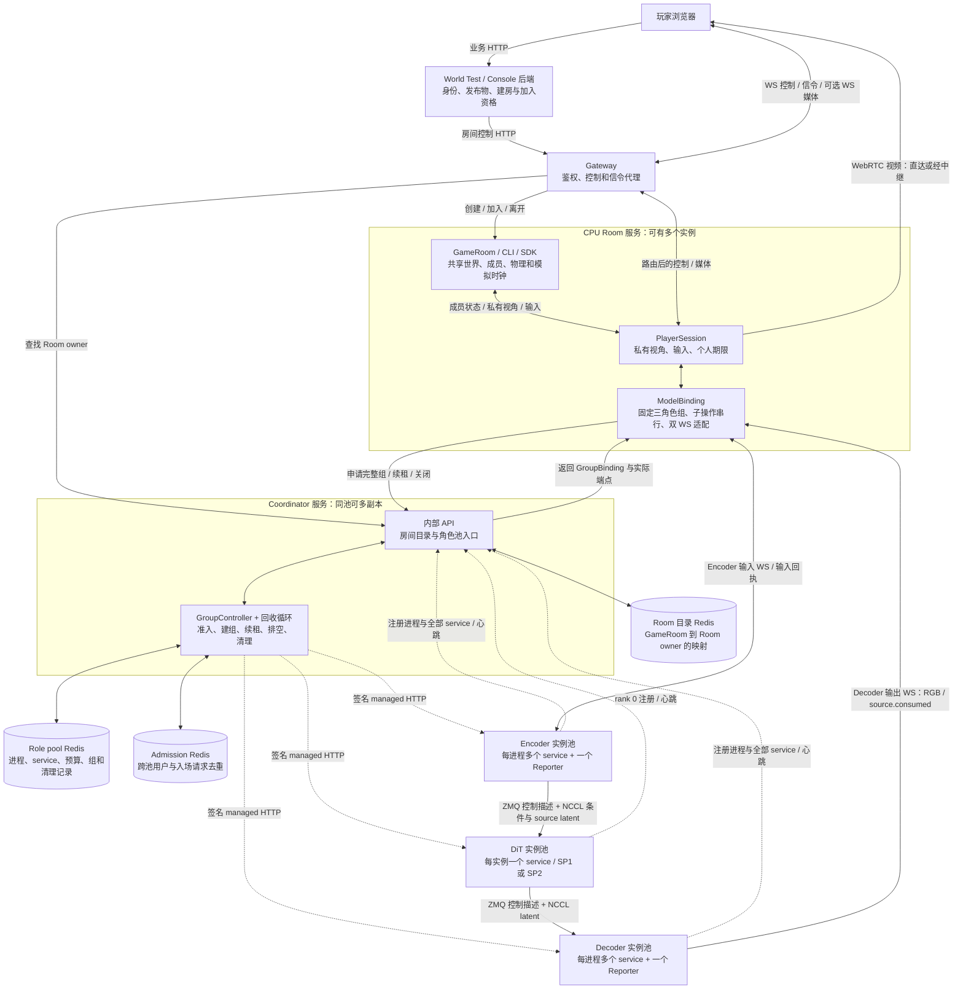
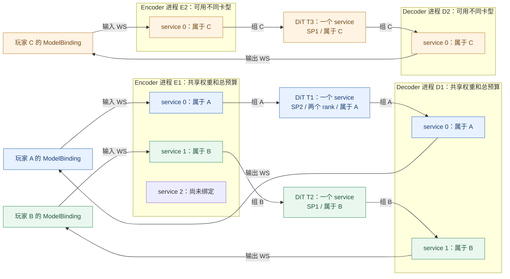
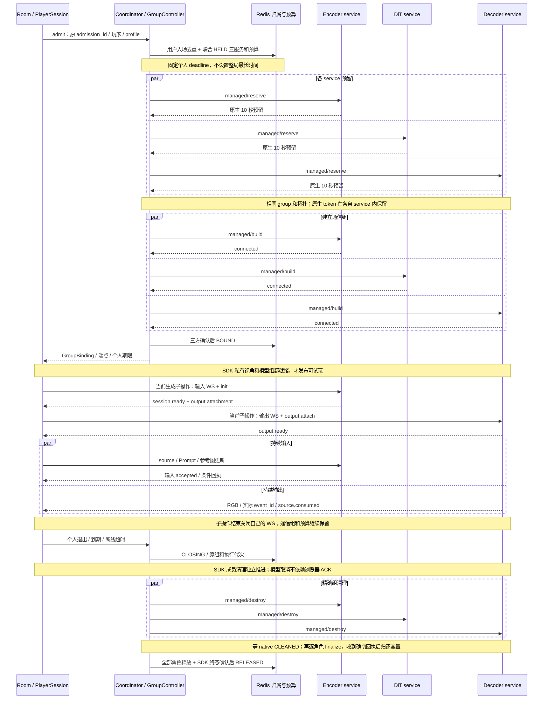

# 最新服务拓扑：Managed 三角色试玩链路

对应本地实现提交 `a0492805f13eb79eceeaf0f54a54ddd701ceaa07`。代码已完成本地测试，尚未部署到线上。本图描述已实现的组件关系，不是上海或泰国当前线上机器清单。角色数量、GPU 类型和配对仅作示例。

配置与能力边界见 [Managed role pool 实现指南](/docs/sglang-diffusion/zing/specs/MANAGED_ROLE_POOL)。

## 1. 总体服务拓扑

实线表示业务调用或数据流，虚线表示模型资源管理。图中服务可以独立部署，分组不表示必须位于同一台机器。

关键边界：

- GroupController 和回收循环运行在 Coordinator 副本内，当前不是额外部署的独立 Master 服务。
- Encoder/DiT/Decoder 通过 Coordinator 注册，由 Coordinator 写入 Redis；角色进程不直接修改分配账本。
- Redis 不保存逐帧 RGB、latent 或模型 KV。Gateway/WTP 不转发 GPU 间张量；Room 直接连接已绑定的 Encoder 和 Decoder。
- 三类 Redis 是逻辑职责，可以按配置共用实例或使用不同实例；同一准入范围内各池共用 admission home。当前客户端固定 Redis primary 身份，不提供透明切主或在线重分片。
- 一个 Coordinator 配置一个 ServingPool；该池的多个副本共享同一权威账本。增加独立池时配置对应 Coordinator/资源域，不把同一进程预算重复登记到不同池。

## 2. 每位玩家如何绑定三种角色

示例中 A、B 属于同一 GameRoom，C 可以属于另一局。所有玩家各有私有视角和逻辑 Model Slot；共享世界不等于共享模型会话。

E1 有三个 service，就有三个 service 注册记录和一份进程记录。如果 E1 的已验证预算只能承载两位玩家，service 2 即使没连接，也不能继续分配。

- 每个 service 同时只承载一个玩家；E/D 进程可以共享模型权重和执行资源，但其 service 各有独立连接与状态。
- SP2 的两张卡/两个 rank 共同形成一个 DiT service；只由 rank 0 注册，不能计为两个 Model Slot。
- 配对在准入时动态选择，不固定 1:2；可以有任意相容且预算足够的进程/service 数量。新增节点参与后续分配，健康活动组保持原配对。
- L1/L2 前缀缓存归 DiT 管理。换段清理动态 KV、latent 和编解码状态；静态前缀只按完整合法 key 复用。

## 3. 一位玩家的建立、使用与释放

ModelBinding 是长期逻辑父绑定，不是一条覆盖全部角色的物理父 WS。当前实现为每次生成子操作建立 Encoder 输入 WS 和 Decoder 输出 WS；换段可重新建立业务 WS，但不重新分配三角色，也不自动拆掉 NCCL 通信组。

显式 Prefill 使用 Encoder 的 Prefill WS，计算/恢复 DiT 前缀缓存，不需要 Decoder 出图；Decoder service 和预算仍为玩家保留。`memory_ready` 与 L2 持久化确认分开，持久化检查在 DiT 侧进行。

## 4. 扩缩与故障处理位置

| 事件 | 负责组件 | 行为 |
| --- | --- | --- |
| 新进程加入 | 角色 Reporter → Coordinator | 模型就绪、manifest 和预算校验后加入候选 |
| 心跳失联 | Coordinator 的候选过滤 | 剔除候选，保留占用和未确认清理记录 |
| 缩减 Encoder/Decoder | Operator → Coordinator → 指定进程 | DRAINING 禁新组；等待现有玩家及在途操作收尾，再由部署管理者停止进程 |
| 用户退出或个人到期 | Room + Coordinator + 各角色本地 watchdog | 精确取消并确认三个角色；SDK 成员独立清理 |
| E/D 共享进程硬故障 | 进程内保护 + Coordinator | 影响其关联组，隔离告警；不自动重启或迁移活动会话 |
| Redis 主身份变化 | 固定 primary 检查与准入屏障 | 停止新操作；外部证据和原生恢复查询完成核对后人工恢复 |

角色数量由部署管理决定；注册/摘流/绑定自动化不等于自动购买 GPU 或启动云实例。CLI `room resume` 仍仅保留扩展位置，浏览器对有效原成员的重连正常保留。
