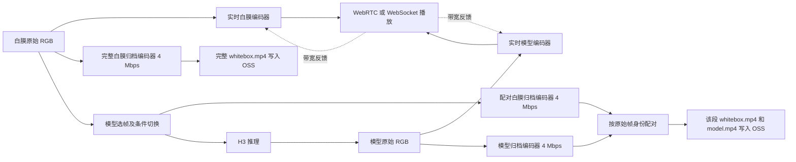

# 白膜与模型独立 4 Mbps OSS 录像方案

日期：2026-10-22。状态：已实现并通过本地发布回归；实际部署版本及端到端验收结论见[发布 PR #394](https://github.com/seedleap/sglang/pull/394)。适用于 Room 单活跃会话的 `whitebox-render-v2`，同时覆盖 WebRTC 和 WebSocket 播放入口。

## 1. 目标与决定

按最新要求，保留全部三类服务端录像，**每类均从原始 RGB 独立编码为 4,000,000 bit/s 目标码率的视频**：

| 文件 | 内容 | 归档码率 |
| --- | --- | --- |
| `streams/<stream_id>/whitebox.mp4` | source 会话完整白膜画面 | 4 Mbps |
| `streams/<stream_id>/segments/<segment_id>/whitebox.mp4` | 与该段模型输出逐帧配对的白膜 | 4 Mbps |
| `streams/<stream_id>/segments/<segment_id>/model.mp4` | 该段模型画面 | 4 Mbps |

**保留 `segments/<segment_id>/whitebox.mp4`，保留段内白膜和 model 的逐帧配对关系。**全部归档编码器不接收 WebRTC 带宽反馈。网络变差可以降低实时播放画质，但不能降低这三类 OSS 视频的编码预算。

4 Mbps 是每路目标码率，约 0.5 MB/s；不是 4 MB/s，也不是三路合计 4 Mbps。使用固定目标 ABR 加 VBV 约束，不随网络调整。简单或静止画面的实际码率可以低于目标，不填充无意义字节来凑足码率。

## 2. 当前实现与改造位置

本次核对基线为线上 Room build #30，源码 `d788e022a6cee930a75cfb6bcfc279263ad48ab0`。实施时重新确认 `white_box` 和线上版本，吸收同期 RTC 改动。

| 当前行为 | 改造 |
| --- | --- |
| 完整白膜在 latest 选帧后，由 `source_playback` 编码并复用于归档 | 在原始帧验证完成、latest 替换之前分流，新增独立 4 Mbps 完整白膜归档编码器 |
| model 的 `playback` 压缩帧同时用于实时播放与归档 | 模型 RGB 校验和条件身份确定后，在实时编码前分流，新增独立 4 Mbps model 归档编码器 |
| segment 的 `record_source` 已独立编码配对白膜 | 保留此职责，改用归档专用的 4 Mbps 配置与编码路径 |
| 归档子进程只接收压缩帧，负责 MP4 封装和 OSS 上传 | 增加有界 RGB 输入与归档编码，继续复用流式封装和上传 |
| segment 使用 `pair`，检查双视频与元数据帧数一致 | 保留配对契约，改为提交两份独立归档编码结果，不再包含实时编码结果 |

源码依据：[RTC 码率反馈](https://github.com/seedleap/sglang/blob/d788e022a6cee930a75cfb6bcfc279263ad48ab0/python/sglang/multimodal_gen/runtime/realtime/whitebox/rtc_transport.py#L350)、[采集和预览](https://github.com/seedleap/sglang/blob/d788e022a6cee930a75cfb6bcfc279263ad48ab0/python/sglang/multimodal_gen/runtime/realtime/whitebox/interactive.py#L501)、[模型分发](https://github.com/seedleap/sglang/blob/d788e022a6cee930a75cfb6bcfc279263ad48ab0/python/sglang/multimodal_gen/runtime/realtime/whitebox/interactive.py#L1227)、[流式归档及完成判定](https://github.com/seedleap/sglang/blob/d788e022a6cee930a75cfb6bcfc279263ad48ab0/python/sglang/multimodal_gen/runtime/realtime/whitebox/stream_recording.py#L98)。

## 3. 原始画面分流与逐帧配对



### 3.1 完整白膜

在 `_produce()` 验证帧身份、附加输入回执之后，为每个接纳的原始白膜帧提交一次归档操作，再发布给 latest 与模型选择器。归档不能接在 `_preview()`、RTP 队列或浏览器接收端之后。

录制范围沿用 source 会话实际采集的起止边界，包含等待模型、模型关闭和 prompt/reference 切换期间的白膜画面。模型因条件重建跳过 source 时，完整白膜录像仍继续记录。

保留原宽高与实际采集帧数，使用 `capture_pts_us` 保存 VFR。不复制帧补成固定 FPS，不按预览 FPS 重采样。若源本身没有产生画面，归档不能制造缺失的真实帧。

### 3.2 配对白膜与 model

配对白膜取自实际选给该模型段的原始 RGB，独立编码为 4 Mbps。不能从完整白膜的 H.264 中任意抽取压缩帧来拼接：两份白膜采用不同选帧序列，编码依赖和帧索引不同。

模型 RGB 校验通过、实际 prompt/reference 版本与 source 身份确定后，分发给归档和实时两条编码路径。归档不等待实时编码或媒体发送成功，不从低码率 H.264 解码后再编码。实时路径仍可按现有策略丢弃过期播放帧。

配对白膜可以在等待模型输出期间先编码，但先将压缩结果保留在有界配对缓存中；只有对应模型归档帧就绪后，才按同一段内视频索引向两个 MP4 和元数据提交。两个归档编码器各自有顺序索引，不使用完成先后顺序配对。

配对键保留 `source_session_id`、`source_epoch`、`source_frame_index`、`segment_id`、`segment_epoch` 和 `model_source_frame`，并校验 `capture_pts_us`。两个视频的第 i 帧必须来自同一份已选 source，PTS 相同。只提交给推理、但没有有效模型输出的尾部 source 不单独写进配对白膜视频；取消或缺失输出按实际执行结果和缺失范围报告，不能包装成正常完整结束。

配对视频的封装时长统一按下一张成功提交的配对帧 PTS 确定，尾帧两路使用同一 EOS 时长规则。提前编码携带的 duration 仅为暂定值，不能用最终未配对的后续 source 帧决定白膜尾帧时长，导致两个视频帧数、PTS 相同却总时长不同。

沿用现有受限模型输入窗口和配对容量作为缓存边界，新增压缩字节上限与最大等待时间。保留推理身份、输出窗口和有效尾帧验证；不能把归档编码或 OSS ACK 变成释放推理 credit 的必要条件。视频归档无法接纳时按第 5 节降级并回收对应缓存。

### 3.3 时间线与条件更新

完整白膜与模型段帧数通常不同；同一段的配对白膜与 model 帧数相等。继续使用原始采集微秒时钟和既有 `states.jsonl` 中的 source provenance，不重置或压缩条件切换造成的时间空洞。

`render.start/stop` 决定段边界。同段 prompt/reference 更新保持原文件，输入与状态元数据记录实际生效的条件版本和 reference 内容身份。两路配对帧共享同一条件快照，不能读取后续被覆盖的全局状态。

RTC 重连不重启归档编码器、不重置录像索引；新 source 或新 segment 使用新的身份和编码器。每个 MP4 以 IDR 开始，正常结束 drain 后写出尾帧；帧时长根据下一帧 PTS 确定，EOS 尾帧沿用明确的上一间隔规则。

## 4. 三路归档编码配置

使用独立归档配置，禁止把实时的 `WHITEBOX_SOURCE_MAX_BITRATE` / `WHITEBOX_PLAYBACK_MAX_BITRATE` 当作归档预算。以下环境变量已在 Room 配置中实现；只对新会话生效：

```text
WHITEBOX_ARCHIVE_ENCODING=independent-rgb-v2
WHITEBOX_ARCHIVE_SOURCE_BITRATE=4000000
WHITEBOX_ARCHIVE_PAIRED_SOURCE_BITRATE=4000000
WHITEBOX_ARCHIVE_MODEL_BITRATE=4000000
WHITEBOX_ARCHIVE_RATE_CONTROL=abr
WHITEBOX_ARCHIVE_VBV_BUFFER_MS=2000
WHITEBOX_ARCHIVE_KEYFRAME_INTERVAL_MS=1000
```

| 编码项 | 三路统一设计 |
| --- | --- |
| codec / 容器 | H.264 / fragmented MP4，继续使用已有 OSS 上传流程 |
| 目标码率 | 每路 4,000,000 bit/s |
| VBV | 每路 maxrate 4,000,000 bit/s，buffer 8,000,000 bit，独立于 RTC |
| 码率控制 | 显式 ABR；不能只设 maxrate、保留当前 CRF=18 后就声称启用了 4 Mbps 目标编码 |
| 像素格式 / preset | yuv420p / veryfast；首版保持 baseline 及 B-frames=0，减少播放兼容和时间戳变化 |
| 关键帧 | 首帧 IDR，按采集时间约 1 秒强制 IDR；长间隔后的首帧为 IDR；不受 RTC PLI 影响 |
| PTS / 尺寸 | 沿用实际 source capture PTS 和原始宽高；不通过改 FPS 或分辨率控制归档成本 |

首个归档 H.264 包会检查 x264 的实际码率控制、bitrate、VBV maxrate 和 bufsize，未生效则明确失败。x264 将 ABR 且 maxrate 等于目标值的组合标记为 `rc=cbr`；manifest 分别记录配置语义 `rate_control=abr` 与实际 `x264_rate_control=cbr`，不启用填充字节。目标码率、VBV 约束、实际每 10 秒码率分别记录。简单场景实际码率低于目标不构成网络降码率；验收重点是预算独立、原始输入一致和画质。单位及编码选项依据 [FFmpeg libx264 文档](https://www.ffmpeg.org/ffmpeg-codecs.html#libx264_002c-libx264rgb)。

4 Mbps 是压缩预算，不是无损承诺，也不保证不同分辨率、纹理复杂度下画质完全相同。480 和 736 两档均先按每路 4 Mbps 设计，分别验收。

## 5. 进程、资源与失败边界

### 5.1 有界归档进程

沿用 source 和 segment 各自的归档子进程：source worker 运行一个完整白膜编码器；当前 segment worker 运行配对白膜、model 两个编码器。编码后继续复用 MP4 封装和 OSS multipart，Room 主事件循环只负责有界入队。

RGB 用共享内存槽位传递，描述符包含身份、时间戳和元数据，不把整段原始视频留在内存。初始预算如下，实施后需实测验证：

| 资源 | 初始边界 |
| --- | --- |
| RGB 槽位 | 每路最多 8 帧且最多 32 MiB，按实际 `width × height × 3` 取更严格上限 |
| 三路 RGB 总额 | 同一 Room 最多 96 MiB，包含未释放的收尾槽位；不含编码器内部缓存、配对压缩缓存和上传缓冲 |
| RGB 排队时间 | 最多 1 秒；容量或时间任一超限触发归档降级 |
| 配对压缩缓存 | 沿用当前配对帧数/时间预算，另以实际 AU 大小计费；首版最多 32 MiB，不能复制为无限等待队列 |
| 上传 | 复用当前 8 MiB 分片、每个 worker 32 MiB 上传缓冲 |
| worker 上限 | source、当前段、一个收尾段合计最多 3 个；上传在途缓冲合计最多 96 MiB |
| 编码线程 | 每个编码器初始 1 个 x264 线程；按实测核对 Room CPU 配额 |

RGB 池、压缩缓存、未满分片、元数据与上传缓冲都计入 Room 总预算。上述 96 MiB 上传在途缓冲不包括每个未满分片；原有对象缓冲上限仍须保留并单列高水位，不能把几个局部上限误认为进程总 RSS。

槽位描述符包含 worker generation、slot generation 和完整会话身份。消费确认后才能复用，迟到 ACK 不得释放新一代槽位。取消、worker 崩溃和重连必须回收资源。source 与配对白膜分别编码，RGB 若使用共享槽位复用，必须计数所有消费者；首版允许有界独立拷贝以简化所有权。

### 5.2 模型段切换

结束旧段时先停止接收新 RGB。已处理的命令均确认后，worker 解除共享内存映射并发出 `rgb_released` 回执，父进程回收 RGB 池；codec 保留的一帧已在 worker 私有内存中。随后 drain 编码器、配对缓存和封装器并释放编码器，完成有界上传。共享 RGB 释放不等待 reference 确认或 OSS 网络收尾。收尾 worker 仍占用一个 worker 名额，不能因其已停止编码就隐去上传资源占用。

新段开始前同时检查 worker 名额、RGB 总额、配对预算和 CPU 容量。已有一个旧段仍收尾而资源不足时，立即返回可重试的归档容量错误，例如拟新增 `ARCHIVE_CAPACITY_UNAVAILABLE`，不创建第四个 worker、不隐藏排队等待 OSS。现有 source 和已运行模型不受影响。新段准入拒绝与已运行视频归档故障是不同场景。

独立归档 worker 在容器已有 CPU affinity 范围内分配不同 CPU，避免三个编码器挤在旧版同一归档核心；不新增 CPU 配额。单活跃会话不代表无收尾重叠，必须测试连续快速启停和慢 OSS。所有参数只在新会话开始时生效，不在录制中途切换码流配置。

### 5.3 已运行时的故障

不通过降低归档码率、自动降分辨率或静默跳帧消化压力。RGB 队列满、编码超时、配对失效或上传持续失败时，受影响归档标记 `partial` 或 `failed`，保留有效前缀，记录首个缺失帧、最后共同配对帧和原因。

配对段任一路编码失败即停止该段两路归档继续接收，不能让一份 MP4 继续增长却宣称配对完整。若封装第二份视频失败，按最后共同成功位置报告，不能把“成对提交”当成两个 OSS 对象的原子事务。完整白膜与模型段归档分别报告状态。

正在进行的实时试玩可继续，视频归档故障不伪装成 `RTC_CONNECTION_FAILED`。视频编码与上传 ACK 只管理归档资源，不要求 H3 或 RTC 等待 OSS。正常结束先 drain、封装尾帧，再完成 multipart 并确认对象；沿用有界 finish 期限。上传成功不等于内容完整。

**reference 资产确认是另一条约束。**现有 reference 更新需要确认图片持久化后才能应用，不能用“视频归档失败不阻塞”绕过这一步。动态 reference 确认逐张使用 worker 内单独的上传线程，最多两个在途确认任务、每图 8 MiB，媒体命令继续处理；收到持久化回执才允许切换。若视频失败但资产确认通道仍可用，按原约束继续；若 worker 整体退出或 OSS 故障导致资产确认不可用，新 reference 更新应有界失败、保持旧条件、返回稳定的控制/资产错误，不盲目接受未保存版本。键盘和已有条件的实时画面可以继续；本方案不承诺存储完全失效时仍能成功切换新图。

## 6. OSS 布局与接口兼容

保留现有视频路径和段内配对，每个模型段独立完成双视频与元数据校验。

```text
streams/<stream_id>/
  manifest.json
  whitebox.mp4                    # 独立 4 Mbps，完整 source
  inputs.jsonl
  states.jsonl
  source-states.jsonl
  ui_bundle/...
  segments/<segment_id>/
    manifest.json
    whitebox.mp4                  # 独立 4 Mbps，配对白膜
    model.mp4                     # 独立 4 Mbps，模型画面
    inputs.jsonl
    states.jsonl
    references/...
```

source 保持 `recording_kind=source`、`timeline.alignment=source_timeline`；segment 保持 `recording_kind=render_segment`，完整时为 `one_to_one`。segment 的两个视频帧数、索引、PTS、输入覆盖范围与状态行应一致；完整 source 则以实际接纳的采集帧数检查。不能只比较两个 MP4 同帧数而忽略两者都漏掉的输出。

manifest 通过新增 `archive_encoding_version=2` 标识独立编码，保持已有布局/schema 可读。每个视频的编码元数据设为 `reused_playback_bitstream=false`、`network_adaptive=false`，明确 `rate_control=abr`、target/max bitrate、VBV、编码版本、payload 字节数和时长。去掉不适用的 CRF 字段，避免 manifest 写着 4 Mbps 而实际复用实时流。

报告继续枚举原有三类视频；`videos[].encoder` 返回实际编码配置与校验结果，顶层 `archive_encoding_version=2` 表示独立归档。视频 manifest 还记录 `first_pts_us`、`duration_us` 和 `measured_payload_bitrate`，输入区间尾时间与 MP4 尾时长一致。Token、票据、input、prompt/reference 消息及客户端现有录像路径保持兼容，客户端无需为本改造更换接入接口。历史低码率录像保持原样并据实展示，不能靠重新转码声称恢复细节。

服务端 MP4 保存白膜/模型图像，浏览器叠加的 UI 继续通过 UI bundle、状态和输入回执归档。客户端屏幕录像或 UI 合成录像若另行上传，不能因本改造自动标为服务端 4 Mbps 原始画面归档；高质量 UI 合成母版需另行使用归档视频和状态渲染。

## 7. 容量与实施范围

按三个视频都录满 5 分钟、实际平均码率接近目标估算，不含容器、reference、UI 和元数据：

| 项目 | 估算 |
| --- | ---: |
| 每路编码数据 | 0.5 MB/s |
| 每路满 5 分钟 | 150 MB，约 143 MiB |
| 三路满 5 分钟合计 | 450 MB，约 429 MiB |
| 三路同时归档上传 | 约 12 Mbps，建议实测可持续上传吞吐至少 18 Mbps |

实际大小按 `0.5 MB/s × (完整 source 秒数 + 2 × 各模型段秒数之和)` 估算。等待期间完整白膜可能超过 5 分钟，450 MB 不是单会话硬上限；继续保留单录制大小、最长生命周期和内存预算。

模型活跃时，当前有实时白膜、实时 model、配对白膜三个编码器；改造后为两个实时编码器加三个归档编码器，合计五个，净增两个。配对白膜从原预算升至 4 Mbps，完整白膜还要覆盖全部采集帧，必须实测 CPU，不能仅按编码器数量估计成本。

优先使用 Room CPU 子进程，核对 CPU quota、throttling、RSS、IPC 拷贝和上传余量。本方案不使用训练任务 GPU；CPU 不足时先明确 Room CPU 容量需求，不回退为实时低码率流归档。

| 范围 | 修改内容 |
| --- | --- |
| `session.py` 与归档编码器 | 新增三路独立码率配置、ABR/VBV、实际参数记录；归档对象不暴露 RTC 调码率接口 |
| `interactive.py` / `render_source.py` | 完整 source 在 latest 之前分流；模型 RGB 在实时编码前分流 |
| `render_segment.py` | 保留配对白膜职责，切换为 4 Mbps 归档编码；保留帧身份与条件映射 |
| `stream_archive.py` / `async_recording.py` | RGB 有界槽位、描述符、worker 生命周期、取消回收与错误隔离 |
| `stream_recording.py` / `recording.py` | 子进程独立编码、成对写入、drain、实际完整性和 manifest |
| `reports.py` 与 WTP | 保留视频入口，展示归档失败和编码参数，兼容历史录像 |

从实施时最新 `white_box` 派生隔离 worktree，合入当前 RTC 修复后执行回归。先更新读取兼容与配置验证，再只对新会话开启独立归档。回滚停止新建独立编码会话，正在录制的文件保持原配置收尾，不覆盖历史 OSS 对象。H3 算法、reference 上限和训练任务不在本改造范围内。

## 8. 验收标准

1. 固定同一 RGB 序列和编码配置，分别注入正常与极低 RTC 带宽反馈。实时编码预算变化；三个归档实例目标始终为 4,000,000，均不收到 RTC 调码率或关键帧请求。同平台确定性测试可比较归档 AU 哈希；实际游戏验收按参数、帧身份和质量统计比较。
2. 主动触发预览替换帧、RTP 丢帧或 WS ACK 延迟，完整白膜仍覆盖全部接纳 source；segment 两视频覆盖全部有效模型输出，成对索引、PTS 和状态一致，无静默漏帧。
3. 完整运行 5 分钟，包含移动、UI actions、模型启停、prompt/reference 联动更新和 RTC 重连。检查三类文件可播放、尺寸不变、首帧 IDR、尾帧、条件版本和 source 身份。视频间的差异必须能由选帧与实际输出解释。
4. 覆盖快速切段和慢 OSS：最多三个 worker、RGB/配对/上传总额有界，旧段释放与迟到 ACK 正确；资源不足时新段明确拒绝，既有会话不被中断。
5. 注入 RGB 队列满、编码进程退出、配对一侧失败、OSS 中断和收尾超时。归档如实标记 partial/failed，实时旧条件可继续，不降码率、不无限积压、不污染下一会话。新 reference 确认失败时保持旧条件，不误报 applied。
6. 检查报告、下载和历史录像兼容；三份文件的元数据与实测编码相符，不能只修改 manifest 中的码率字段。

质量与性能按仓库要求分别覆盖 **480 和 736** 两档，记录实际宽高。固定模型、硬件、输入轨迹、条件更新与源码做改动前后对比；不能用 720 替代 736，也不能从一档外推另一档。

每份 OSS 视频检查解码错误、与原始 RGB 对齐的质量指标、人工画面、每 10 秒实际码率、帧数、PTS、关键帧间隔与尾部完整性。加入复杂运动/纹理和静止场景，区分正常 ABR 波动与错误调码率。

报告包含原有 TTFF、E2E、FPS、TPOC、ICL（可采集项），以及三路归档编码 P50/P95、实时编码 P95、Room CPU/throttling、RSS、槽位高水位、配对等待、上传吞吐和结束耗时。目标：正常场景零归档漏帧；同条件实时 FPS 不下降超过 5%，source-to-output P95 不增加超过 10%。这是拟定发布门槛，不是已取得的测试结果；baseline 波动过大时需重复测试并报告区间。

先完成离线回归，再在空闲单会话服务验收；不抢占进行中的试玩，不重启无关推理或训练任务。

## 9. 本地实现验收

新增 `test_whitebox_independent_archive.py` 验证 832×480 与 1280×736 实际编码/解码、采集时间控制、三类录像、双视频尾时长、共享内存过期回执、真实子进程与本地 OSS 协议、参考图上传阻塞期间持续归档、满槽降级与下一会话复用、连续四段及条件更新。新测试已纳入 Room 镜像构建检查。

本地发布回归覆盖归档、source/segment 生命周期、报告、输入控制及 RTC 兼容。对应原始日志与线上验收结果在发布 PR 中维护；CPU 编码验证不能替代真实 H3 端到端性能结论。WebRTC 编码预算与恢复策略文件保持当前部署基线不变。
