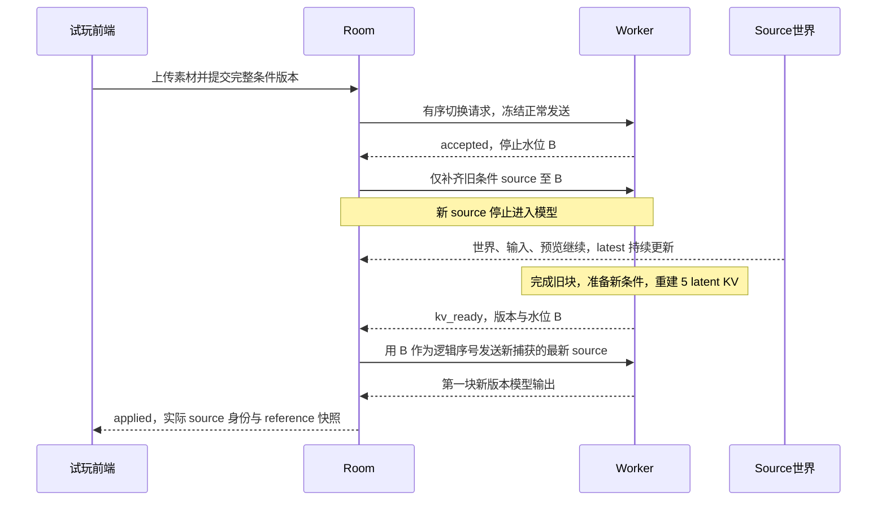

# 白模 prompt/reference 联动切换与 source 跳帧方案

日期：2026-10-21。状态：独立 worktree 已实现，正在回归，尚未部署。已集成 main 的完整 reference 与固定 5 latent 路径；本轮没有新增 GPU 实验。下面保留设计依据，并以本节实现说明区分已经完成与部署验收待办。

当前实现：WTP 当前段联合更新、21 图逐图上传、Room 有序版本与 clip 屏障、无未来 source 的控制 dispatch、KV-ready 后 fresh capture 恢复、按 event 归档 reference、归档写入确认、暂停计数与结束唤醒。`deploy/whitebox/model_service.py` 显式传递可配置的 `--zing-reference-max-images`（默认 21），准备配置固定 5 latent；没有离线表时显式保留原白模部署的 resident AdaLN 路径。

实现边界：素材在一个 source 会话内有界保留（192 MiB、512 项），不增加逐候选驱逐/引用计数器；已经存储的内容可通过 SHA 去重。未知的 worker 切换结果按有界超时结束模型段，暂未新增 worker 状态查询/重放接口。主线新 Lynn decoder 按有效像素范围释放尾帧；恢复仍要求已协商能力和至少一个完整 clip 的输入窗口。实际 GPU 峰值、21 图真实素材准入、切换时延与画质必须在部署测试中核验。

用户指定发布依赖：须等待 Codex 会话 `01a13a2b-6b71-7170-be2f-38e951f143a2` 结束，重新核对其最终版本后，才能合并共享分支并部署测试。

## 1. 建议与预期效果

建议在**同一个模型段内，把完整 prompt 和 reference 集合作为一个版本切换**。推理服务显式启动参数使用 `--zing-reference-max-images 21`，通过实际能力协商把数量限制传到 Room 和试玩前端。

对切换期间的 source，采用**完整编码块边界上的暂停收帧、重建完成后取最新帧**：白模世界、按键处理、source 预览和 source 记录继续；只暂停 Room 向该模型段选取、提交新的 RGB。已经送入模型的帧按原身份完成，不清空已接纳队列。切换完成后从当前最新位置继续，省去补算暂停期间的旧画面。

这一方案消除的是**切换后追赶旧 source 的额外延迟**。Qwen/reference 编码、KV 重建、恢复后收集新块和推理仍需要时间；模型画面会暂时停在上一帧，随后跳到较新的场景。它不能保证模型画面始终连续运动，也不能把计算停顿变成零。UI 默认保留用户当前 A/B 选择，并显示“正在更新画面”；不自动把白模画面标成模型输出。

不能用固定 `sleep(1)`、跳过固定 30 帧或只清浏览器缓冲来实现。reference 数量、图片大小、模型历史和计算配置都会改变实际耗时。推荐用 worker 完成信号驱动恢复，分别记录真实的准备、KV 重建、source 暂停和首画面时间。

## 2. 证据基线与当前实现

原会话：[分析白膜视频分辨率下降](codex://threads/01a13a2b-6b71-7170-be2f-38e951f143a2)。该会话仍在迭代 RTC，因此下表固定源码提交，不把工作树 HEAD 当作 GPU 线上版本证明。

| 基线 | 固定提交 | 用途 |
| --- | --- | --- |
| SGLang main | `18d7e0cd9295d0c8c7a0ef19d6dd58f222eb5ad3` | #317 完整 reference 更新、数量配置；包含 #373 固定 5 latent 重建 |
| 当前白模工作树 | `7014d88b3f9ad1dd94a6a35c44896971d0b465c0` | Room、render segment、source 选择、ordered prompt 协议、RTC |
| 当前 WTP 工作树 | `fd723d21ea8f33a7f71e9d53458cc283fa711120` | 试玩 UI、素材上传、prompt.replace 客户端 |
| 已读取的 H3 部署记录 | `a82df6ffacf5e8387912a63d14d38100c5e30b1c` | 既有两卡 Encoder + 两卡 DiT/Lynn、prefix 20,480 等配置线索；实施前必须重新核对线上 |

main 和白模分支共同祖先为 `0dafc687b02cc6e63c1078d91116fc89e04fad7d`。本次仅 fetch 并读取 main，没有 merge、rebase 或切换工作树。

### 2.1 main 已提供什么

- [#317 合入](https://github.com/seedleap/sglang/commit/18d7e0cd9295d0c8c7a0ef19d6dd58f222eb5ad3)：后续 `kind="prompt"` event 可同时携带完整 prompt 和完整 `references` 图片列表；图片是 MessagePack 中的 PNG/JPEG/WebP 原始字节。
- `references` 缺省表示沿用 worker 接纳该事件时的 active 集合；`[]` 表示清空；非空列表表示完整替换；`null` 无效。只换图时发送相同 prompt 和新的 event ID。
- 显式换图重新准备整组图片、Qwen 条件及全部 reference VAE latent。首版没有相同图片 latent 复用，不能把同 ID 当作相同内容。
- worker 在候选容量校验成功后保存完整候选；重建成功才发布新 active。可恢复的候选错误不应用新 prompt 或新图片；旧 KV 已清空后的未知失败必须结束模型会话，不能声称自动恢复旧 KV。
- `session.ready` 声明 `prompt_reference_updates`、`max_references`、编码/解码字节等能力；普通 ACK 只表示接纳，实际生效仍由输出 event/version 证明。
- [#373 合入](https://github.com/seedleap/sglang/commit/d3fb4d3ed556fa2bb5bcfd869b5c8acf9046d06f)：固定最近 5 个 clean target latent，按 `1+2+2` 重建历史 KV；不再支持关闭此机制，也不保留旧 donor 路径。

**5 latent 是 VAE 时间维的 5 个 latent，不是 5 张视频帧。**重建保留历史 latent 的数值，重算它们在新条件下的 KV，不重新输出这段历史视频。标准编码几何是 17 个 source 像素帧对应 5 个 latent，但任意滑动历史不能直接用 `5/FPS` 换算时间。

### 2.2 白模接入还有哪些缺口

| 当前位置 | 已核实行为 | 所需变更 |
| --- | --- | --- |
| `WhiteboxPlaytest.tsx` | 显示参考图数量 `/9`；当前段按钮只更新 Prompt；参考图在新段生效 | 当前段提交 prompt + 完整 references；显示实际能力和版本状态 |
| `whitebox-client.mjs` | `uploadReferences()` 限制 9 张、集合 8 MiB；`updatePrompt()` 不带图 | 动态能力校验、先上传后原子提交、上传期间锁定本次草稿 |
| `render_source.py` | `session.ready.capabilities` 固定 9 张/8 MiB | 声明 Room 与实际 worker 的有效交集 |
| `render_assets.py` / `render_contract.py` | 集合限制 9 张/8 MiB；素材已有 SHA-256 内容身份 | 放开数量与集合预算，复用素材身份并加入候选 pin/释放 |
| `RenderJournal.prompt()` | FIFO 版本队列、CAS、strict/at_or_after、重连幂等；只保存文本 | 每个版本绑定完整条件快照与 source 暂停策略 |
| `RenderSegment` | 要求 `source_prompt_protocol="ordered-boundary-v2"` | 保留这个协议和边界语义，并扩展 reference/切换状态 |
| 白模 adapter | 接收 `kind="prompt.update"`，payload 含版本和最早 source 边界 | 融合 main 的候选准备、图片校验和原子发布 |
| main adapter | `kind="prompt"` + 顶层 references，pending 使用 latest-wins | 不能直接替代白模的 FIFO 协议，也不能静默丢掉图片 |
| `_generation()` / `model_output_condition()` | `_generation()` 开始时固定 `refs`；后续仅按 event 切换文本 | 输出和录像必须按实际 event/version 选择 reference 快照 |

白模已有一层持久化、有序的控制契约。推荐将 main 推理实现作为集成基线，保留白模有序控制的必要差异。两个入口可以复用同一个内部候选准备函数；不把 Room 已承诺的顺序更新改成 latest-wins。每次仍只向 worker 交付一个在途条件版本，之后的版本等前一个出现实际输出再推进。

## 3. reference 容量与接口

### 3.1 启动配置和能力协商

推理服务现有启动命令追加以下**已实现参数**，其余模型/并行/采样配置保持显式核对：

```text
--zing-reference-max-images 21
```

CLI 显式值优先于 pipeline JSON；没有 CLI 时保留 JSON；都没有时 Zing 默认 21。0 表示不接收 reference，负数和非法整数在启动阶段拒绝。参数只改变服务允许的数量及由它推导的 ingress 预算，不是逐请求申请显存的参数。

实施时贯通启动器、API、模型 worker 和独立 conditioning RPC 服务配置，读取实际 `session.ready`，至少确认：

```text
max_references = 21
prompt_reference_updates = true
source_prompt_protocol = ordered-boundary-v2
source_condition_switch_protocol = clip-barrier-v1  # 本方案拟新增
```

缺少新增能力的旧 worker 继续提供已支持功能；前端禁用当前段换图/主动跳帧入口并返回明确能力提示。不能假设未知字段已被处理，更不能降级成只改文本。Room 初始声明若尚未绑定 worker，只能作为预检查；绑定后的模型段能力才是提交依据。

`clip-barrier-v1` 在模型段初始化时协商，在该 generation 内要求**所有条件更新**都遵循完整 clip 边界，包括只改 prompt 的更新。不能先走任意 native 边界的旧切换，再临时打开 clip 屏障：旧切换可能改变模型全局 latent 相位，使模型块边界与 Encoder 的 5-latent clip 结束点不再相交。已有未协商的活跃模型段保持原能力，用户下次主动启动模型段时采用新契约；不自动打断或重开旧段。

### 3.2 图数、字节和显存是三类限制

main 的 `ReferenceLimits(N)` 默认预算为：reference 编码字节 `N×64 MiB`、reference 解码 RGB `N×48 MiB`，媒体名额 `N+1`。N=21 时分别是 1,344 MiB、1,008 MiB 和 22 个媒体名额；source 展示及保留的其他媒体也占总媒体名额。显式较小的 WS、RPC、RGB 预算仍生效。

**不建议据此把试玩链路的所有消息上限直接放到 1.3 GiB。**本方案首版建议平台允许 21 张，每图沿用当前 8 MiB，单次完整集合上限先定为 64 MiB，实际有效上限取平台与 worker 能力的较小值。64 MiB 是提案中的平台集合预算，并非 main 的现行集合默认值；超出该预算应明示拒绝，后续可依据真实素材调整。

已有 `asset.upload` 逐图上传与 `sha256:` 素材 ID 可以复用：浏览器至 Room 保持单图有界消息；Room 至 worker 的完整集合消息允许所需大小并保留 prompt/MessagePack 封装空间。分别核对 `render_host`、`room_proxy`、websocket 客户端、模型传输和 conditioning RPC 的限制，不能只修改 UI 的数字。上传与控制发送串行有界，图片上传可能占用连接时间，应在暂停模型收帧之前完成，不在每帧元数据中重复发送图片。

素材存储增加基于 active、已排队候选、上传中草稿和归档在途引用的 pin。队列的总素材字节数有独立上限，多个 64 MiB 候选不能无限累积；容量不足在接纳前拒绝，不通过清理 active 素材腾空间。已归档历史素材保留，释放内存引用不等于删除录像证据。具体 host 预算由实际内存配置确定，不能把单组 RGB 限额当作整个进程峰值。

### 3.3 21 图的 KV 容量前提

既有 H3 记录中 `zing_kv_pool_max_prefix_rows=20480`。main 所附**另一个配置的历史案例**中，21 图/480p 的新 prefix 为 22,479 行，高于该值；该案例 9 图为 13,011 行。它说明当前池可能拒绝一组合法的 21 图，并不意味着所有 21 图必定需要同样容量。

必须按实际 prompt token、每图 Qwen/VAE resize bucket、reference 顺序和运行档位测算 prefix，并计入 5 latent 历史及后续目标/source 所需 slot。先做容量准入和单活跃会话峰值验证，再决定池参数。不要直接照抄历史案例的显存数：该案例使用旧 donor workspace，#373 已移除它；硬件、四步采样与当前四卡拆分部署也不同。

main 同期 #374 默认要求 offline AdaLN 表；既有部署记录是旧配置。集成必须核实与当前 checkpoint、timestep/shift、采样计划匹配的表，不能把“合入 #317 + 加一个 flag”当作完整可部署变更。

### 3.4 平台原子更新契约

保留 `prompt.replace`、`prompt_version`、`expected_prompt_version`、segment/source epoch 和 `request_id`，将这个版本解释为 prompt 与 reference 的联合条件版本，无需再创建一个独立图版本计数器。

以下是**提案字段**，当前白模尚不支持：

```json
{
  "type": "command",
  "op": "prompt.replace",
  "request_id": "<unique-request-id>",
  "source_session_id": "<source-session-id>",
  "source_epoch": "<source-epoch>",
  "segment_id": "<segment-id>",
  "segment_epoch": "<segment-epoch>",
  "expected_prompt_version": 3,
  "prompt_version": 4,
  "prompt": "Use the appearance from <Picture 1> in the rainy scene.",
  "references": [
    {"id": "<Picture 1>", "asset_id": "sha256:<image-content-sha256>", "role": "scene"}
  ],
  "effective": {"source_frame_index": 1234, "policy": "at_or_after"},
  "source_policy": "skip_during_switch"
}
```

- 提交前复制本次文本和图片列表；上传成功后用同一份草稿提交，后续编辑不能混进本次请求。上传失败则不发更新。
- 同 prompt 换图合法；引用 ID 和列表顺序与 prompt 内容保持一致。不能只对 prompt 文本做去重。
- 缺省 references 是文本更新；Room 在该 FIFO 候选实际交付时绑定已生效 references，不继承未生效候选。显式 `[]` 清空，`null` 拒绝。
- Room 先解析素材归属/摘要、校验数量和预算、pin 候选并写入原有 journal，再回 accepted。相同 request ID 和内容重复请求返回原操作；同 ID 不同内容冲突。候选轮到交付时，先取得模型段归档所需素材的写入确认，再开始暂停和发送给 worker，避免模型已经切换而录像引用的图片尚未存好。
- Room→worker 保留有序 `prompt.update` 的版本/边界字段，新增可选 references 编码字节。main 的 `prepare_reference_upload`、`prepare_reference_update` 和候选准入逻辑复用；不把平台 `asset_id` 传给不认识它的 worker。
- `accepted`、`kv_ready` 和 `applied` 分别表示接纳、模型新条件已就绪、出现真实新版本输出。前端不能在 ACK 时显示“更新已生效”。

## 4. source 跳过策略

### 4.1 已经存在的 latest 行为与不能删的帧

Room 的 `LatestFrame` 只保存最新 source 帧；模型发送循环先等 credit，再调用 `latest.get(cursor)`，已经会跳过尚未选取的中间帧。但预取窗口中的帧已进入 Room pairing、API ledger、独立 Encoder 或 sampler，在 KV 重建期间仍可能形成旧画面负担。

当前强约束包括：`source.append.client_seq/source_frame_start` 连续；`source.accepted/consumed` 水位有序；输出 `output_frame_start` 连续；`source_alignment` 完整；Room 每个已选 source 恰好对应一个 model 输出/归档位置。直接删除 accepted/pending/encoded 队列，或恢复时把模型 local index 跳过几十帧，都会破坏这些约束。

因此，把丢帧点放在 **Room 选择 source 之前**，通过发送屏障确保重建窗口没有新 source 入队。source 世界的原始帧号和 capture PTS 可以前跳；提交给 SGLang 的逻辑序号继续连续。

### 4.2 为什么单加暂停开关不够

main 的 `_activate_pending_prompt(ready)` 只在下一 `ready.model_chunk` 为 chunk 3、局部 latent start 为 5 时执行，入口在 `_step()` / `drain_ready()`。adapter 的 `wait_for_next_chunk()` 也主要等待 source 或 `more_work`。

若 Room 停 source 并等待“新 prompt 第一帧”，worker 会等下一 source 才能触发重建；双方互等。若先让下一块 source 入队再暂停，重建后的第一块就仍使用暂停前的旧画面，达不到恢复后直接选最新帧的目标。

本方案需要一个小而明确的模型控制能力：**在已完成旧块的安全边界，允许没有新 source 的控制 dispatch 完成候选准备与 KV 重建。**这是新增实现要求，main 目前没有现成的 `kv_ready` 屏障。

### 4.3 推荐屏障：完整 clip 边界

首版选择完整 source codec clip 边界，降低清理半个 Encoder clip、桥接 latent 和跨块 lookahead 的复杂度。标准几何为 clip17/latent5，Encoder 在每个完整 clip 后清理其局部 causal cache。使用共享几何函数计算边界，避免 Room 硬编码另一套规则。

初始 `1+2+2` 以及之后 `3+2` 都在 5 latent 结束；每次切换仍在这个结束点重建并重新从 `3+2` 继续，因此在初始化协商的新契约下可保持全局相位对齐。计算 B 时仍须断言实际几何和相位，不能只因帧号能被 17 整除就认定安全。

顺序如下；`A`、`B` 都是**模型逻辑 source 的 exclusive 水位**，不是世界帧号：

1. **准备上传。**浏览器/Room 先完成图片上传与基本校验，此时原模型照常运行。轮到候选交付时才开始下述屏障。
2. **冻结正常发送。**Room 在现有 source 发送序列器内关闭正常选帧；把正在处理的 source send 完成并计入 `A=sent_end`，或在尚未获得身份/预算前撤销，不能遗留隐含在途帧。之后发有序切换请求，和 `source.append` 共用事件序号与 wire lock。
3. **worker 预留停止水位 B。**以实际 accepted 水位、已有计算依赖、旧 prompt 的合法块边界和历史要求计算下一个完整 clip 结束点。对已稳定运行且上述约束满足的 clip17 链路，通常是 `B=17×ceil(A/17)`；初始历史不足时至少推进到完整 5 latent。worker ACK 返回 B，A/B 不一致或 B 无法满足依赖时拒绝，不让 Room 自行猜测。
4. **有界补齐旧块。**Room 仅再发送逻辑 `[A,B)`，每次仍从 fresh latest 选帧，通常最多 16 帧；这部分明确归旧条件。worker API 和独立 Encoder 预取同时禁止接纳 `>=B` 的新 source。若已存在不可撤销的更远依赖，预留 B 前必须纳入，不能事后丢帧。
5. **完成旧计算并停在 B。**Encoder 结果、bridge 和 sampler 中 B 之前的工作全部转交并 clean commit，最近 target 历史满 5；不得存在引用 B 及之后 source 的旧相位去噪/lookahead。边界处使用现有不依赖下一块的 commit 路径，不把 cross-chunk 融合对下一块的需要变成无限等待。
6. **执行控制 dispatch。**没有新的 source appends 也能被调度：完成候选 Qwen/reference VAE、全 rank 准入、按新布局重建 block 0 和最近 5 latent 历史。解耦现有 `_activate_pending_prompt(ready)` 对下一 ready 对象的依赖，保留局部 chunk 3/start 5 的几何验证，设置恢复时下一块应遵守的相位。
7. **确认 KV 实际可用。**在持有新状态的所有计算 rank 完成重建后，返回带身份的 `kv_ready`。CUDA 异步 launch 返回不算完成；在切换控制路径用对应完成事件与 rank 一致性确认，避免每帧全局同步。新条件已 active，但 journal 对用户的 `applied` 仍等输出证据。
8. **从现在恢复。**Room 收到匹配的 ready 后记录最新 source watermark，等待其后的第一张新捕获帧再恢复提交；不给暂停前选出的帧补发。第一张新图使用逻辑 index B，后续继续 B+1…，配对记录保存真实世界帧号/PTS。
9. **确认可见。**第一块实际使用新 event/version 的模型输出到达后，更新 journal 的 applied 和新 reference 快照；浏览器匹配到真实像素呈现后再报告 visible。旧 decoder 尾帧继续使用旧版本，不得重贴标签。

Room 由独立的现有 control task 推进上述切换，source 循环只执行门闩和 `[A,B)` 配额；不能仍把唯一触发点放在 `before_segment_source()`，否则停发后没有后续调用来推进状态。控制任务必须先等到队首候选的 `effective.source_frame_index/source_pts_us` 在当前 source epoch 达到请求门槛，再开始冻结；不能因候选刚入队就提前切换。最终实际 effective 仍取首个新版本输出的源帧身份。

wire lock 仅保护排序与水位，不跨 worker ACK/重建等待长期持有。worker 在 B 之前只暂存请求，旧工作按旧 prompt 完成，不能提前调用 `sampler.update_prompt()` 触发 main 的相位切换；B 达成后再进入候选准备与重建。adapter 必须把 pending 控制阶段计入可调度条件及 `more_work`，以无 appends 的有界 dispatch 返回状态，取消和状态查询在等待新 source 时仍可处理。

安全边界是计算/输入依赖边界，**不能要求 `sent == received`、所有 decoder 输出已送达浏览器或所有浏览器 ACK 清空**。decoder 和媒体队列可能保有合法旧尾帧，等待新 source 才吐尽会再次死锁。它们保留各自版本和配对资源，在恢复后按原顺序交付；配对/输出剩余预算必须能容纳这些有界尾帧。

恢复还必须有启动新块的 credit：记 worker 实测协议允许的旧尾输入/输出占用为 T，新相位首个可推进块需要的 source 数为 K；在完整 clip17/latent5 边界上，3 latent 首块通常需要 9 个像素帧，但必须以当前 Encoder/decoder 的实际需求为准。Room 的 encoder、output 和 pair 三种门槛均须为恢复留下 K 个输入的合法余量，输出 reserve 另覆盖录制/编码尾帧；不能仅检查 encoder consumed 已到 B。初始化按支持 profile 的上界检查，B 处复查实际占用；旧尾尚不能释放且余量不足时，在清 KV 前拒绝候选。若旧路径仍有合法推进条件则恢复旧条件，否则限时排空可独立释放的输出，到期结束模型段，不能无条件承诺旧模型一定能继续。无法证明该余量的 profile 不声明 clip 屏障能力，不能通过放开无界窗口或等待浏览器 ACK 解锁。

还要验证控制消息可达：当前 Room 接收循环会等待 `render_queue.put()`，仅将 `model_control()` 放在分支前面不能消除媒体队列阻塞。进入重建前先交付可独立释放的旧输出，并为剩余有界尾帧在结果/RGB/编码队列预留计费空间，使 ready 接收不会等待浏览器或未来 source；状态返回与处理不得被满媒体队列无限挡住。对应阻塞用例必须进入验收，不满足时在清 KV 前拒绝或超时退出，而非无限增加缓冲。

不调用 `source.end` / `sampler.finish()` 伪装暂停，不重置 generation、seed、全局逻辑帧号、decoder 或整个 source encoder。完整 clip 的自然局部缓存清理与“结束会话”是不同操作。

### 4.4 停顿覆盖范围与时间精度

推荐暂停覆盖**worker 候选准备 + KV 重建**，因为当前 reference 解码/Qwen/VAE 也在 worker 的串行执行路径上。只包住 KV 函数，仍可能在候选准备时积压 source。用户所说约 1 秒可作为现象线索，不能作为恢复计时器。

暂停开始于 Room 补齐 B 后停止发送，结束于 Room 收到 ready 后的首张新捕获帧。其长度包括安全边界控制、准备、重建和完成通知，不严格等于 GPU KV 耗时。跨机器时钟未校准时，以各进程单调时间分别报告阶段时长，不直接相减拼成精确跨机区间。

例如 source 为 30 FPS，B 前最后选中的世界帧是 1000，恢复后选择世界帧 1037：模型输入逻辑序号仍是 `…B-1,B,B+1…`，世界帧 1001–1036 没有进入该模型段，共跳过 36 个编号。世界运行和既有 source 预览/录像路径独立继续；模型录像保留 capture PTS 的间隔。source 预览本身已有 latest 覆盖机制，本方案不新增逐 capture 无损录像保证。30 FPS、暂停约 1 秒通常跳过约 30 帧，实际数量以捕获计数、原始水位和已有丢帧统计核对，不能把所有编号缺口都归因为本次切换。

如果必须把跳过区间限制为 GPU 重建开始/结束的毫秒级窗口，就还需要精确跨机时间映射及对通知到达前已接纳 source 的处理，复杂度明显增加。本方案先提供**无旧帧追赶、实际可核验的暂停区间**；测量通知与边界开销后，再判断是否值得进一步缩短。



## 5. 状态、失败和一致性

### 5.1 最小状态与职责

扩展既有 pending prompt 对象和 operation 状态，不另建通用调度服务：

```text
accepted → quiescing → preparing → rebuilding → kv_ready → applied
```

状态名是提案。至少记录 `source_session_id/source_epoch`、`segment_id/segment_epoch`、model session/generation、`request_id/event_id/prompt_version`、边界 B、reference 描述/集合摘要和阶段时间。集合摘要覆盖 ID、顺序、内容 SHA、格式及必要语义字段；不能只哈希 prompt，也不能只哈希图片 ID。

Room 负责世界身份、发送门闩和素材归属；adapter 负责 wire/预算/事件序号及控制调度；worker 负责模型安全边界、候选与实际 KV；sampler 负责原子发布与相位。worker ready 需覆盖关联 generation/epoch，旧会话的迟到 ready 不能解除新会话门闩。

source capture 与输入审计沿用各自现有记录保证，保留预览跳帧统计；本方案额外记录模型输入暂停区间，不宣称所有 capture 或每次短暂输入已被完整归档。跳过的只是本模型段未选取的画面，不能主动丢弃世界按键、修改世界时钟或为了凑连续性伪造一帧 RGB。短暂攻击/动作若完全落在暂停区间，模型可能看不到它；若未来业务要求每个短动作都呈现，需要另行定义回放或关键事件策略，不能同时承诺无追赶和完整视频保留。

### 5.2 异常路径

| 情况 | 行为 |
| --- | --- |
| 上传/数量/像素/RGB/素材归属失败 | 在接纳前拒绝；模型继续，不进入暂停 |
| 候选 Qwen/VAE 或 KV 准入可恢复失败 | 全 rank 一致拒绝，保留旧 active/KV，返回 `CONDITION_INVALID`；解除本次门闩，从新捕获 source 继续旧条件，当前操作标 never_applied。保留 journal 现有语义：后继已接纳 FIFO 操作标 `DEPENDENCY_FAILED`，置 `rebase_required`，调用方按真实 applied 版本重新提交；同时释放这批失败操作的候选 pin，不能让后继永久等待失败前项的输出 |
| 清空 KV 后重建失败或 collective 异常 | 模型段失败并释放资源；source 世界继续；不自动重启模型、不报告旧 KV 可回退 |
| strict 边界与完整 clip 跳过冲突 | 首版拒绝 `strict + skip_during_switch`，返回 `EFFECTIVE_BOUNDARY_UNAVAILABLE`；既有 strict 文本更新只在未协商 clip 屏障的旧契约会话保留，不能在新契约 generation 内混用并破坏相位，不能静默改为 at_or_after |
| 新候选在当前切换途中到达 | 留在有界 Room FIFO；已冻结版本不替换，下一候选等当前真实输出证明后再交付 |
| 网络超时或 ready 丢失 | worker 按 operation/event + generation 保留有界的阶段、B、active 版本/集合摘要与 ready 结果；同身份查询或重试只重放状态，不重复重建。Room 自身 journal 不能证明 worker 未生效。未知时限时 reconciling，不盲目开放发送；到期仍无法核实就终止该模型段、释放资源并保持 source 世界运行 |
| 重连 | 沿用 request ID、CAS、generation/epoch 恢复阶段；不能重复重建/重复跳过。若无法重建可靠状态，明确结束模型段 |
| cancel/end/source 结束 | 终止屏障和等待，释放该候选素材/租约；唤醒等待任务但不得发送新 source；迟到 ready 忽略 |
| 还没有 5 latent 历史 | 在旧条件下有界完成第一个完整历史窗口；若 source 已结束且不足，不做假填充切换 |

超时应分别覆盖补齐/排空、候选准备、KV 重建和首输出，不能复用一个 1 秒常量。设置值以 1/9/21 图的实际长尾和现有生命周期预算确定；本轮没有新增时延实测，不写成已验证默认值。

### 5.3 输出、播放与录像

- `prompt_by_event` 扩展为完整条件快照；每个真实输出块取自己的文本和 reference descriptors。修改 `_generation()` 固定 `refs` 的传递点，否则画面换图后录像仍会记录初始化图片。
- 复用 `recording.add_references()` 保存新版本依赖的素材；候选交给 worker 之前等待实际持久化/归档接收契约要求的确认，不能只确认“已入异步队列”。失败时尚未改变模型，可拒绝候选并释放 pin。首个新版本输出发布、进入录像和 journal applied 前，检查对应素材确认与 descriptors 一致。若之后录像写入失败，标记 recording_failed/不完整并按既有终止策略处理，保留模型已经 applied 的事实，不能回写成 never_applied。已产生的帧及 UI/输入状态不能被后续版本回写。
- operation 存一份完整条件信息；视频元数据只携带版本/摘要和必要映射，避免 RTC 控制通道再次逐帧重复大状态。
- source capture PTS 保留真实间隔，SGLang local PTS 保持模型连续输入约定。Room 已有 `pending[local]` 映射负责把二者连接；不能把不连续世界帧号传成 worker 的连续 source ID。
- WS 和 RTC 共用后端条件/暂停契约。恢复后模型仍在同一个 media stream/segment 内；不以重建 decoder、flush H.264 依赖链或重开 RTC 代替条件切换。首帧显示及帧身份延迟指标仍须以真实像素匹配，不能只看 metadata 到达。
- 录像保留实际时长与时间空洞，不通过重写所有 PTS 加速播放来掩盖暂停；可记录跳过区间供分析和训练筛选，不能据此自动升级为训练可用数据。

## 6. 为什么选择这个方案

| 方案 | 优点 | 主要问题 | 建议 |
| --- | --- | --- | --- |
| 仅接入换图，继续现有 credit/latest | 改动最少 | 无明确切换区间；预取 source 仍可能滞后 | 可作为能力接入阶段，不作为跳帧验收完成 |
| 固定暂停 1 秒或跳 N 帧 | 简单 | 图数/负载变化就失准；可能太早恢复或多等 | 不采用 |
| 清空 worker source/latent 队列 | 看似可立即追平 | 破坏连续序号、source 编码状态、credit 和配对 | 不采用 |
| 当前 next-ready 重建前后发事件 | 少量代码 | 已准备首块仍旧；全停 source 会死锁 | 仅能做测量，不能独立满足目标 |
| 完整 clip 屏障 + 无 source 控制重建 | 保留现有模型时间线，恢复选最新；边界可验证 | 需协调发送/预取/worker；最多多补一个 clip，仍有计算停顿 | 首版推荐 |
| 重开模型段 | 复用 start/replace | 丢失同会话历史、增加冷启动和资源切换 | 保留用户主动替换段功能，不作为正常切换实现 |

参考图 latent 缓存、独立条件编码并行、任意 native 子块上的更短屏障可以后续做。首版先把正确性和事件驱动恢复闭环，避免同时增加模型数值路径与缓存失效规则。

## 7. 预计修改范围与落地顺序

本表只列未来实施范围，本轮没有执行。

| 阶段 | 模块/文件 | 交付与验证 |
| --- | --- | --- |
| 1. 固定集成基线 | main #317/#373/#374 与白模 ordered/quantum/decoder 差异 | 保留白模协议；清点模型配置、AdaLN、prefix pool 与 transport；不直接整树覆盖 |
| 2. 联合条件版本 | WTP `WhiteboxPlaytest.tsx`、`whitebox-client.mjs`；Room `render_contract.py`、`render_source.py`、`render_assets.py`、`render_segment.py` | 21 图能力、完整候选、same-prompt 换图、清空、失败原子性、幂等 |
| 3. 输出证据与归档 | `interactive.py`、recording/stream recording、UI 状态展示 | prompt/reference 与每块真实 event 对齐，旧尾帧不污染 |
| 4. source 屏障 | adapter、`source_session.py`、`incremental.py`、独立 Encoder admission、Room 发送循环 | B 的计算、无 source 控制 dispatch、全 rank ready、恢复 latest、取消/断连 |
| 5. 最小集成验收 | 既有 unit/realtime 与 browser 测试体系 | 先模拟时序与 CPU 契约，再在授权的实际单会话部署验证 |

source-only 预览、世界引擎、UI 输入、录像盘和其它模型服务不因条件更新重启。部署仍采用一个实例一个活跃会话，不引入多用户调度、第二份整池 KV 或额外 GPU。

## 8. 验收矩阵和指标

### 8.1 正确性门槛

1. **联合更新**：文本+图同时变、同文换图、图数量 1→9→21→1、顺序变化、同 ID 新内容、`[]`、省略与 null 都符合契约；第 22 张和各种字节/容量超限明确拒绝。
2. **故障原子性**：模拟图解码/Qwen/VAE/单 rank 准入失败，旧 active 不被部分覆盖；重建清 cache 后失败不会假恢复；素材和租约有界释放。
3. **无互等**：A 恰好在 clip 边界、差 1 帧、差 16 帧；prefetch 在途、quantum=1、半个旧模型块、decoder 尾帧滞留、历史未满。停止 source 后无需新 RGB 就能走到 kv_ready 或明确失败；连续多次更新保持相位，旧非对齐会话不能中途开启此能力。
4. **精确发送约束**：ACK B 后没有 source index >=B 被提交到本次重建前；已有 [0,B) 全部归属可追踪，accepted/consumed/output 不出现空洞或双释放。
5. **恢复新鲜度**：第一张新输入来自 Room 接收 ready 后的捕获，world index/PTS 前跳，model local 从 B 连续；无旧暂停期帧补发。
6. **并发与恢复**：两次连续提交、取消、重连、迟到旧 ready、request ID 重试、generation 改变、source EOS；状态和版本不串线，后续新模型段仍可用。
7. **媒体证据**：WS/RTC 下新版本首个 RGB、编码帧、呈现画面、UI source 身份与录像 reference 一致；旧尾帧不标新版本，恢复不依赖浏览器 ACK。
8. **数值与质量**：固定保留的逻辑 source 序列，对比不启用暂停但离线输入同序列的条件/历史重建结果；另看运动/相机大跳及短事件丢失效果。随机过程保持既有推进规则，不承诺与“把所有世界帧都推理”的视频逐帧相等。

### 8.2 测量口径

使用同一世界、同一动作、相同 reference 素材、相同模型与输出参数，对比“只接入换图”和“启用屏障”。分别跑纯 prompt、1/9/21 图完整替换、相同图重复提交及失败恢复；每类至少收集 20 次有效切换并保留逐次原始记录，报告中位数、P95、最大值和失败数。这个样本数是最低实施建议，不是稳态性能已获证明。

必须采集：

- 上传时间与字节；候选准备/Qwen/reference VAE 时间；KV 重建 GPU 与 host 时间分开。
- 请求到 B 预留、B 达到、worker ready、Room ready、首个新输入、首个新版本输出、首个真实呈现的各阶段。
- B、暂停前后世界 frame index/capture PTS、模型 local index、被跳过数量/时间和原因。
- 恢复后首输入捕获年龄、首输出捕获年龄、后续 5 秒的 source→output 延迟趋势；不能只报告平均 FPS。
- active+candidate 的 RAM、KV slot/峰值显存、素材字节和租约余额；N=21 不仅测 init，也测从小集合换到大集合。

验收的硬不变量是帧身份正确、有界资源、无死锁、暂停期不新增模型输入、ready 后选新捕获帧且不补播旧输入。跳帧不缩短 KV 算子本身，不能把暂停期间未推理的帧从统计里隐去后宣称模型吞吐提升。参考图改变是否达到人物/场景意图，需要单独视觉验收。

### 8.3 已有时延证据的边界

main 随附的旧提交 `1182ae1d7c00aeadafcfc053283a54e43bcc6347` 单案例预热阶段，480p/9 图的 KV 重建约 0.920 秒；480p/21 图约 1.575–1.577 秒，候选准备约 2.392–2.416 秒。736p/21 图重建约 1.833 秒。候选时间已包含 Qwen/VAE，不能再把分项相加。

这些是另一次测试的同步 host 阶段计时，使用不同采样/资源布局，且早于最终 main 合并；本次没有重新测量原始证据包，不能外推为当前生产 SLA。它们足以说明“换图也固定只停 1 秒”没有依据。整体更新延迟还包含排队、安全边界、输出与展示，应按上面的新测量闭环验收。

## 9. 代码阅读索引

以下链接固定提交，避免原会话继续迭代后失去证据定位。

| 主题 | 入口与检查点 |
| --- | --- |
| main 协议/数量 | [source adapter](https://github.com/seedleap/sglang/blob/18d7e0cd9295d0c8c7a0ef19d6dd58f222eb5ad3/python/sglang/multimodal_gen/runtime/entrypoints/openai/realtime/adapters/zing_h3_source_adapter.py)：`session.ready`、`_ingest_prompt_event`、`prepare_next_request` |
| main 数量公式 | [zing_contracts.py](https://github.com/seedleap/sglang/blob/18d7e0cd9295d0c8c7a0ef19d6dd58f222eb5ad3/python/sglang/multimodal_gen/runtime/realtime/zing_contracts.py)：`ReferenceLimits`；[CLI 注册](https://github.com/seedleap/sglang/blob/18d7e0cd9295d0c8c7a0ef19d6dd58f222eb5ad3/python/sglang/multimodal_gen/configs/pipeline_configs/base.py) |
| main 候选准备 | [source_session.py](https://github.com/seedleap/sglang/blob/18d7e0cd9295d0c8c7a0ef19d6dd58f222eb5ad3/python/sglang/multimodal_gen/runtime/pipelines_core/stages/model_specific_stages/zing_h3/source_session.py)：`_update_prompt`、`_admit_prompt_update`、`run` |
| main 生效边界 | [incremental.py](https://github.com/seedleap/sglang/blob/18d7e0cd9295d0c8c7a0ef19d6dd58f222eb5ad3/python/sglang/multimodal_gen/runtime/pipelines_core/stages/model_specific_stages/zing_h3/incremental.py)：`_next_model_chunk`、`_activate_pending_prompt`、`drain_ready` |
| main KV 与 clip | [sampling.py](https://github.com/seedleap/sglang/blob/18d7e0cd9295d0c8c7a0ef19d6dd58f222eb5ad3/python/sglang/multimodal_gen/runtime/pipelines_core/stages/model_specific_stages/zing_h3/sampling.py)：`rebuild_prompt_prefix`；[progressive_encoder.py](https://github.com/seedleap/sglang/blob/18d7e0cd9295d0c8c7a0ef19d6dd58f222eb5ad3/python/sglang/multimodal_gen/runtime/pipelines_core/stages/model_specific_stages/zing_h3/progressive_encoder.py)：clip 水位、局部 cache 清理 |
| 白模有序控制 | [白模 adapter](https://github.com/seedleap/sglang/blob/7014d88b3f9ad1dd94a6a35c44896971d0b465c0/python/sglang/multimodal_gen/runtime/entrypoints/openai/realtime/adapters/zing_h3_source_adapter.py)：`_reserve_prompt`；[render_source.py](https://github.com/seedleap/sglang/blob/7014d88b3f9ad1dd94a6a35c44896971d0b465c0/python/sglang/multimodal_gen/runtime/realtime/whitebox/render_source.py)：`before_segment_source`、`segment_model_control`、`segment_prompt_output` |
| Room 版本与素材 | [render_contract.py](https://github.com/seedleap/sglang/blob/7014d88b3f9ad1dd94a6a35c44896971d0b465c0/python/sglang/multimodal_gen/runtime/realtime/whitebox/render_contract.py)：`prompt`/`prompt_applied`；[render_assets.py](https://github.com/seedleap/sglang/blob/7014d88b3f9ad1dd94a6a35c44896971d0b465c0/python/sglang/multimodal_gen/runtime/realtime/whitebox/render_assets.py)：`SourceAssets` |
| source 和录像映射 | [interactive.py](https://github.com/seedleap/sglang/blob/7014d88b3f9ad1dd94a6a35c44896971d0b465c0/python/sglang/multimodal_gen/runtime/realtime/whitebox/interactive.py)：`LatestFrame`、`_generation`、`_render`；[render_segment.py](https://github.com/seedleap/sglang/blob/7014d88b3f9ad1dd94a6a35c44896971d0b465c0/python/sglang/multimodal_gen/runtime/realtime/whitebox/render_segment.py)：`model_output_condition` |
| 前端 | [whitebox-client.mjs](https://github.com/seedleap/world-test-platform/blob/fd723d21ea8f33a7f71e9d53458cc283fa711120/web/src/whitebox-client.mjs)：`updatePrompt`/`uploadReferences`；[WhiteboxPlaytest.tsx](https://github.com/seedleap/world-test-platform/blob/fd723d21ea8f33a7f71e9d53458cc283fa711120/web/src/WhiteboxPlaytest.tsx) |
| 主线设计与历史试验 | [prompt-reference-switch.zh-CN.md](https://github.com/seedleap/sglang/blob/18d7e0cd9295d0c8c7a0ef19d6dd58f222eb5ad3/docs/docs/sglang-diffusion/zing/specs/prompt-reference-switch.zh-CN.md)：协议、§8.8 历史案例、末尾 CLI 与最终合并说明；历史实验不等同于本提案验收 |

