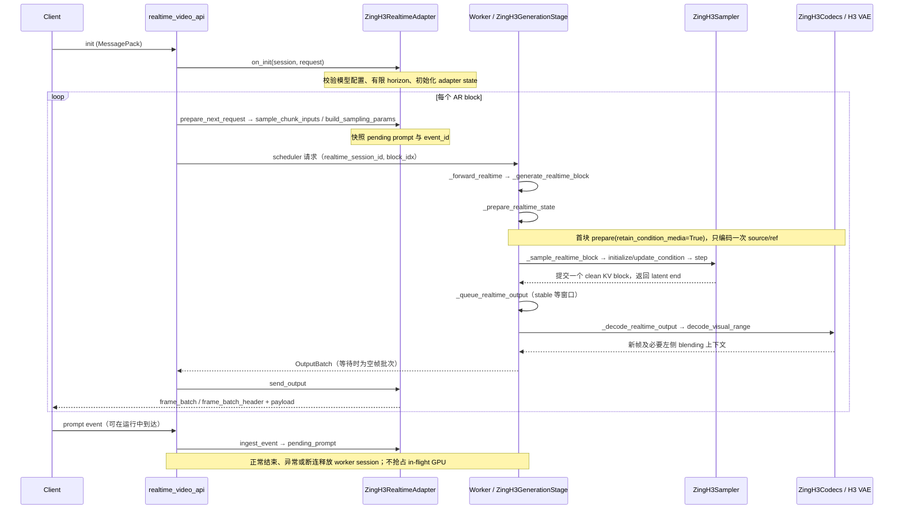

离线入口、视频输入格式与 checkpoint 导出见[推理说明](/docs/sglang-diffusion/zing/overview)，
共享模块与 KV 语义见[架构说明](/docs/sglang-diffusion/zing/architecture)。

## Realtime WebSocket（issue #98，有限长度实现）

产品目标是 ref2va 风格的参考条件与持续游戏 source 渲染，见[持续输入 API 提案](/docs/sglang-diffusion/zing/specs/causal-ar-realtime-api.zh-CN)。
该提案要求默认不预设时长、source.append/accepted/consumed、像素级 source_alignment
及 EOS flush。下面是当前可运行的有限长度入口，不能据此验收 #104；持续 source、
有界长会话和版本协商尚未实现，有限测试只是开发验证步骤，不是产品目标。

Zing causal pipeline 复用 `WS /v1/realtime_video/generate`。每次 scheduler
请求只生成并提交一个 AR block；第一次返回时，后续 block 尚未采样。
普通 MiniMax-H3 pipeline 和 Zing 的 `/v1/videos` 完整视频入口保持原有行为。

使用匹配 four-step AR checkpoint 和 noise schedule 的部署时，客户端发送 MessagePack 初始化消息：

```json
{
  "type": "init",
  "prompt": "A camera moves through a forest",
  "size": "832x480",
  "num_frames": 22,
  "fps": 24,
  "seed": 42,
  "zing_solver": "few_step",
  "zing_denoising_step_list": [1000, 750, 500, 250],
  "num_inference_steps": 4,
  "zing_realtime_decode_mode": "immediate",
  "realtime_output_format": "raw"
}
```

`num_frames` 是整个有限序列的像素帧数，缺省为 22；服务端根据模型导出的
`num_frame_per_block`、`split_first_latent` 和 VAE 时间压缩参数计算结束块。
`max_chunks` 可以提前结束，但不能延长 `num_frames` 指定的序列。
`first_frame` 作为 reference 输入；需要多个 reference 或对齐 source video 时，
可使用已有的 `zing_request` 两消息结构，此时 target.output 决定总帧数和尺寸。
`zing_solver`、`zing_denoising_step_list` 使用与离线 Zing 相同的采样配置。

更新 prompt：

```json
{"type": "event", "kind": "prompt", "payload": "The forest turns snowy", "event_id": 1}
```

更新在下一次准备 block 请求时取样，不修改已经准备或正在生成的 block。
多次待处理更新只保留最后一次；输出沿用 `frame_batch` / `frame_batch_header`，
并携带该块实际采用的 `event_id`。新 prompt 会重建 conditioning prefix，保留
已提交的 source/target KV，并固定视频的绝对位置。历史块的 KV 仍反映生成时
使用的 prompt，不重新采样历史帧。

初始化消息支持 `zing_realtime_decode_mode` 开关：

- `immediate`（默认）：每块立即出帧。对已提交 latent 前缀使用原生 H3 VAE，
  缺少的右侧上下文以最后一个 latent 补齐，只发送新增帧索引；块边界允许与
  整段离线解码不同。
- `stable`：仍然每次调度一个 AR block，但等到该块全部帧具备完整的 VAE
  时间窗口后才发送。最后一块会发送所有剩余帧。每个输出块保留原始的
  `chunk_index`、`request_id` 和 `event_id`；未产出帧的请求不会标记会话可播放。
  22 帧等短序列可能到最后一次调度才首播。

两种模式均不修改、重复发送已经发送的帧。解码从新输出所在 clip 的前一个 clip
开始，只保留原生 VAE blending 必需的左侧上下文，不再从第零帧重解码整个前缀。
immediate 的未定稿边界仍可能随新 latent 重新计算，但只发送新帧。采样历史仍完整
保留；此改动不等于有界无限时长流，也没有新的真机 FPS 结论。

首版仅输出视频，不提供 audio 或 camera actions；仅支持本地 VAE，不支持
remote VAE、插帧和超分。视频、KV、条件输入和 RNG 状态由 worker 会话持有，
自然结束、断开连接及生成失败时释放。失败块丢弃尚未提交的 source/target
事务；active/noisy target KV 不会写入历史。断连不会抢占正在执行的 GPU block，
清理可能需要等当前 block 结束；清理完成前立即重连可能触发会话数量限制。
长时间会话应继续发送现有协议的 heartbeat，避免触发空闲超时。

CPU 回归覆盖两块逐步采样与离线 latent 对齐、跨块 RNG 隔离、prompt 更新时
绝对位置不变、第二块失败回滚、帧数/顺序及会话清理。真实权重验证按单卡、
SP2 顺序执行；CPU 测试不能替代真实模型、VAE 和分布式通信验证。


### 可选 TAEH3 解码器

原生 H3 VAE 仍是默认解码器。部署时可通过 pipeline config 设置
`video_decoder_backend="taeh3"`、`taeh3_checkpoint_path` 和
`taeh3_decode_precision`（`fp32`、`fp16` 或 `bf16`）；权重必须匹配适配器固定的 SHA256。
TAEH3 是有损替代解码器，启用前应比较实际输出画质。

TAEH3 的实时入口要求 `zing_realtime_decode_mode="stable"`。每个会话独立保存
解码层的时间缓存，按五个 latent 一组解码新增数据，并保留十二帧尾部缓冲。
小于内部解码组的输入可能暂不出帧；结束时补齐并裁剪到请求帧数。
输入 AR block、内部解码组和发送的视频块不是同一边界。
取消、失败及自然结束时释放会话缓存。

TAEH3 解码缓存有界不代表整个生成会话有界：DiT 仍保留完整历史。
单独 decoder 耗时也不代表端到端实时性能；应分别测量首帧、稳态逐块延迟、
媒体传输和持续播放情况。

### Reference / source 与模型选择

Zing 加载专用 causal/AR checkpoint，不通过每次请求的 `fl2va/ref2va` 字符串切换
原版 MiniMax-H3 的两套权重。`conditions[].role="reference"` 指静态参考；
`target.source` 指与输出对齐的待渲染 source。`first_frame` 仅转成一个 reference，
不是首帧强制保持或原版 FL2VA 的模式选择器。主要接入场景应使用 references + source：

```json
{
  "type": "init",
  "prompt": "保留角色外观，把场景渲染为雪山",
  "zing_solver": "few_step",
  "zing_denoising_step_list": [1000, 750, 500, 250],
  "num_inference_steps": 4,
  "zing_realtime_decode_mode": "stable",
  "zing_request": {
    "messages": [
      {"role": "user", "content": [
        {"type": "text", "text": "保留角色外观，把场景渲染为雪山"},
        {"id": "character", "type": "image", "uri": "/media/character.png"}
      ]},
      {"role": "target", "content": [
        {"type": "video", "output": {"frames": 243, "height": 480, "width": 832}}
      ], "conditions": [
        {"content_id": "character", "role": "reference", "latent_modalities": ["visual"]}
      ], "source": {"type": "video", "uri": "/media/game-243-frames.mp4"}}
    ]
  }
}
```

这里 URI 是服务端可访问媒体，仍需初始化时提供完整 source，不能模拟持续 append。
当前 realtime 只返回 video，ref2va 风格的 reference 条件不表示已实现音频流。
832×480（480p，按模型 32 像素对齐）是缺省值，不是唯一合法分辨率；显式 size/target.output 保留，worker 校验
模型空间网格与容量约束。Source 经媒体预处理后检查帧数、FPS 归一化、宽高比及目标
画布适配，不强制源文件原始尺寸逐像素等于输出尺寸。

### 函数调用与状态所有权



`retain_condition_media` 只用于保留已预处理的 reference 像素/音频，供动态 prompt
重新编码 Qwen conditioning；避免再次读取 URI/预处理。普通离线请求默认不保留，
会话结束随 inputs 释放。它不是 KV、不是额外 source 历史，也不表示持续输入已实现。
