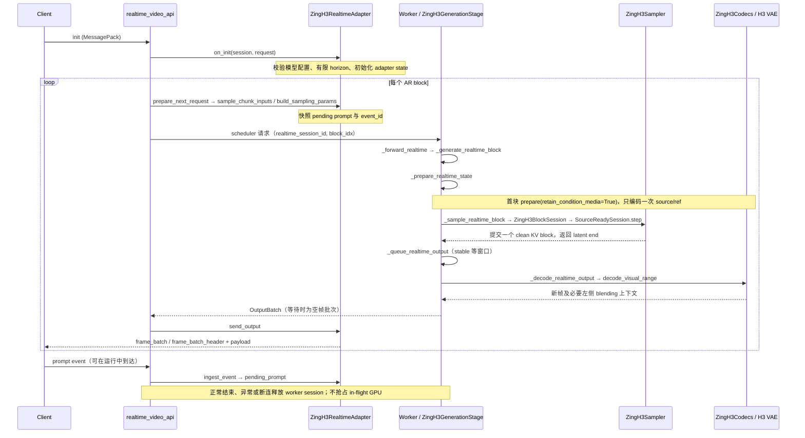

离线入口、视频输入格式与 checkpoint 导出见[推理说明](/docs/sglang-diffusion/zing/overview)，
共享模块与 KV 语义见[架构说明](/docs/sglang-diffusion/zing/architecture)。

世界测试平台的 `white_box` 接入、CLI/UI 扩展点、插槽管理、三路录像及配置，见仓库
[`benchmark/whitebox/README.md`](https://github.com/seedleap/sglang/blob/main/benchmark/whitebox/README.md)。
该链路复用下述 H3 source 接口，实时预览使用 JPEG，归档视频使用 H.264 MP4。

## 持续 RGB source（version 1）

`WS /v1/realtime_video/generate` 支持显式选择持续输入适配器。
下面的初始化消息使用 MessagePack 传输，不提供 `num_frames`：

```json
{
  "type": "init",
  "zing_realtime_api_version": 1,
  "prompt": "Preserve the character and camera motion",
  "size": "832x480",
  "fps": 24,
  "seed": 42,
  "zing_realtime_decode_mode": "stable",
  "realtime_output_format": "raw",
  "source_stream": {"format": "rgb24", "width": 832, "height": 480, "fps": 24}
}
```

部署须在模型目录提供绑定 `zing_config.json` SHA256 的
`zing_realtime_profile.json`，声明匹配 checkpoint 的两步或四步 schedule、guidance 和
`indexed-cpu-v1` 噪声语义。默认前三块四步、之后两步，无需附加采样 CLI，
profile 未声明 initial 阶段时也采用此默认。也可显式写出完整计划，
保留 checkpoint hash、guidance、noise 等其他字段：

```json
{
  "solver": "few_step",
  "denoising_step_list": [1000, 500],
  "initial_block_count": 3,
  "initial_denoising_step_list": [1000, 750, 500, 250]
}
```

不传采样 CLI 覆盖时，入口和 worker 使用 profile 明确声明的完整计划。
显式启动参数的 solver/grid 或 `--zing-initial-block-count 3` 选择 CLI 的整套计划；
因此旧四步 profile 也可通过 CLI 开启混合采样。
仅显式传 `--zing-initial-block-count 0` 会保留 profile 的常规 grid 并关闭初始阶段。
旧 profile 不含 initial 字段时，改用默认混合计划；要保持全程原 grid，
在 profile 显式设置 `initial_block_count=0`，或传上述关闭 CLI。
profile 和最终有效计划均须合法。迁移边界见[默认混合采样设计](/docs/sglang-diffusion/zing/specs/default-mixed-sampling)。
客户端不能覆盖采样计划，建议省略 `num_inference_steps`；显式填写时须等于有效计划的
常规阶段列表长度（默认混合计划为2；自定义列表取实际长度）。`session.ready.num_inference_steps` 回显该值，
`session.ready.sampling_schedule` 返回 solver、`denoising_step_list`、`initial_block_count`
和 `initial_denoising_step_list`。入口冻结完整计划，通过内部 source 命令交给 worker。
混合部署的旧客户端若写死4或只接受四步 ready，须与服务一同升级。
静态表还必须覆盖实际生效的完整计划，见[混合采样静态 AdaLN 设计](specs/initial-block-static-adaln.md)。
初始化可通过 `references` 提供至多九个唯一 ID 的 JPEG/WebP/PNG 二进制图片，
总大小至多 8 MiB；当前只支持视频、RGB24 source 和本地解码。
测试用例保留原始全局风格图为 Picture 1，五张上下对照图为 Picture 2–6，共六张参考图。
参考图严格保留客户端传入顺序，第一张图片就是第一张 reference；不得按 ID 排序或用 source 首帧替换。
持续 RGB 只进入 source 编码路径，不会自动抽取首帧作为 prompt 视频上下文。

### 尺寸与传输预算

输出尺寸按已加载模型的 `VAE spatial compression × DiT patch size` 校验，当前两轴要求 32 整除。
832×480、896×512、1280×736 可通过输出网格校验；精确 1280×720 输出不支持。
实时上传 source 始终在 VAE 前按短边 ≤480、面积 ≤399360 选桶缩放，小输入不放大。
例如上传 1280×736 时编码为 832×480，输出仍可请求 1280×736；上传尺寸不必与输出相同，
但须满足宽高比与传输限制。实际编码尺寸见 `session.ready.source_encoding`。
网格与传输准入通过仍不保证 KV 容量或生成质量。

部署参数 `--realtime-max-message-bytes` 默认 `67108864`（64 MiB），统一限制完整
MessagePack 消息与 source admission，不能设置无限大小。`--realtime-transport-host-bytes`
默认 `8589934592`（8 GiB），启动时必须覆盖配置的并发会话传输预算；
每会话保守预留 `14 × message_bytes + 9 MiB`，默认八会话共 7,240 MiB。
这只计算传输缓冲，不包含模型、codec、KV、解释器或系统 socket 内存，也不是 RSS 上限。
多服务进程部署需分别预留并合计 host 内存。

服务使用可执行消息队列上限的 Uvicorn `websockets` 后端，接收队列固定为一条，关闭压缩。
每条 append 既不能超过 `session.ready.max_source_message_bytes`，也不能超过
`len(RGB payload) + 4096`；初始化（含参考图）限 `8 MiB + 4096`。
source 的 pending 额度仍为四个 clip，并受帧数、字节数和元数据记录数共同限制。

配套 `benchmark/zing_h3_causal/continuous_source_client.py` 的 `--max-message-bytes`
必须与部署值相同，默认也是 64 MiB。客户端在 init 中发送 `source_message_budget_bytes`，
服务在 `session.ready.max_message_bytes` 回显；不一致返回 `source_transport_mismatch`，
在参考图解码和落盘之前拒绝。旧客户端可省略此字段，但仍须遵守服务协商出的限制；
新配套客户端要求新版 ready 字段，应与服务一起升级。
从源码运行客户端时设置 `PYTHONPATH=python SGLANG_LIGHTWEIGHT_RUNTIME=1`。

直接接口错误采用英文 `content` 和稳定 `code`：`source_dimensions_unaligned`、
`source_transport_mismatch`、`source_init_too_large`、`source_message_too_large`、
`source_credit_exceeded`。超过 WebSocket 本身上限时，在解码前以 **1009** 关闭，
此时不能保证应用层错误消息。world-platform `authorized_generate` 的外部错误和
AsyncAPI 合约不在本次直接 source 接口变更范围内。完整配置与回归方法见仓库
`docs/docs/sglang-diffusion/zing/specs/SOURCE_TRANSPORT.md`。

### 发送与确认

等待 `session.ready` 后，按返回的单批帧数、单消息字节数和 pending 帧/字节预算发送：

```python
{
    "type": "event", "kind": "source.append", "event_id": 1,
    "payload": {
        "client_seq": 0, "source_frame_start": 0,
        "num_frames": 1, "pts_us": 0,
        "data": rgb24_bytes,
    },
}
```

这里每条消息发送一帧，也可设置 `num_frames=17` 一次发送连续 17 帧；它是本条消息的帧数，
不是会话总帧数，也不是强制发送批次。已验证单帧及 `1,3,17,2,5` 不规则分包。
默认使用内置渐进 encoder；部署 profile 省略 `source_encoder` 即可启用。
它保留 checkpoint 的 `[1,2,2]` latent 分块与 17 帧 clip 边界，
首个稳定 latent 就绪即可调度匹配的 DiT block，详见仓库
`benchmark/zing_h3_causal/PROGRESSIVE_SOURCE_VALIDATION.md`。
如需旧版整 clip 编码，在 `zing_realtime_profile.json` 显式设置
`"source_encoder": {"mode": "clip17"}`；此模式需收集 17 帧才开始编码（EOS 尾段除外）。
渐进编码减少首段输入等待，不保证总吞吐提高或 BF16 结果逐位相同。

| 参数 | 含义 |
| --- | --- |
| `event_id` | source 和 prompt 事件共用的严格递增事件编号 |
| `client_seq` | 从 0 连续递增的 append 消息序号 |
| `source_frame_start` | 此消息第一帧在整条 source 中的绝对帧号，从 0 开始 |
| `num_frames` | 此消息连续 RGB 帧数 |
| `pts_us` | 第一帧的媒体时间戳，单位微秒 |
| `data` | 按帧顺序拼接的 RGB24 HWC 二进制，长度为 `num_frames * width * height * 3` |

`client_seq` 从零连续递增，`event_id` 对 source 和 prompt 事件严格递增；
像素帧位置连续，`pts_us = source_frame_start * 1000000 // 24`。
`source.accepted` 返回服务端 `source_id` 和被接受的绝对帧区间，表示已接纳，
不释放发送额度。只有 `source.consumed` 的累计 `source_frame_end` 和
`source_bytes_end` 才释放完整 append 边界的额度。慢消费者会通过这条链路施加背压：客户端接收视频变慢，使共享 writer 的发送等待，
`source.consumed` 随之推迟；客户端用完 `session.ready` 宣告的额度后必须等待，
收到 consumed 才继续发送。当前最多保留 68 个未消费 source 帧，超额发送会被拒绝。
这些是传输协议的序号、确认和流控字段，与生成画面的文本 prompt 无关；
prompt 更新只通过共用的 `event_id` 标明哪个输出采用了哪个提示词。

输出沿用 `frame_batch` / `frame_batch_header`。每个分批携带绝对
`output_frame_start`、PTS、`source_alignment` 和 `source_dependency_end`，
以及实际生成该片段时的 `chunk_index`、`request_id` 和 prompt `event_id`。
source 对齐区间与计算依赖水位不同：codec lookahead 可使依赖超出当前输出区间。

输入 EOF 时发送 `kind="source.end"`，payload 为
`{"source_frame_end": actual_frame_count}`。服务完成末尾编解码补齐、发送全部输出
并释放输入额度后返回 `session.completed`。普通断线不能视为完成；不支持断点重连。
非法 source 顺序会终止该会话。错误内容使用简明英文，内部异常只写服务日志。

当前持续路径使用有界 window=21/sink=3、block_relative RoPE、最大帧间隔 12；
默认解码器为 Lynn，部署通过 `decoder_config.checkpoint_path` 和
`decoder_config.model_dir` 指定权重与架构目录。每个会话独立持有时间缓存，按 latent
推进解码；source 末尾未确认有效的帧暂留到后续输入或 EOF。持续输入只接受 `stable`。
显式 `video_decoder_backend="native"` 仍可用于原生 decoder 对照。


以下基础 source 验收属于链接所列冻结版本（主要为历史 TAEH3），不代表本次 Lynn 与
原生 decoder 省略组合的 GPU 验收。历史验收覆盖 SP1/SP2、五参考图、结束排空、
取消清理、慢消费者、并发隔离和有界内存。
10/60 秒长会话使用同一 5 秒用例的技术性拼接，不能作为自然长视频画质结论。
可运行 RGB pipe 客户端见仓库 `benchmark/zing_h3_causal/CONTINUOUS_SOURCE_VALIDATION.md`，
完整证据见 `benchmark/zing_h3_causal/CONTINUOUS_SOURCE_ACCEPTANCE.md`。
[Issue #131](https://github.com/seedleap/sglang/issues/131) 继续跟踪 24 FPS 性能，
[Issue #153](https://github.com/seedleap/sglang/issues/153) 跟踪画质；基础验收通过不代表实时性能达标。

## 有限长度 WebSocket（兼容入口）

未选择 version 1/source_stream 的请求继续使用有限长度适配器。

Zing causal pipeline 复用 `WS /v1/realtime_video/generate`。每次 scheduler
请求只生成并提交一个 AR block；第一次返回时，后续 block 尚未采样。
普通 MiniMax-H3 pipeline 和 Zing 的 `/v1/videos` 完整视频入口保持原有行为。

使用匹配 four-step AR checkpoint 和 noise schedule 的部署时，客户端发送 MessagePack 初始化消息：

```json
{
  "type": "init",
  "prompt": "A camera moves through a forest",
  "size": "832x480",
  "num_frames": 22,
  "fps": 24,
  "seed": 42,
  "zing_solver": "few_step",
  "zing_denoising_step_list": [1000, 750, 500, 250],
  "num_inference_steps": 4,
  "zing_realtime_decode_mode": "stable",
  "realtime_output_format": "raw"
}
```

`num_frames` 是整个有限序列的像素帧数，缺省为 22；服务端根据模型导出的
`num_frame_per_block`、`split_first_latent` 和 VAE 时间压缩参数计算结束块。
`max_chunks` 可以提前结束，但不能延长 `num_frames` 指定的序列。
`first_frame` 作为 reference 输入；需要多个 reference 或对齐 source video 时，
可使用已有的 `zing_request` 两消息结构，此时 target.output 决定总帧数和尺寸。
`zing_solver`、`zing_denoising_step_list` 使用与离线 Zing 相同的采样配置。

更新 prompt：

```json
{"type": "event", "kind": "prompt", "payload": "The forest turns snowy", "event_id": 1}
```

更新在下一次准备 block 请求时取样，不修改已经准备或正在生成的 block。
多次待处理更新只保留最后一次；输出沿用 `frame_batch` / `frame_batch_header`，
并携带该块实际采用的 `event_id`。新 prompt 会重建 conditioning prefix，保留
已提交的 source/target KV，并固定视频的绝对位置。历史块的 KV 仍反映生成时
使用的 prompt，不重新采样历史帧。

原生解码器的有限长度入口支持 `zing_realtime_decode_mode` 开关（默认 `stable`）：

- `immediate`：每块立即出帧。对已提交 latent 前缀使用原生 H3 VAE，
  缺少的右侧上下文以最后一个 latent 补齐，只发送新增帧索引；块边界允许与
  整段离线解码不同。
- `stable`：仍然每次调度一个 AR block，但等到该块全部帧具备完整的 VAE
  时间窗口后才发送。最后一块会发送所有剩余帧。每个输出块保留原始的
  `chunk_index`、`request_id` 和 `event_id`；未产出帧的请求不会标记会话可播放。
  22 帧等短序列可能到最后一次调度才首播。

两种模式均不修改、重复发送已经发送的帧。解码从新输出所在 clip 的前一个 clip
开始，只保留原生 VAE blending 必需的左侧上下文，不再从第零帧重解码整个前缀。
immediate 的未定稿边界仍可能随新 latent 重新计算，但只发送新帧。采样历史仍完整
保留；此改动不等于有界无限时长流，也没有新的真机 FPS 结论。

首版仅输出视频，不提供 audio 或 camera actions；仅支持本地 VAE，不支持
remote VAE、插帧和超分。视频、KV、条件输入和 RNG 状态由 worker 会话持有，
自然结束、断开连接及生成失败时释放。失败块丢弃尚未提交的 source/target
事务；active/noisy target KV 不会写入历史。断连不会抢占正在执行的 GPU block，
清理可能需要等当前 block 结束；清理完成前立即重连可能触发会话数量限制。
长时间会话应继续发送现有协议的 heartbeat，避免触发空闲超时。

CPU 回归覆盖两块逐步采样与离线 latent 对齐、跨块 RNG 隔离、prompt 更新时
绝对位置不变、第二块失败回滚、帧数/顺序及会话清理。真实权重验证按单卡、
SP2 顺序执行；CPU 测试不能替代真实模型、VAE 和分布式通信验证。


### 默认 Lynn 解码器

部署配置示例：

```json
{
  "decoder_config": {
    "type": "lynn_streaming",
    "checkpoint_path": "/models/lynn.pt",
    "model_dir": "/models/lynn",
    "precision": "bf16"
  }
}
```

选择 Lynn 后，配置验证自动禁用导出 H3 VAE 中闲置的原生 decoder，构造和 checkpoint
读取都跳过 `decoder` / `post_quant_conv`；无需显式配置 `load_decoder=false`。
原生 encoder、latent statistics 和 posterior sampling 保留，ref 与 Qwen 仍在 DiT。
原生对照路径仍加载完整 decoder。此处的加载优化尚无 Lynn 组合版本的真实 GPU
显存/TTFF/prompt 切换 A/B 数据；历史 TAEH3 实验不能替代该验收。

缺少 checkpoint 或架构目录时启动报错；不回退到其他 decoder。
Lynn 要求 `zing_realtime_decode_mode="stable"`，每个会话独立持有缓存，
每个新 latent 推进一次 decode_step；EOS 校验实际帧数，不做旧五 latent 分组或十二帧尾部补齐。
取消、失败和自然结束时释放缓存。TAEH3 后端和对应配置已移除。

有限长度入口的 decoder 缓存与 DiT 历史是不同的内存来源；持续 source 入口另有 window/sink 限制。
单独 decoder 耗时不代表端到端实时性能，应分别测量首帧、逐块延迟、媒体传输和持续播放。

### Reference / source 与模型选择

Zing 加载专用 causal/AR checkpoint，不通过每次请求的 `fl2va/ref2va` 字符串切换
原版 MiniMax-H3 的两套权重。`conditions[].role="reference"` 指静态参考；
`target.source` 指与输出对齐的待渲染 source。`first_frame` 仅转成一个 reference，
不是首帧强制保持或原版 FL2VA 的模式选择器。主要接入场景应使用 references + source：

```json
{
  "type": "init",
  "prompt": "保留角色外观，把场景渲染为雪山",
  "zing_solver": "few_step",
  "zing_denoising_step_list": [1000, 750, 500, 250],
  "num_inference_steps": 4,
  "zing_realtime_decode_mode": "stable",
  "zing_request": {
    "messages": [
      {"role": "user", "content": [
        {"type": "text", "text": "保留角色外观，把场景渲染为雪山"},
        {"id": "character", "type": "image", "uri": "/media/character.png"}
      ]},
      {"role": "target", "content": [
        {"type": "video", "output": {"frames": 243, "height": 480, "width": 832}}
      ], "conditions": [
        {"content_id": "character", "role": "reference", "latent_modalities": ["visual"]}
      ], "source": {"type": "video", "uri": "/media/game-243-frames.mp4"}}
    ]
  }
}
```

这里 URI 是服务端可访问媒体，仍需初始化时提供完整 source，不能模拟持续 append。
当前 realtime 只返回 video，ref2va 风格的 reference 条件不表示已实现音频流。
832×480（480p，按模型 32 像素对齐）是缺省值，不是唯一合法分辨率；显式 size/target.output 保留，worker 校验
模型空间网格与容量约束。Source 经媒体预处理后检查帧数、FPS 归一化、宽高比及目标
画布适配，不强制源文件原始尺寸逐像素等于输出尺寸。

### 函数调用与状态所有权



`retain_condition_media` 只用于保留已预处理的 reference 像素/音频，供动态 prompt
重新编码 Qwen conditioning；避免再次读取 URI/预处理。普通离线请求默认不保留，
会话结束随 inputs 释放。它不是 KV、不是额外 source 历史，也不表示持续输入已实现。
