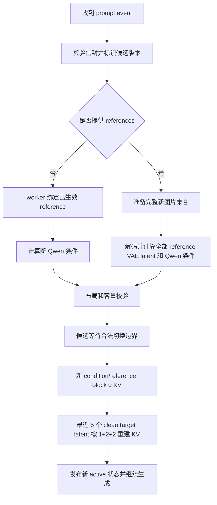

# Zing prompt 与完整 reference 集合切换设计

更新：2026-10-21。已实现，并扩容至 21 张 reference。扩容验证见 §8.5，review 修订验证见 §8.6；旧提交双卡实测中人物模型更换部分成功，下雪、巨石移除未达到目标。受测提交的单案例 9/21 图容量和性能实测见 §8.8；完整异常、连续更新与长流回归仍未验收。

本次实现：[PR #317](https://github.com/seedleap/sglang/pull/317)。关联：[Issue #311](https://github.com/seedleap/sglang/issues/311)、[PR #303](https://github.com/seedleap/sglang/pull/303)。本文独立描述 reference 扩展；不修改 #311，也不修改 #303 的历史设计。

首版扩展现有 `kind="prompt"` event，使同一条消息可携带新 prompt 和本次继续推理所需的完整 reference 图片集合。显式提供图片集合时，重新准备媒体、计算 Qwen 条件和全部 reference VAE latent，再沿用 #303 的切换边界，将新 condition/reference KV 与最近 5 个 clean target latent 的 `1+2+2` KV 在同一流程内重建。成功后新状态整体生效。

首版不判断业务上的新增、删除或替换，不复用旧 reference KV，也不增加图片 VAE latent 缓存。保留后续复用相同图片 latent 的明确接口边界即可。

## 1. 当前实现与本次范围

核查基线为 `seedleap/sglang` main `7af628cec6f3525812852a7a595c6d8add7417bd`，#303 已合并。

| 位置 | 已有行为 | 本次变化 |
| --- | --- | --- |
| 初始化 `init` | 同一消息接收 prompt 与 `references`；source 由 `source_stream` 描述；图片为字节 | `user_media` 已移除并拒绝；更新入口复用图片校验与存储预算 |
| 后续 prompt event | `payload` 为完整 prompt 文本；复用初始媒体 | 可附带完整 `references`；缺省仍是文本更新 |
| 模型输入 | 保存媒体、conditions、Qwen 条件、reference latent | 准备一份候选输入，避免提前修改 active 输入 |
| #303 KV 切换 | 新 condition + 旧 reference + 最近 5 个 target latent | 新 condition + 新 reference + 最近 5 个 target latent |

当前 `build_sampling_params()` 会生成含完整媒体列表的内部 `zing_request`，但媒体来自初始化状态。这不能证明上游每次更新已经发送完整 reference 请求。coding agent/world-service 的生产方协议仍需单独对接，本文定义本分支新增的 SGLang 接口。

本次只更新 reference 图片。保留 source 首帧展示、其他非 reference 媒体、持续 source 输入、输出尺寸、采样配置和解码器进度；不扩展动态视频展示、音频条件或 source 替换，不再次调用 `on_init()`。

## 2. 调用协议

### 2.1 前置条件与能力声明

适用 Zing source-ready、video-only 会话。reference 更新依赖 #303 的滚动前缀机制，服务固定使用 `prompt_switch_prefix_latent_frames=5`，且原始 chunk plan 为 `[3,2] + split_first_latent=True`。

`session.ready` 返回布尔能力字段 `prompt_reference_updates`；只有当前会话配置支持此功能时才为 true。客户端未看到 true 时，不发送带 references 的更新。旧服务可能忽略 event 的额外字段，仅接受文本，因此不能以普通 `control_ack` 判断图片更新受支持。

未启用该能力的会话继续支持原有纯文本路径；带 references 的消息返回明确的非 fatal“不支持”错误，不静默退化为只更新 prompt。

### 2.2 一条消息包含完整 prompt 和完整图片集合

保留原有 `type/kind/event_id/payload`，在 event 顶层新增可选 `references`。以下为本分支的 Python/MessagePack 调用示例，`ws` 表示已经初始化并完成能力检查的连接：

```python
from pathlib import Path
import msgpack

assert ready.get("prompt_reference_updates") is True

event = {
    "type": "event",
    "kind": "prompt",
    "event_id": next_event_id,  # 遵循现有会话事件序号约束
    "payload": "完整的新提示词，使用 <Picture 1> 中的外观。",
    "references": [
        {
            "id": "<Picture 1>",
            "format": "png",
            "payload": Path("new-reference.png").read_bytes(),
        }
    ],
}
await ws.send(msgpack.packb(event, use_bin_type=True))
```

图片 `payload` 是 PNG/JPEG/WebP 的原始文件字节，不是 base64 字符串、URL、文件路径或素材 ID。首版不增加下载服务。调用方若持有 URL，应先按自身权限取得图片，再组装消息；线上具体由哪个组件执行该步骤，需对接时确定。

| `references` 状态 | 语义 |
| --- | --- |
| 字段缺省 | 沿用 worker 接纳该更新时已经生效的 reference 集合；只重算所需的 prompt 条件 |
| 非空列表 | 用列表中的全部图片作为新 reference 集合，声明顺序即新 reference 顺序 |
| `[]` | 目标集合为空，不保留旧 reference；保留非 reference 媒体和 source 首帧 |
| `null` 或其他非列表值 | 本次候选更新无效；prompt 和 reference 均不应用，连接及 active 推理继续 |

空列表已实现；零 reference 的媒体准备、packing 与小模型 KV 路径纳入 CPU 测试。真实 Qwen/GPU 端到端仍需验证。若某部署不支持，应在清空旧 KV 前拒绝整个候选，不把它解释成“保持不变”。

新消息依然要求非空完整 prompt。只换图时可重发相同 prompt，并使用新的合法 event ID。判断更新身份不能仅比较 prompt 字符串，否则同文换图会被遗漏。

### 2.3 校验与引用规则

初始化和动态完整替换共用启动配置 `zing_reference_max_images=N`，默认21；总媒体名额自动为 `N+1`，Source展示和保留的非reference媒体也占名额。每图仍最多16,777,216像素。当前完整预算与启动方式见[§9](#9-启动时配置-reference-张数与容量2026-10-21)，下文§8保留各轮历史固定容量测试的真实配置。

`session.ready`声明实际 `max_references`、`max_reference_image_bytes`、`max_reference_bytes`、`max_reference_decoded_bytes` 及协商后的 `max_message_bytes`。Reference单图压缩上限64MiB；N张reference合计最多 `N×64MiB`，原图RGB默认最多 `N×48MiB`。内部Qwen/RPC预算另为自动Source展示预留一个名额，不开放独立媒体上传。显式设置较小的RGB、WS或RPC预算时，该限制仍会拒绝超限请求；数量不代表任意尺寸、prompt和KV都能运行。

数量默认值和无I/O的 `ReferenceLimits` 复用既有轻量 `realtime/zing_contracts.py`；消息和transport host预算仍由 `source_transport.py` 负责。API不落盘、不上传OSS、不额外缩放reference。模型编码后真实token和KV池准入保持独立，不根据原图RGB字节数自动分配显存。

同一候选内 reference ID 唯一，且不得与保留的非 reference 媒体 ID 冲突。相同 ID 对应不同图片是合法的新快照；首版全部重编码，不依据 ID 推断内容相同。

内部新的 Qwen 媒体列表由“保留的非 reference 媒体（相对顺序不变）+ 新 reference（请求顺序）”组成。conditions 与 VAE latent 使用相同 reference ID/顺序。不会沿用旧 reference 媒体，也不会自动改写 prompt 里的 `<Picture N>` 或 subject 定义；调用方负责完整 prompt 与新列表一致。沿用既有结构化引用校验，不新增靠正则猜测自由文本含义的删除逻辑。

### 2.4 Review 修订：编码字节直接传输（2026-10-20）

调用方通过 WebSocket/MessagePack 提交 PNG/JPEG/WebP 原文件字节。API 原样保留已验证的编码字节并预留 RAM/inflight 配额；初始化和动态替换均由 worker 的 `media_input._decode_media()` 在内存解码。动态集合持有到 dispatch 完成；被淘汰、验证失败或取消时释放自身配额。会话结束释放初始化媒体。ReferenceUpload 管理接收字节和租约，不再创建媒体临时文件或磁盘配额，不上传 OSS、不强制转码。URI 输入仍保留给原有离线/规范请求；没有修改通用 H3 的 URI 契约。

依据：现有 API→scheduler 使用 pickle/ZeroMQ，scheduler 的 SP 广播支持嵌套 bytes，source 数据也已沿请求携带字节；旧落盘只是现有 URI 解码入口的适配，不是 IPC/SP 硬性要求。小图双 rank CPU 探针验证了传输可行性，完整媒体、候选生命周期及集成仍按下文验证，不能据此声称零拷贝或加速。pickle、广播 tensor 和反序列化存在复制；沿用 transport host 预算，并将保留媒体从磁盘租约改为 RAM/inflight 租约。初始化图片只随首个 dispatch 发送，后续 dispatch 使用 worker 的 active 输入；只有新换图事件携带新全集，避免每块重复发送初始图片。

数量常量合并到既有轻量 `realtime/zing_contracts.py`，删除单独的常量模块。prompt handler 从 wire 分派函数提取，保持先淘汰旧 pending、失败向 worker 传播 rejected、成功才 ACK 的顺序。

## 3. 状态模型与职责

现有 reference 相关状态不只有 KV：

| 状态 | 当前持有位置 | 显式更新 reference 时的处理 |
| --- | --- | --- |
| 编码图片字节、ID、格式、顺序 | API adapter 的媒体状态与 RAM/inflight 租约 | 候选独立持有新集合；dispatch 完成后释放，active decoded 输入归 worker |
| 解码媒体 | worker `inputs.condition_media`，用于 Qwen | 新 reference 重解码；保留 source 展示及非 reference 媒体 |
| Qwen 多模态条件 | `inputs.positive` / sampler prompt snapshot | 用新 prompt + 新完整媒体重算 |
| reference 归一化媒体与视觉 latent | `inputs.media`、`inputs.visual[id]` | 按新集合重算，旧 ID 不隐式残留 |
| 角色与布局依据 | `inputs.conditions` 和 packer 输入 | 按新集合重建；不要沿用旧数量、顺序、位置 |
| condition/reference/历史 target KV | sampler 的会话 KV cache | 在切换边界统一清空逻辑内容并重建 |
| 最近 5 个 clean target latent | `SourceReadySession.recent_visual` | 保留并在切换时取最新值；它们不是 reference latent |
| source 编码缓存、source bridge、ledger、decoder | 现有流式会话对象 | 保留，不因 reference 更新重建会话 |

沿用现有分层，不新建通用“资源管理框架”：

- **API adapter**：解析消息、验证媒体、管理编码字节与传输/在途内存预算；将不可变更新描述传给 worker。复用 init 的图片校验与内存预算入口，但不复用初始化 source/decoder/ledger 的副作用。
- **模型 worker (`ZingSourceStreamState`)**：解析“保持 references”或“完整替换”，准备候选 decoded media、condition、VAE latent 和布局，执行准入；管理模型侧 active/pending 状态与失败通知。
- **增量 sampler (`SourceReadySession`)**：在已有合法边界应用完整候选快照，重建 KV，发布实际生效的版本。不能只把 condition 放进 `PromptSnapshot`、把 reference 留在外部可变对象里。
- **codecs / packer / sampling**：分别负责媒体编码、布局和模型 KV 构建，不依赖 WebSocket、event 消息或上传目录。

模型侧更新快照至少绑定：event ID、prompt version、prompt 文本、候选媒体/conditions、Qwen condition、reference latent。沿用现有输入类型，由 `PromptSnapshot.inputs` 绑定候选输入。全局 source 进度、decoder 和 RNG 不属于该快照。

API 只用 `_pending_prompt_command` 保存待派发的 prompt/event_id、reference 描述或拒绝标记；调度等待和派发都读取同一对象，避免与独立 tuple 重复维护身份。选中后转交 `_selected_prompt_command`，随后进入 batch；不改变 latest-wins 或首次 source 前更新的既有时序。

API 保存的“最新收到请求”不等于模型 active。worker 是实际生效 reference 的权威来源。API 不得因为收到候选就修改共享 reference 媒体快照，使正在排队的旧 dispatch 偷看到新图片。后续 dispatch 也不能用初始化图片反向覆盖 worker 已生效的新集合。

## 4. 从接收到生效



### 4.1 接收、准备与 latest-wins

1. 校验基本消息类型、event ID 和非空 prompt；非法信封不形成候选。通过信封检查后，新事件按 #303 的 latest-wins 规则淘汰旧 pending，即使它随后因图片内容或准入失败而被拒绝，也不复活已被取代的 pending。
2. API 接收层保存版本独立的编码媒体字节/描述，后续随 dispatch 交给模型。媒体准备失败也必须把该版本的拒绝/淘汰信息传到模型侧，不能只在 API 回错而让旧 pending 悄悄生效。
3. worker 接纳新候选时，先处理已有 pending 的淘汰，再准备新状态。显式 references 使用完整新集合；缺省 references 绑定此时的 active 集合，不继承尚未生效的 pending。
4. 显式 references 时，首版完整重算新图的 decode/normalize、VAE latent 和新 prompt 的 Qwen condition。即使内容与旧图相同，也不增加跨版本缓存。旧纯文本路径继续复用既有 reference latent，避免无关性能回退。
5. 准备和准入通过后才能进入 pending。一个准备完成的旧候选若已过期，必须释放，不得因异步任务后完成而重新提交。模型执行期间接收的新 event 仍受既有 dispatch 传播时序限制，不承诺网络收到后的紧邻下一块生效。

例如 active=A；E1 指定 reference=B，但尚未生效；E2 只改文本且不带 references。如果 E2 接纳时 E1 仍是 pending，E2 使用 A 并取代 E1；如果 E1 已生效，E2 使用 B。这也是为什么 reference 缺省不能在 API 层根据“最后收到的集合”提前填充。

首版不新增图片编码与 DiT 并行调度。候选准备可以占用当前 worker 执行时间，造成输出间隔增加；“保留旧 active”表示状态不被破坏，不承诺准备期间持续满速产出。

### 4.2 候选布局与资源准入

实现中的 latest-wins 在 worker 接纳下一次 dispatch 时判定。网络层收到新事件不抢占已经执行中的 dispatch，也不回滚已生效的 epoch。首次 source 前收到带图更新时，仍先初始化原始 epoch，再等待 5 个 clean target latent；首次 source 前的纯文本更新保留旧接口直接使用新文本初始化的行为。

准入必须使用候选 `inputs.visual/media/conditions` 和 condition，不能继续用 `_admit_prompt_update()` 当前的旧 `self.inputs`。检查实际 reference/condition 行数、滚动前缀和后续 target/source 所需容量。

复用现有 pool 的容量计算和 slot 约束；候选超过已租用 slot 或部署容量时拒绝，首版不在切换中在线扩容或更换 pool。`_pooled_storage()` 内捕获的 `self.inputs` 也要核对，避免首次租用或重算请求仍引用旧集合。reference 变多可能影响前缀位置和 slot 行数需求，不能只校验图片张数；同步 #373 后不再保留 donor workspace。

准备阶段会同时保有旧 active 和新候选的媒体、condition 与 latent。应按会话总预算计费，结合既有接收、在途内存、RPC 和 worker 限额拒绝超预算请求；不能因为每条消息都未超 64 MiB 就允许累计无限上传。默认不创建第二份完整 KV cache。

### 4.3 在 #303 的同一个流程中重建 KV

继续等待：最近 clean target latent 已满 5 个、旧相位已准备的工作结束、新 source 块满足现有切换条件。历史 latent 在真正切换时读取最新值，不在网络收到事件时提前冻结过时的 5 帧。

随后复用并扩展 `rebuild_prompt_prefix(candidate_inputs, candidate_condition, recent_visual, cache)`：

```text
依据候选输入打包完整新布局（仍未破坏旧 cache）
    ↓
清空旧逻辑 KV，保留可复用的 pool 底层存储
    ↓
前向计算 block 0：新 condition + 新 reference
    ↓
依次 clean commit 历史 target：1 latent → 2 latent → 2 latent
    ↓
验证重建终点与下一 model block 对齐
    ↓
发布新 active inputs、prompt、event/version 和 media origin
    ↓
从局部 chunk 3 继续；全局 frame/PTS/source 进度不变
```

现有 #303 已按此顺序计算 block 0 和历史 target；本次关键是将其输入从“旧 reference + 新 condition”换成完整候选。它是一个统一重建流程，内部有多次 forward，并非将所有 token 改为一次无因果约束的前向。

reference 数量和顺序变化后重新计算布局与 RoPE 起点，不沿用旧 reference 导致的 target origin。历史 target latent 保持原数值，不重新解码、VAE 编码、去噪或输出，也不消耗额外噪声抽样来伪造历史。

### 4.4 发布与资源回收

只有重建成功并验证对齐后，才能让后续模型块看到新 active；旧块输出仍携带旧 event/version。不能在 Qwen 编码完成时提前更新输出版本。

候选编码字节的生命周期覆盖读取它的在途 dispatch/SP rank；API 在 `on_chunk_complete()` 释放对应 dispatch 的字节和租约，不能用客户端 ACK 代替完成证据。候选被淘汰、校验失败或取消时立即释放自身资源；旧 active 的已解码媒体只在替换成功后更新，模型端不保留无界历史。

`ReferenceUpload.release()` 清空所持字节并通过 `conditioning.release_media_reservations()` 统一注销 RAM/inflight 租约；`release_api_media()` 在会话清理时释放初始化媒体剩余租约。编码媒体没有临时文件，不再需要 unlink/rmdir 失败重试或磁盘配额。会话中其他文件（如可选 source IPC socket）的清理仍归原有会话逻辑，不影响媒体内存回收。

## 5. 错误与应答

| 阶段 | 处理 | active 状态 |
| --- | --- | --- |
| 非法消息类型、无法解析的包或 source 顺序错误 | 沿用既有协议/会话错误策略，不把所有异常统一降级 | 按已有生命周期处理 |
| 有效 prompt 信封，但 references 为 null、格式错误、图片损坏、ID 冲突、功能不支持或容量不足 | 返回英文、带稳定 code/event_id 的非 fatal 更新拒绝；整条更新不应用 | 保留旧 prompt、旧 references 和旧 KV |
| 可恢复且已完成所有 rank 一致性处理的 conditioning 失败 | 沿用 ConditionError/notice 路径，拒绝候选 | 保留旧 active |
| 未知 GPU/collective 故障，或清空旧 KV 后重建失败 | 沿用 #303 的 fatal session 清理 | 不声称可以恢复旧 KV |
| 准备完成但已被较新候选淘汰 | 丢弃并释放该候选，不生效 | 不回写过期状态 |

当前 `_listen_events()` 对 source adapter 抛出的异常会结束事件处理。因此新增可恢复 reference 校验错误必须在适当入口转换为非 fatal notice 并继续收包，不能仅 `raise` 后宣称“旧会话继续”。不要广泛捕获 CUDA/分布式异常后继续运行。

`control_ack` 仍只表示消息已被接纳，不表示已生效；之后仍可能出现编码/容量失败 notice。实际生效以输出 block 的 event/version 为准。输出继续使用既有 prompt_event_id 关联实际生效事件；首版不增加每帧原图或独立的 reference 指纹审计字段。

SP 多 rank 在进入 VAE/DiT collective 前必须对候选、媒体准备结果和准入结论达成一致。不能一部分 rank 使用新 references，另一部分继续旧 references；也不能一方已 return，另一方继续进入 collective。复用现有 conditioning 共识及错误传播机制，并为新增 VAE 阶段补齐覆盖。

## 6. gateway 与客户端边界

直接连接支持该能力的 Zing worker，是首版协议的验证入口。测试客户端增加发送上述完整 event 的能力，不再通过第二个 init 更新图片。

普通代理路径需确认 MessagePack 图片字节、包大小限制和字段完整转发。授权 world-platform 路径当前由 gateway 将 rewrite 结果组装为文本 event，并有明确的允许列表；它不能因为 worker 支持该字段就自动获得图片更新能力。

平台接入时需单独完成：可信生产方提供完整图片集合、gateway 保留并校验其字段、能力声明透传、字节预算贯通。若涉及 `one_time` 效果回退，必须定义回退的是 prompt+references 整个快照；不能恢复旧 prompt 却继续使用新图片。本文不自动扩展浏览器自由上传权限，也不声称现有 coding agent 已遵守此协议。

## 7. 代码归属与 reviewer 阅读路线

本分支的 `adapters/zing_reference_upload.py` 管理编码字节和内存租约；`codecs.prepare_reference_update()` 构造候选完整输入；`PromptSnapshot.inputs` 绑定候选，`_activate_pending_prompt()` 重建成功后发布。API 使用内部 `zing_prompt_update` 携带事件身份、编码图片字节或拒绝标记。worker 准备完成后依赖 decoded media/latent；上传字节在 dispatch 完成时释放，初始化字节在会话结束时释放。

直接测试客户端提供 `--prompt-updates` 清单入口；完整示例见 [输入协议与客户端示例](/docs/sglang-diffusion/zing/specs/SOURCE_REFERENCE_INPUTS)。清单的 source 帧位置仅控制发送时刻，实际生效仍以输出 event ID 为准。

以下路径位于 `python/sglang/multimodal_gen/` 下；按入口、worker 准备、sampler 生效的顺序阅读。

| 阅读顺序与文件 | 关键入口 | 实现职责与核查问题 |
| --- | --- | --- |
| 1. `runtime/entrypoints/openai/realtime/adapters/zing_h3_source_adapter.py` | `on_init`、`ingest_wire_event`、`build_sampling_params`、`prepare_next_request` | 共用图片准备、解析完整集合、能力声明；新旧 dispatch 是否共享可变媒体？ |
| 2. `runtime/entrypoints/openai/realtime/realtime_video_api.py` 与 `conditioning.py` | `_listen_events`、媒体接收/预算路径 | 合法候选失败后是否继续收包？消息与媒体内存预算是否归还？ |
| 3. `runtime/pipelines_core/stages/model_specific_stages/zing_h3/source_session.py` | `_update_prompt`、`_admit_prompt_update`、`_pooled_storage` | worker active/pending 的权威归属；新图是否真正进入编码和容量计算？ |
| 4. 同目录 `codecs.py`、`media_input.py`、`packing.py` | `prepare`、`H3InferenceInputs`、`pack_prompt_switch_prefix` | 复用准备逻辑；只换 reference、保留 S0；零图/重排/布局是否一致？ |
| 5. 同目录 `incremental.py`、`sampling.py` | `PromptSnapshot`、`_activate_pending_prompt`、`rebuild_prompt_prefix` | 完整候选绑定；切换前后版本、历史 latent 与 KV 是否一致？ |
| 6. 相关测试、客户端与协议说明 | 下节所列测试入口；[输入协议与客户端示例](/docs/sglang-diffusion/zing/specs/SOURCE_REFERENCE_INPUTS) | 新格式可用、旧格式兼容，错误/竞态/实际效果都有证据？ |

`zing_reference_upload.py` 隔离接收字节和在途租约，复用 `conditioning.py` 校验及内存准入；init 与 update 共享 worker 的编码图片解码路径。模型侧 reference 编码归 codecs，不依赖 adapter/session 或传输配额。首版不引入全局图片注册表、资源 ID 服务或泛化插件系统。

## 8. 验证方案和通过标准

### 8.1 CPU 与协议测试

优先扩展现有 `test_zing_h3_source_adapter.py`、`test_zing_progressive_source_session.py`、`test_zing_source_bridge.py`、`test_zing_h3_chunks.py`、`test_zing_kv_pool_runtime.py` 和 conditioning RPC 测试，不以单纯 mock helper 调用代替完整输入路径。

| 要保证的行为 | 测试 | 通过标准 |
| --- | --- | --- |
| 旧接口兼容 | 原文本 event、旧 init 两种媒体格式、功能开关关闭 | 原行为不变；新能力关闭时显式拒绝带图更新 |
| 完整集合替换 | 1→2、2→1、同 ID 换内容、重排、相同内容重新上传 | Qwen 媒体、conditions、reference latent 键和顺序都等于新集合，无旧图残留 |
| 空值有确定语义 | 字段缺省、[]、null | 保留/清空/拒绝准确区分；清空后仍保留 S0 与非 reference 媒体 |
| 同文换图可触发 | prompt 相同、图片变化、event ID 更新 | 不被文本相等判断去重；输出版本属于新事件 |
| 候选失败不污染 active | 损坏图、ID 冲突、超容量、可恢复编码失败 | 新 prompt 不部分生效；返回关联 notice，随后合法 event 仍可处理 |
| latest-wins | E1 带图未生效，E2 缺省/带图/失败；过期准备结果后完成 | E2 绑定正确 active；E1 不复活，不发生旧结果回写 |
| 联合 KV 重建 | 记录新布局、block 0 与 1/2/2 三次 clean commit | 只执行一套重建序列，使用新 reference；不先额外独立建一份 reference KV |
| 时间线与资源稳定 | startup 未满 5 latent、多次切换、取消/断连、旧 dispatch 未结束 | 历史不重复输出、source/PTS 连续、无提前释放字节与预算泄漏 |

协议测试固定 `prompt_reference_updates`、`CONDITION_INVALID`、`fatal=false` 和 event ID 关联。

### 8.2 GPU 正确性与分布式

- 固定模型/导出、source、初始 prompt、随机种子、采样配置和切换时刻，测试新图、同 ID 换图、少图/零图、连续更新，覆盖 SP1 与 SP2。
- 建立独立全量准备基准：同一新集合重新计算 condition/reference latent，再使用相同的 5 个 clean target latent 和 RNG 状态重建前缀。与事件路径比较实际媒体绑定、张量形状与数值、首个新 block 输出。
- 同一确定性配置优先要求 exact；跨 SP 或 kernel 数值差异使用事先记录并与既有测试一致的容差，不能运行后为通过而放宽。检查各 rank 的候选版本和 collective 次序。
- 在重建前后比较 RNG 状态，确认历史前缀重建不额外抽样；对不同新图片不能要求生成结果相同。
- 输出 event/version 证明协议生效；另用固定机位/明显外观差异的 reference 案例人工检查画面，避免把 metadata 通过当成视觉效果通过。

### 8.3 延迟、吞吐与内存

以同一硬件/模型/分辨率/source/SP/调度配置下的 #303 行为为基线。纯文本更新做前后回归；新图更新与“显式全量重算”基准比较。原版 #303 不支持新图，不能据此编造新图更新的前后加速比。

分别测试：纯文本、显式相同全集、替换一图、增加一图、删除到零。固定预热并至少重复 5 次；冷启动与热态分别报告，不把它们混成均值。

以下仍是未完成的受控性能验证计划，不能用旧诊断实验或 CPU 探针填写结果。记录接收到候选准备完成的耗时、Qwen/VAE 分段、等待边界、KV 重建、客户端收到首个新版本画面的端到端延迟、交付间隔、峰值 CPU/GPU 内存和临时磁盘。区分服务端时钟与客户端时钟，不直接相减；有 CUDA 异步时使用恰当计时或标明 host 计时范围。

纯文本路径的验收要求是不引入额外 reference VAE 编码，并且延迟/吞吐不出现超出已测基线波动的持续回退；实际数值阈值在取得同环境基线后冻结。新图路径首版不承诺加速倍数，要求资源有界、无重复 reference KV 构建，并公开各阶段成本。长流反复更新的稳定资源上界通过预算和实际测量共同验证。

客户端已新增逐事件 `prompt_updates`、`prompt_update_latency_ms`（count/median/P95）和状态计数，并单独落为 `prompt-updates.json`（仅指标 JSON，不是 reference 图片）。提交点位于 `await send(event)` 前，包含 MessagePack 编码、writer 等待及上传；终点为首个匹配 event_id 的完整合法帧 payload 到达。两端均使用同一客户端 monotonic 时钟，另存帧序号及视频 PTS 供定位；不混用视频时间与墙钟，也不把 ACK 当采用，不包含本地图片读取或浏览器渲染。

`applied` 表示已观察到对应输出；`rejected` 是非 fatal 拒绝；只有观察到更新 event 的输出后才将更旧、尚未观察到输出的候选标为 `superseded`。正常结束仍未见输出为 `not_observed`，异常/取消为 `interrupted`；非 applied 的 latency 为 null，不计作零。历史实验仅有发送完成后的诊断延迟，不能补算缺少起点的上传耗时。

`bench_streaming_source.py --prompt-updates <manifest>` 可按既有预热/重复参数执行，并将这些记录传入共享报告。报告展示每次 event 的状态、提交/到达时间、首帧/PTS/延迟；汇总只采用正式成功会话的 applied 样本，预热和失败会话不混入。当前指标链路有 CPU/协议验证，尚无当前 head 在 480/736 上的受控 GPU 延迟、Qwen/VAE/等待边界/KV 分段与峰值内存报告；这些项明确为未测，不宣称性能验收或提升。

### 8.4 已执行验证与证据边界

代码提交与验证类型分别记录；实验输出 event/version 只能证明条件采用，不能单独证明视觉效果。

**CPU 回归**

- 环境：WSL Ubuntu、Python 3.11.15、PyTorch 2.8.0+cpu、PyAV 15.1.0；开启 `SGLANG_LIGHTWEIGHT_RUNTIME=1`、`SGLANG_DIFFUSION_PLATFORM_OVERRIDE=cpu`、`HF_HUB_OFFLINE=1`，CPU 线程数为 1。测试使用源码快照并核对 SHA-256。
- `ffb652ac283cb980cad9160804d1cf42859f5d2a`：12 文件共 **1,429 passed，0 failed/errors/skipped**，65.90 秒。原始 JUnit/log 保存于任务本地 `C:/sglang317-conflict-20261016/`。它扩展了早期七文件 1,262 passed 的范围，不将两轮数量相加。
- 覆盖 source adapter、reference 媒体、KV pool、chunks、progressive source session、source bridge、initial blocks、delayed eviction，以及客户端和 source work quantum。小型 CPU 模型验证重建 KV 与空缓存基准逐元素相等（rtol=0、atol=0），历史重建不改变 RNG；完整集合顺序、清空及 S0/非 reference 保留也有覆盖。
- 当前清理/状态简化：增加 `unlink/rmdir` 失败、会话末尾删除成功/仍失败、再次清理归还配额的真实生命周期回归；保留现有事件淘汰、首次更新和 prompt 唤醒测试。四个文件共 **222 passed，0 failed/errors/skipped**（21.77秒）：`test_zing_h3_source_adapter.py`、`test_zing_conditioning_lifecycle.py`、`test_realtime_runtime.py`、`test_source_work_quantum.py`。新增5个用例；结果不与旧轮累加。JUnit/log 与源码记录位于任务本地 `C:/sglang317-cleanup-20261019/`。首次收集缺少 `setproctitle`，在既有 venv 补齐后完整通过；仅有已有 TVM 可选 DLPack JIT warning。最终源码与受测快照 AST 一致（之后仅 isort 空行整理），Ruff、isort 和 diff 检查通过。

**双卡效果验证：仅展示两例**

[两例对照页](https://review-cdn.loopit.com.cn/world-model/sglang/evals/zing317-selected-cases-20261019/review-r1/index.html) 包含 source/输出、实际切换点、修改前后 reference 和请求。以下均使用 `94b5299082c48f0deddf481b02258d9125d8abd5`，step1600、seed42、SP2/Ulysses2、4步、FA4、832×480@24fps、TAEH3 FP16、prefix5；每例输出 113 帧且完整解码通过。

| 案例 | 修改与实际切换 | 已观察结果 |
| --- | --- | --- |
| 人物换装 | 仅替换人物 Picture 2，其他四图不变；帧17 / 0.708秒生效 | 基本成功：红衣深裤变为深帽、蓝袖、黄绿背心和卡其裤，抽查末帧保持 |
| 仅加雪 | P1/P3/P4/P5 从原图添加积雪，人物 P2 不变，保留物体、黏土风格与蓝色液态池水；帧68 / 2.833秒生效 | 12项条件采用审计通过，但关键帧直至结尾未见明显新增积雪，视觉目标未达到 |

雪景的切换前后请求不能混读：[initial.json](https://review-cdn.loopit.com.cn/world-model/sglang/evals/zing317-selected-cases-20261019/review-r1/snow-only/initial.json) 的 `events` 是 `N/A` 加池水/人物保持约束；[updates.json](https://review-cdn.loopit.com.cn/world-model/sglang/evals/zing317-selected-cases-20261019/review-r1/snow-only/updates.json) 的 `events` 才要求从更新起下雪，并在地面、巨石、岩簇、树枝和台阶上积雪。初始字段混入保持约束的表达不够清晰；这些文件保留实测原文，不能事后改写为另一份受测请求。

雪景审计确认 prepared→pending→activated→首个新 event 块使用对应新图/文本，旧 KV 清理并重建；P1/P3/P4/P5 编码改变，P2 不变。两例切换时机不同，不能当成受控效果对照。雪景生效后只有 45 帧（1.875秒），没有该版从 init 使用新条件的对照，失败原因未定。

**尚未验证**

- `ffb652a` 和本次清理修复未重跑上述 GPU 案例；旧提交的效果不能代替当前 head 的完整 GPU 回归。
- 真实 SP2 单 rank 失败、容量拒绝恢复、连续多次换图，以及零 reference 的真实 Qwen/GPU 集成仍缺完整验证。
- 未完成延迟/吞吐、峰值显存和长流压力的受控性能验收；雪景运行带观察点和输出门控，不是性能基准。单次运行/人工关键帧检查也不代表逐帧稳定性或编辑成功率。
- 本次修复只调整 API 资源清理和事件描述，不改模型张量、VAE/Qwen 编码、KV 重建或 RNG；验证以生命周期和协议回归为主，不新增性能提升主张。未部署。

### 8.5 21 张 reference 扩容验证（2026-10-20）

基于合并主线后的 `c1caf1162f` 实施；init、动态完整替换、客户端 manifest、ready 与 Qwen 本地/远程校验同步调整。评审入口为 §2.3 的共享数量契约，随后检查 `source_transport.py` 的 32 MiB 预算、source adapter / upload 的组合名额，再检查 `conditioning/inputs.py`、`resources.py` 与 API 元数据 preflight。未修改编码算法、张量存储或 KV 重建流程。

- **完整 conditioning runner**：默认的全部 25 个测试文件（包含 registered RPC、source/realtime adapter、资源、编码与生命周期）**1,662 passed，0 failed/errors/skipped**，108.54 秒。
- **客户端及相关采样/KV 回归**：4 文件 **224 passed，0 failed/errors/skipped**，31.67 秒；与前一轮分开报告。客户端按 RGB/视频、有无节奏控制及 1–5 步组合，真实发送完整 21 图更新，再发送仅文本和清空事件。
- 边界覆盖：init 与动态更新接受 21 图、保持顺序和原始字节；22 张 reference 拒绝；Source 首帧及非 reference 媒体占用 22 总名额；保留媒体与上传合计恰好 32 MiB 接受、超出 1 字节拒绝；Qwen 的 Source+21 图通过本地/远程完整编码一致性比较，23 项拒绝且不进入编码；末图内容或顺序改变会改变缓存身份；较低部署预算仍生效。
- 首轮 **1 failed / 1,660 passed**：原 RPC 超限测试仍以 17 项为非法值。旧 Qwen 上限为独立的 16 项，与旧 source 接口 9 图/10 媒体并不相加；扩容后统一为 22 项，将非法输入改为 23 项后完整重跑通过。
- 本地环境：WSL Ubuntu、Python 3.11.15、PyTorch 2.8.0+cpu、lightweight runtime、offline、CPU 线程数 1。使用完整 dedicated runner，但不是 CI 的 Python 3.12 锁定环境，不能替代该环境验收。两套运行分别只有已有 pytest anyio rewrite / TVM 可选 DLPack warning。
- Ruff 0.15.1、格式、isort 7.0.0 与 diff 检查通过。原始 JUnit、日志、环境和受测快照保存在任务本地 `D:/sglang317-reference21-20261020/`。最终格式整理与受测源码 AST 核对。
- **未运行 21 图真实模型 GPU 测试**，未改变 window/sink、图片缩放、offload 或 KV 池。真实像素/token、480/736 档的显存和性能仍须独立验证，不能沿用旧 5 张图实验的资源结论。

### 8.6 Review 修订验证（2026-10-20）

本轮基于 `bc28b8f77d`，按已核实评论实现内存媒体传输、共享 init/update 解码、明确能力协商、提取 prompt handler 和完整延迟记录/报告，并删除仅含常量的新文件。历史实验的像素和结论不改写。

- 完整 25 文件 conditioning runner 最终 **1,663 passed、0 failed/errors/skipped**（109.18 秒），覆盖 PNG/JPEG/WebP 原字节真实解码、候选 VAE/Qwen 准备与 active 保留、RAM 生命周期、取消释放、首轮后不重复传初始化媒体，以及既有 RPC/SP 合约。GPU 编码器仍为 CPU 替身，不作真实模型验收。
- 客户端/报告/采样/KV 五文件最终 **240 passed、0 failed/errors/skipped**（35.17 秒）。WebSocket peer 验证完整 21 图更新、三种更新语义、拒绝后继续收输出、淘汰/未观察/中断状态；注入 40 ms 发送等待，确认计入延迟，非 applied 样本保留 null。更新 benchmark 测试夹具后导出链路通过；初两轮分别因旧指标返回字段、手工 Namespace 缺默认值各失败 1 项（237 passed），保留失败回执。
- Node 直接执行共享报告 JS（DOM shim），核对逐事件行、warmup/失败会话剔除、null 状态剔除、median/P95/count、无指标显示“未记录”和文本转义；通过。该验证不包含浏览器布局或视频播放验收。
- 原始日志、JUnit、源码快照、JS 检查和读回记录在任务本地 `D:/sglang317-review-fixes-20261020/`。测试环境仍为 WSL Python 3.11.15 / Torch 2.8.0+cpu，不能代替 CI 的锁定 Python 3.12 环境。
- 性能评论尚未完全闭合：当前 head 的 480/736 同条件 GPU 预热/重复、提交延迟及 Qwen/VAE/等待边界/KV 阶段成本和峰值内存仍为未测。已有小图双 rank CPU 传输探针只支持设计可行性，无加速或零拷贝结论。本轮没有申请云资源或提交推理作业。

### 8.7 显式配置 reference 解码大小上限

增加部署配置 `zing_reference_max_decoded_bytes`，单位为字节，必须是正整数或 `null`；默认 `null`，不增加新的大小限制。不将 conditioning RPC 的 512 MiB 校验解释为本地 worker 的统一限制，也不引入自动主机/cgroup 余量检测。

在启动命令的 `--pipeline-config-path` JSON 中可添加 `"zing_reference_max_decoded_bytes": 1073741824`，表示每组 reference 展开为 RGB 后最多 1 GiB；这里只是配置示例，不是默认值或推荐容量。计算公式为该组全部 reference 的 `sum(width * height * 3)`，恰好等于上限允许，超过则拒绝。只读取图片头及执行原有格式验证，不先展开 RGB、调用 Qwen 或 VAE。

初始化的全部 `references` 图片均参与累计；后续更新检查新请求提供的完整 reference 集合。旧 active reference 与内部 source 展示不计入这个单组上限。它不是 RSS/峰值内存或显存保证，不涵盖新旧集合共存、预处理副本、IPC/SP 副本或模型工作区。压缩上传 64 MiB、单图像素及现有 KV 准入各自保持独立。

超限初始化失败；超限更新沿用已有非 fatal 拒绝流程，不替换 active prompt/reference/KV，上传 RAM lease 被释放，后续合法更新仍可接收。检查位于实时 API 的共享上传验证路径，直接调用原生 URI/offline worker 接口不受此上传配置限制。

本次已执行 6 个相关测试模块，共 286 项通过（其中 21 项为此配置新增的边界/入口检查），耗时 10.55 秒；Ruff 与 `git diff --check` 通过。覆盖配置取值、初始化与动态更新的累计边界、超限拒绝后恢复、媒体归属及 RAM lease 清理，并用禁止 PIL RGB 转换的检查确认前置验证不先展开像素。测试环境为 WSL Python 3.11 / Torch 2.8 CPU，原始日志、JUnit 和源码快照在 `D:/sglang317-reference-limit-20261020-r1/`。随后完成的 GPU/SP2 单案例 9/21 图性能和峰值内存实测见 §8.8。

### 8.8 单案例 9/21 图容量与性能实测（2026-10-21）

受测产品提交 `1182ae1d7c00aeadafcfc053283a54e43bcc6347`。按用户要求，只检查能否完整运行、协议和性能，不检查画面效果或数值等价。由既有人物更换 case 的 5 张 reference，加同 case 旧输出在切换前的不同场景视图补充为 9 / 21 张，9 图是 21 图的有序子集；不能称为原生 21 图数据集。初始及更新 prompt 在两种图数间分别相同，仅更新 P2，显式列表全量重算 reference VAE。

固定 source 113帧/24fps、seed42、SP2/Ulysses2/ring1、w6s3、block_relative/gap12/after_step0、stable解码、最近5个clean latent重建；四步 `[1000,750,500,250]`、initial_block_count=0、实际 timestep_shift=8。DiT/VAE BF16、Lynn streaming BF16，Qwen本地复制在两rank，无offload。镜像摘要 `sha256:4b9bca7dd61784cd84e43ac760db4c458c08a2d6bf22887e3740455fffe9e015`；Torch2.13.0+cu130、Transformers5.12.1、FA4 4.0.0b19、Triton3.7.1。设备标识NVIDIA L20D，实际CC10.3/148SM、PyTorch可用约267.69GiB/卡，不能按普通低显存L20规格理解。

每组1次冷LRU预热、2次正式请求，共12次全部输出113帧（1,356帧），8次正式全部成功、无失败/未执行。四次预热均验证“超限更新拒绝→同连接合法更新生效”，未额外增加诊断推理。GPU `dlcy90v7vg48sjbh`、CPU控制器 `dlchbo8az75jhfcm` 均Succeeded，已结束。

**计时边界与样本限制：**正式保留生产Qwen CPU LRU，不加GPU同步或CPU高频采样；阶段同步计时仅在预热。每格请求指标n=2，P95为线性插值；ICL合并两次正式批次间隔。一次预热没有填满Graph缓存，每rank正式仍新增5次capture、43次replay，因此不称为完全稳态，也不推断稳定性能提升。第一/第二次正式原始值在证据包中。

更新在unpaced客户端累计提交68帧source时触发，**不等待旧视觉实验中的51帧输出**；八次正式均从输出第17帧/0.708秒采用新event。source帧阈值不是墙钟2秒，也不等于输出生效位置。提交到新输出延迟包含当时排队及初始计算，不能当作纯更新计算成本或与旧68帧视觉切换直接对比。

#### 正式性能

以下为中位数 / P95，除FPS外单位为秒；更新延迟为客户端发送前至首个对应event_id完整帧payload到达，不含本地图片读取与浏览器渲染。

| 宽×高 | 图数 | TTFF | E2E | FPS | TPOC | ICL | 更新延迟 |
| --- | --- | --- | --- | --- | --- | --- | --- |
| 832×480 | 9 | 2.718 / 3.339 | 11.620 / 12.588 | 9.808 / 10.625 | 0.636 / 0.661 | 0.202 / 1.969 | 4.996 / 5.716 |
| 832×480 | 21 | 4.286 / 5.239 | 15.103 / 16.506 | 7.562 / 8.264 | 0.773 / 0.805 | 0.218 / 2.843 | 7.799 / 8.847 |
| 1280×736 | 9 | 3.807 / 4.633 | 22.711 / 24.181 | 5.002 / 5.325 | 1.350 / 1.396 | 0.368 / 3.543 | 7.506 / 8.491 |
| 1280×736 | 21 | 5.346 / 6.418 | 26.465 / 28.208 | 4.293 / 4.576 | 1.509 / 1.556 | 0.398 / 4.404 | 10.318 / 11.585 |

| 档位 | 图数 | source→首输出秒 | tail drain秒 | credit wait秒 | 24fps估算stall秒 |
| --- | --- | --- | --- | --- | --- |
| 480 | 9 | 2.612 / 3.232 | 4.093 / 4.378 | 7.158 / 7.844 | 3.931 / 4.140 |
| 480 | 21 | 4.170 / 5.124 | 4.527 / 4.874 | 10.135 / 11.195 | 5.832 / 6.156 |
| 736 | 9 | 3.687 / 4.510 | 9.245 / 9.724 | 12.696 / 13.684 | 13.778 / 14.423 |
| 736 | 21 | 5.221 / 6.295 | 9.844 / 10.255 | 15.813 / 17.117 | 15.994 / 16.665 |

source-to-output与dependency-to-output的逐会话p50/p95和完整事件JSON保留于证据包；不能把各会话P95汇总后冒称原始帧总体P95。IFL未测（没有独立逐帧交付时间），ICL为批次间隔；stall不是浏览器实测。

#### 实际token、容量与内存

CPU计划与两个rank的真实初始/更新condition行、Qwen image/video grid、每图VAE latent shape全部一致。

| 档位 | 图数 | condition初始→更新 | reference VAE行 | prefix初始→更新 | formal prefix容量 | slot_rows |
| --- | --- | --- | --- | --- | --- | --- |
| 480 | 9 | 7119→7243 | 5768 | 12887→13011 | 22784 | 34656 |
| 480 | 21 | 11907→12031 | 10448 | 22355→22479 | 22784 | 34656 |
| 736 | 9 | 7649→7773 | 5768 | 13417→13541 | 23296 | 51068 |
| 736 | 21 | 12437→12561 | 10448 | 22885→23009 | 23296 | 51068 |

每图原始尺寸与分桶独立于输出档位：P1为1280×720，Qwen grid `[1,44,80]` / 880 tokens、VAE桶1280×704 / 880行；P2–P5为1024×854，Qwen `[1,54,64]` / 864、VAE桶1024×832 / 832行；补充P6–P21为832×480，Qwen `[1,30,52]` / 390、VAE同尺寸 / 390行。9→21共增加9468个prefix行（VAE4680、condition4788）；未增加参考图缩放策略。身份、SHA及逐图布局见LOCK/layout-plan。

为了比较图片计算开销，同档9/21正式共用21图容量池。480每卡slot/workspace预留34.703/22.815GiB，736为51.137/23.328GiB；rank0原生分配回执与CPU计划字节完全一致，两个rank的实际capacity/prefix行均核对。9图较小专用池仅做CPU估算：改为21图池时，slot和workspace各增加约9.484GiB/卡，合计18.969GiB/卡，**不是本次两个formal配置间额外实测的分配增量**。

每rank正式峰值如下（GiB，包含常驻模型和上述统一池；每请求首dispatch前重置allocator峰值，无额外GPU同步）。

| 档位 | 图数 | rank0 allocated / reserved | rank1 allocated / reserved |
| --- | --- | --- | --- |
| 480 | 9 | 175.332 / 182.676 | 175.331 / 182.428 |
| 480 | 21 | 177.215 / 185.033 | 177.218 / 184.688 |
| 736 | 9 | 207.112 / 216.545 | 207.197 / 217.033 |
| 736 | 21 | 207.862 / 220.617 | 207.863 / 221.193 |

证据包另列各请求开始/末尾allocated、reserved、RSS及新旧candidate共存的阶段峰值；formal RSS仅dispatch采样，warmup RSS为10ms采样，均不是整个API/client进程树的严格CPU峰值。NVML按1秒采样覆盖四次服务启动和全部会话，所见GPU0/1最大使用226.199/226.668GiB；该值不含离线建表，也不是严格瞬时峰值。

#### 编码成本与优化实际执行

以下均为预热一次同步host计时，包含CPU预处理/传输/GPU执行，不是纯kernel时间，且JIT/磁盘缓存未清空；不能用480的首次Qwen成本和后运行的736直接推断分辨率差异。candidate包含Qwen与VAE，不能把三项相加。

| 档位 | 图数 | rank | 初始/更新Qwen秒 | 更新VAE合计秒 | candidate准备秒 | KV重建秒 |
| --- | --- | --- | --- | --- | --- | --- |
| 480 | 9 | 0 | 20.292 / 0.637 | 0.354 | 1.228 | 0.920 |
| 480 | 9 | 1 | 20.132 / 0.628 | 0.366 | 1.223 | 0.920 |
| 480 | 21 | 0 | 30.596 / 1.171 | 0.687 | 2.392 | 1.577 |
| 480 | 21 | 1 | 30.612 / 1.149 | 0.707 | 2.416 | 1.575 |
| 736 | 9 | 0 | 1.514 / 0.734 | 0.363 | 1.470 | 1.000 |
| 736 | 9 | 1 | 1.500 / 0.709 | 0.404 | 1.444 | 1.001 |
| 736 | 21 | 0 | 2.118 / 1.227 | 0.694 | 2.498 | 1.833 |
| 736 | 21 | 1 | 2.044 / 1.233 | 0.713 | 2.477 | 1.833 |

- 实际使用FA4、SP2 chunk Graph（每rank正式capture5/replay43，未disabled）、history grouped/current RoPE及Q/K norm融合。480的current RoPE-KV fused正式计数每rank增加1100；736按支持条件关闭此硬件专用路径。standalone denoise_graphs未使用；Python计数不覆盖Graph内部逐kernel调用。
- stable shapes、compiled AdaLN、FA4 metadata reuse实际模型设置为True；weights-free AdaLN表242,242,560字节，每rank正式增加7548次命中，miss/fallback为0。fixed FA4、metadata复用和编译AdaLN未单列kernel级命中计数，不把开关为1当作全部命中证据。Progressive encoder auto实际采用parallel，两rank参与；HISTORY_ROPE_PLAN=0。
- Qwen CPU缓存256MiB，21图/736两版本占256,179,504字节，仍容纳；formal不是完全陌生prompt/图片的冷Qwen延迟。参考VAE仍全量重算。

#### 显式大小限制与结果边界

同一测试上限设为32,428,032字节。9图RGB为18,051,072字节，21图恰好等于上限；预热负例只将P21替换为更大的P1编码内容（ID仍唯一、仍21图、压缩大小仍合法），RGB变为33,994,752字节，应拒绝。四组均观察到rejected→applied、旧状态可继续输出且会话最终113帧完整。真实worker媒体解码记录中没有负例图片集，init/update的合法集合均进入实际编码。

这只证明指定图片尺寸、硬件及池配置可容纳本案例；32MiB压缩预算、21张协议上限、RGB配置和GPU容量不是同一个约束。没有实际GPU超限init、单SP rank失败、worker OOM、零reference、连续多次成功换图、长流或画质验收。candidate-ready→KV-start约2.18–2.45秒的host间隔包含packing/准入等，未独立隔离API收到事件至安全边界的等待；端到端更新延迟已包含整体等待。上述限制仍保留，未自动关闭review线程。

早先GPU尝试分别失败于已移除的TAEH3启动字段、旧表默认shift5与实际shift8不符，均未生成成功帧，不混入正式样本。本轮采用支持的Lynn与按实际shift8生成的私有表，提交前已用真正RealtimeSampler逐位核对完整FP32 timestep/sigma计划。

原始证据与完整报告（不含RGB/模型权重）已上传并回读校验：

```text
oss://leap-worldmodel-thailand-single-az/world-model/sglang/evals/zing317-capacity-performance-20261021-r10/performance-evidence.tar.gz
SHA256: 57ebd7aaac0e3909a394725890e5d35e2d1f16f73530276472f549ab3e7ced64
```

这是需bucket读取权限的OSS对象，不是匿名网页。包内有中文REPORT、analysis/summary、全部原始requests/events/server/observer JSON与日志、配置/资产回执、CPU/GPU布局及精确冻结测试脚本；不把本地派生统计冒充服务原始记录。云端完整工作目录 `/cpfs/world-model/sglang/evals/zing317-capacity-performance-20261021-r10`；本地报告 `D:/sglang317-capacity-performance-20261021-r10/REPORT.md`。

## 9. 后续优化点

| 优化 | 可复用内容与条件 | 保留的正确性要求 |
| --- | --- | --- |
| 相同图片复用 VAE latent | 图片内容一致，VAE 权重/归一化/resize/精度等配置一致；缓存 clean latent | 不能只用 ID/URL 判断；新 ID 映射、顺序和布局仍重新计算 |
| 减少重复 decode/normalize | 同一内容和预处理参数，明确不同 Qwen/VAE 媒体轨道 | 不跨错误尺寸/颜色空间/配置复用；仍独立管理生命周期 |
| 复用已存在的 conditioning 缓存 | 现有服务使用正确的完整输入键时可自然命中 | 新 prompt、媒体顺序或内容变化不能误命中；首版仍调用完整编码入口 |
| 媒体准备与推理重叠 | 独立资源预算、版本淘汰和 SP 顺序可证明安全后再做 | 不提前发布新输入，不无限堆积候选 |

新 reference KV 和 `1+2+2` 历史 KV 使用同一次重建流程，是首版直接采用的结构，不留到后续再消除重复。首版不设计 reference KV 跨 prompt 复用；即使图片没变，condition、布局或位置也可能变化。

## 10. 上游实践与待 review 的决策

上游核查版本为 `sgl-project/sglang` `f7ad4345b86d147a1c3095a3cebabca9a33ebaa1`。其 realtime API 已将 `on_init` 和后续 event 处理分开，并通过模型 adapter 提供入口。本方案沿用该边界，不把会话更新伪装成再次初始化。`ingest_wire_event`、Zing source-ready 和 #303 是目标 fork 的现有能力，不能宣称上游已经具备动态 reference 协议。

上游 Diffusion 贡献指南强调 helper 归属、端到端验证和影响性能时提供对比。新增能力应限制在 Zing adapter，不改变其他模型默认行为，不在通用 scheduler 热路径加入媒体编码。上游 reviewer 预计关注：字段兼容与能力协商、非 fatal 错误是否真实保持连接、active/pending 所有权、SP collective 一致性、pool 及暂存预算、真实效果和延迟证据。当前是 fork 的功能实现；受测提交的单案例容量与性能实测见 §8.8；距离上游提交仍缺完整 GPU/SP2 异常、连续更新与长流回归，视觉未通过项见 §8.4。

建议 review 时依次确认：

1. 接受完整集合与缺省/空列表/null 的区分；新能力仅在 #303 支持配置下开放。
2. 首版显式 references 全量重算，只将相同图 VAE latent 复用留作后续优化。
3. 新 condition/reference 与历史 `1+2+2` 共用重建流程，成功后整体发布；清空 KV 后失败沿用 fatal 清理。
4. 只更新 reference 媒体；source 展示及非 reference 媒体保持，API 层不把 pending 当 active。
5. 先明确 worker 接口，再核实平台生产方和 gateway 接入；不把“完整请求已由上游发送”当作既定事实。

## 参考资料

- [目标源码：source adapter](https://github.com/seedleap/sglang/blob/7af628cec6f3525812852a7a595c6d8add7417bd/python/sglang/multimodal_gen/runtime/entrypoints/openai/realtime/adapters/zing_h3_source_adapter.py)
- [目标源码：worker source session](https://github.com/seedleap/sglang/blob/7af628cec6f3525812852a7a595c6d8add7417bd/python/sglang/multimodal_gen/runtime/pipelines_core/stages/model_specific_stages/zing_h3/source_session.py)
- [目标源码：codecs](https://github.com/seedleap/sglang/blob/7af628cec6f3525812852a7a595c6d8add7417bd/python/sglang/multimodal_gen/runtime/pipelines_core/stages/model_specific_stages/zing_h3/codecs.py)
- [目标源码：packing](https://github.com/seedleap/sglang/blob/7af628cec6f3525812852a7a595c6d8add7417bd/python/sglang/multimodal_gen/runtime/pipelines_core/stages/model_specific_stages/zing_h3/packing.py)
- [目标源码：sampling 与 KV 重建](https://github.com/seedleap/sglang/blob/7af628cec6f3525812852a7a595c6d8add7417bd/python/sglang/multimodal_gen/runtime/pipelines_core/stages/model_specific_stages/zing_h3/sampling.py)
- [现有输入协议](https://github.com/seedleap/sglang/blob/7af628cec6f3525812852a7a595c6d8add7417bd/benchmark/zing_h3_causal/SOURCE_REFERENCE_INPUTS.md)
- [#303 独立设计](https://github.com/seedleap/sglang/blob/7af628cec6f3525812852a7a595c6d8add7417bd/docs/docs/sglang-diffusion/zing/specs/prompt-switch-latent-prefix.zh-CN.md)
- [上游 realtime API](https://github.com/sgl-project/sglang/blob/f7ad4345b86d147a1c3095a3cebabca9a33ebaa1/python/sglang/multimodal_gen/runtime/entrypoints/openai/realtime/realtime_video_api.py)
- [上游 Diffusion 贡献指南](https://github.com/sgl-project/sglang/blob/f7ad4345b86d147a1c3095a3cebabca9a33ebaa1/docs/docs/sglang-diffusion/contributing.mdx)

本功能后续更新维护本文，路径为 `docs/docs/sglang-diffusion/zing/specs/prompt-reference-switch.zh-CN.md`。


### 8.9 压缩上传预算调整为 64 MiB（2026-10-21）

按用户要求，将共享的 `REFERENCE_BYTES` 从 32 MiB 提高到 64 MiB（67,108,864 字节）。初始化、完整 reference 替换及 `session.ready.max_reference_bytes` 继续复用同一常量；保留的非 reference 媒体仍占组合上传预算。完整 WebSocket 默认上限同步调整为 `REFERENCE_BYTES + PROTOCOL_OVERHEAD_BYTES`，即 67,112,960 字节，避免最大合法图片集合加上 MessagePack/prompt 字段后被传输层提前拒绝。API 预留及消息接收的缺省值复用该共享默认值；显式配置的较低消息限制仍生效。客户端若发送 `source_message_budget_bytes`，仍须与服务端一致：仓库客户端自动复用新默认值，旧客户端需同步更新或显式传入 67,112,960；沿用旧的 67,108,864 声明会触发 `source_transport_mismatch`。无需新增模块，不改变 RGB/VAE/Qwen 编码流程。

`zing_reference_max_decoded_bytes` 仍是独立的原图 RGB 聚合限制，默认 `null`。§8.8 的 32,428,032 字节（30.93 MiB）是该轮测试显式设置的值，不是生产默认值；合法 21 图恰好等于上限，另一个超限候选用于检验拒绝恢复。若后 16 张改为 1024×854，同组 RGB 会达到 55,234,560 字节（52.68 MiB），沿用该测试配置会被拒绝。修改压缩上传预算不会自动修改 RGB 配置，也不能把原图 RGB 字节数与压缩文件字节数混算。

验证范围：检查 ready 声明、init/更新组合上传恰好 64 MiB 和超出 1 字节的边界，以及合法完整消息是否可容纳于默认传输上限；执行受影响 CPU 协议、资源和生命周期回归。历史 §8.5、§8.8 的结果保持原受测参数，本次没有重跑 GPU 推理，也不将旧 GPU 结果视为 64 MiB 上传或更高分辨率 reference 的验收。

本次 API/媒体/资源/生命周期及 transport 共 7 文件 CPU 回归 **295 passed**，11.34 秒。包含真实 PNG 加尾部字节的 64 MiB 接受及超 1 字节拒绝、完整 MessagePack 大小核对、既有真实 WebSocket 大小/接收队列回归；没有声称通过 WebSocket 端到端传输了 64 MiB 图片。首轮 4 failed / 291 passed 均因测试中的客户端握手仍写死旧消息默认值，修正为共享默认值后完整复测通过。原始结果保存在 `D:/sglang317-upload64-20261021-r1/`。

客户端与 benchmark preflight 两文件另行回归 **110 passed**，12.02 秒；首轮 4 failed / 106 passed 源于冻结快照未传 Git 上下文，补齐已有仓库的只读 Git 环境后通过，未修改产品代码规避错误。Ruff、格式和 diff 检查通过；最终 Python 源码与受测快照 AST 一致。

自审补充修复：`test_encoder_overlap_profile_monitoring.py` 的默认消息大小断言仍硬编码旧64 MiB，独立复现为1 failed / 4 passed。改为引用共享 `DEFAULT_MESSAGE_BYTES`，保留显式48 MiB配置检查。该文件与 `test_bench_client.py`、`test_run_benchmark.py` 三文件共同回归 **115 passed**，13.47秒；Ruff、格式、diff检查通过，格式整理与受测源码AST一致。本次只改测试与验证记录，服务实现未变，未重跑GPU。证据保存在 `D:/sglang317-upload64-testfix-20261021-r1/`。


### 8.10 并行编码 CPU 测试退出清理（2026-10-21）

当前 head `bae2c6f3d2` 的 CI run `39537811675` 中，`dit-pipeline-contracts` 第 0 分片第二轮的 `test_distributed_tiles_match_unmodified_cnn[2-True]` 出现 rank 1 `SIGABRT`，stderr 只有 `terminate called without an active exception`；第一轮通过，其他业务分片及 lint/conditioning 通过。该测试在 base/head/merge 中相同。原生崩溃未在本地两轮诊断中复现，不能宣称已定位其 native 调用栈。

已单独验证一个退出生命周期缺口：`dispose()/clear()` 释放张量但保留 cache 的进程组引用，旧测试在调用 `destroy_process_group()` 后仍持有这些引用。新增 weakref 释放断言在旧顺序上失败；修订后在正常路径先释放 session/cache（含循环变量别名），回收对象，执行有界 `monitored_barrier`，再由 `finally` 销毁进程组，并检查引用已释放。子进程启用 faulthandler 和逐 rank 阶段日志；异常路径不增加 barrier，释放断言放在成功路径，避免覆盖原错误。模型构造前保存待恢复的全局函数，新增构造失败回归，确认原异常保留且进程组已清理。

本次仅修改测试与本节验证记录，产品推理实现、数值容差及 CI 两轮门禁不变。WSL Python 3.11.15、Torch 2.8.0+cpu，锁定依赖逐项匹配 CI；GitHub Python 为 3.11.17，OS/runner 也不同。本地四组原参数连续三轮全部通过（12 passed），新增异常路径 1 passed；Ruff/isort/格式/diff检查通过。原日志、失败探针、JUnit、环境及受测快照在 `D:/sglang317-ci-diagnosis-20261021/`。这是已证实引用残留的修复及崩溃诊断增强，不能将局部通过等同于 SIGABRT 根因已完全消除；最终提交的全量状态以 GitHub CI 为准。未新增 GPU/性能测试。


## 9. 启动时配置 reference 张数与容量（2026-10-21）

### 9.1 用户怎么用

启动命令可直接添加 `--zing-reference-max-images 32`。也可在原有 `--pipeline-config-path` JSON 中加入一个字段，其余模型、解码和并行配置沿用部署：

```json
{"zing_reference_max_images": 32}
```

默认21；必须是非负整数，0表示不接受reference但保留Source展示。init的 `references` 和后续完整替换共用该上限。`session.ready.max_references=32`；内部Qwen/RPC最多容纳32张reference加1张自动Source展示。公开接口不接受其他展示媒体。超限更新仍非fatal，active状态保留；不增加请求级覆盖启动上限的能力。

### 9.2 按单图最大值自动计算

原图像素上限为 `P=16,777,216`，每张RGB按 `3P=48MiB`。旧整组压缩预算64MiB意味着旧协议中单张也最多64MiB；现在明确保留此单张最大值 `E=64MiB`，再按数量累加。没有用图片平均压缩率估算，也不把压缩字节和RGB混为一谈。

令 `M=N+1`、`B=M×E`：

| 资源 | 自动预算 | 显式覆盖／边界 |
| --- | --- | --- |
| reference数量／总媒体 | `N`／`M` | 总媒体不给第二个互相冲突的配置 |
| reference压缩文件 | 单张 `E`，N张合计最多 `N×E` | 每张独立校验，不允许某张独占全组预算 |
| 全部上传媒体 | `B=M×E` | 包含显式上传的Source展示及固定非reference媒体；自动S0不额外上传 |
| reference原图RGB | `N×3P` | `zing_reference_max_decoded_bytes=null`现在选择自动值；显式正整数仍覆盖 |
| 完整WS消息 `W` | `B+4096` | 显式 `--realtime-max-message-bytes` 保持优先；prompt/ID/MessagePack也要能容纳 |
| 每会话transport保留 | `T=14W+B+1MiB` | 沿用既有4个pending source batch、接收和dispatch/output缓冲系数 |
| transport host默认值 | `max(8GiB, 活跃会话数×T)` | Zing仍单活跃会话；显式 `--realtime-transport-host-bytes` 不会自动增大，不足时启动拒绝 |
| Qwen RPC原图RGB输入 | `M×3P` | `max_media=M`；`max_input_bytes=null`选择自动值 |
| Qwen RPC总像素 | `M×P` | `max_decoded_pixels=null`；每侧8192的RPC约束仍独立 |
| Qwen RPC完整请求 | `max_input_bytes+max_header_bytes+F(M,S,R)` | `F`按媒体数量、最大长边和RGB预算推导safetensors元数据及长度前缀；`max_request_bytes=null`自动 |
| Qwen condition输出 | `C=max_condition_rows×(5120×2+8)` | BF16 context和I64 row_role；`max_condition_bytes=null`自动 |
| Qwen完整响应 | `C+max_header_bytes+1024` | `max_response_bytes=null`自动 |
| Qwen inflight额度 | 每tenant `max(2GiB,请求预算+condition预留)`；全局 `max(8GiB,4×每tenant额度)` | 保持原2/8GiB下限及4:1关系；对应字段null自动，显式值仍优先 |

原来Qwen的512MiB输入／请求和178,956,970像素是固定预算（像素为 `floor(512MiB/3)`），不是由旧图数计算而来。本次将输入和像素预算改为最大图乘媒体数。原condition行数16,384、prompt/head大小、超时和并发数不是按图数推导，本次不任意放大；condition/响应字节随配置的行数计算。`ResourceLimits`全部预算仍在构造时校验；服务端RPC解码仍是最终准入方，默认22项但可配置更大，不再硬截断为22。

| N | reference RGB | reference压缩 | 含Source的上传媒体 | Qwen RGB输入 | W（字节） | 单会话T |
| --- | --- | --- | --- | --- | --- | --- |
| 21 | 1008MiB | 1344MiB | 1408MiB | 1056MiB | 1,476,399,104 | 约20.626GiB |
| 32 | 1536MiB | 2048MiB | 2112MiB | 1584MiB | 2,214,596,608 | 约30.939GiB |

这些是最大输入的准入预算，不是启动时分配的RAM，也不等于进程RSS或GPU显存保证。新旧reference和条件在更新准备阶段可能同时存在；缩放、编码、KV和模型本身仍另占内存。管理员可保留更低的显式限制；自动值不会偷偷覆盖已有手工资源边界。

远程Qwen是独立进程，其 `limits.max_media` 需设为 `N+1`；上述可自动字段省略（Python默认）或在现有完整admin JSON中设为 `null`。旧JSON里的数字512MiB等仍被视为明确手工限制，需改成null才能自动推导；不会远程修改已经运行的服务配额。worker端client配置也使用同一个 `ResourceLimits` 解析器；未显式提供max_media时由pipeline的N推导，显式client/service限制各自仍生效。使用本地Qwen不需要RPC配置。

KV前缀行数需要Qwen processor图像token上限、文本token数、VAE resize bucket和并行/目标档位等信息，不能用原图RGB字节直接换算。因此 `zing_kv_pool_max_prefix_rows` 和真实token准入仍按原部署显式配置；没有根据N自动分配可能OOM的KV池。`max_condition_rows` 同样保持模型token约束，不能把新增原始输入预算当成模型一定接受全部最大图的证明。

### 9.3 协议、职责和社区导读

客户端manifest只检查格式、顺序和ID，收到ready后用实际 `max_references` 检查更新列表，不在联网前硬拒绝第22张。旧服务没有该字段时使用默认21兼容值，最终仍由服务准入。旧客户端可声明较小WS预算：必须大于信封并不超过服务最大值，ready返回该会话协商后的值，后续消息也按该值拒绝超限。这样服务上调N不会让现有小请求因严格预算相等检查而全部失败。要实际上传超过64MiB的集合，客户端也需将 `--max-message-bytes` 调到能容纳实际完整消息、且不超过服务上限。

默认数量和纯计算的 `ReferenceLimits` 放既有 `zing_contracts.py`，不新增常量文件；pipeline config负责配置校验，adapter持有会话上限，上传helper只接收所需的数量和RGB预算。transport负责由N推导完整消息／host预算，ServerArgs记录实际值，API用相同计算接收及预留。conditioning结构校验／内容身份不再自带22项或512MiB隐藏上限；真正的RPC入口显式传入 `ResourceLimits`，本地缓存仍受缓存字节限制，不改变编码数值、设备迁移或状态所有权。

核实的上游配置模式：[sgl-project/sglang 956b9a24 的 PipelineConfig.add_cli_args/from_kwargs/update_pipeline_config](https://github.com/sgl-project/sglang/blob/956b9a24eecae92f935672224f8a9561135ebc2b/python/sglang/multimodal_gen/configs/pipeline_configs/base.py#L819) 已提供 `--pipeline-config-path` 与字典覆盖；复用此入口和本分支已有RGB配置模式。Zing私有媒体协议和自动预算不是上游现成特性，不称为社区默认行为。

Reviewer推荐路线：本节→ `configs/pipeline_configs/zing_h3.py`／`ReferenceLimits`（数量及公式）→ `source_transport.py`／`ServerArgs`（实际启动预算与显式值优先）→ source adapter／reference upload（init、更新、ready及租约）→ `conditioning/resources.py`／`wire.decode_request`（RPC自动预算及服务端准入）→客户端及边界测试。重点确认默认值改变是有意按最坏输入扩容、没有隐藏常量回退、旧显式限额不会被覆盖、CPU测试不冒充GPU最大规格可运行。

### 9.4 验证

历史验证（移除公开 `user_media` 入口之前）：相关CPU回归542项通过（27.40秒，Python3.11／Torch2.8 CPU，仓库CPU harness），覆盖默认21、较小上限、32和0，init/user_media/动态替换和恢复、Source/非reference名额、客户端真实WS协商、可配置RPC encode/decode、LocalConditioner完整33项缓存身份、压缩/RGB边界、显式transport限制及旧协议回归。用stride-zero tensor视图与已计算摘要验证33张最大像素输入的元数据预算，不实际分配1.5GiB RGB；不把它称为大图编码或推理验收。新增“完整消息超过旧64MiB”的真实WS＋真实adapter初始化／动态替换通过（两张各32MiB+8192字节合法PNG）；生产API入口也覆盖init超过客户端声明预算时在图片验证前拒绝。不存在按图数实际预分配大数组的测试。

没有新增云资源或GPU推理；没有验证最大N×最大文件经生产WebSocket主循环、真实Qwen/VAE、IPC/SP广播和KV池完整运行，也没有480/736性能结论。历史9/21图实测不代替本次最大输入验证。最终结果、命令和JUnit在 `D:/sglang317-reference-count-config-20261021-r5/`。合入远端CI测试修复5cb14d341d后，本变更涉及的Python文件与r5受测快照逐字节一致；远端只额外修改未包含在本轮列表的parallel_encoder测试和历史文档。r1新增夹具7失败、r2参数编辑错误117失败的日志均保留，修复后r3/r4/r5依次510/511/542通过。


补充CI修订：首笔提交 `b513350909` 的GitHub检查发现9个文件import排序不符合仓库isort 7.0.0；该轮Ruff 0.15.1及格式检查已通过，本地此前遗漏独立isort检查，不能据此声称完整lint通过。按CI固定版本排序后，归一化import顺序的AST逐文件一致，相关CPU回归再次 **542 passed，25.74秒**（r6）；未改容量公式或新增GPU实验。与CI相同的固定工具检查（Ruff 0.15.1／isort 7.0.0）完整PR差异34个Python文件全部通过；r6保留固定工具检查、JUnit和CI失败原始回执，证据目录 `D:/sglang317-reference-count-config-20261021-r6/`。


### 9.5 RPC复制前准入与元数据预算修正（2026-10-21）

只读review复现两处边界后，修正同一方案，不新增常量文件或传输格式。使用方式不变：`zing_reference_max_images`与RPC `limits`继续生效，显式值优先；不增加云/GPU实验。

远程client持有由`ResourceLimits`提取的四个媒体限制（数量、长边、RGB、像素）。`validate_input`只读shape/numel和prompt，不读tensor内容；同时检查原始RGB加两个长度前缀是否已不可能放入显式请求上限。启动时worker把该校验绑定到每个rank的conditioner，在内容hash之前执行；失败仍走原CPU receipt共识，保留active，停止RPC及设备分配。直接client.encode也先调用同一检查，最后保留完整序列化body的实际字节检查。因此不能声称所有仅因封装多几个字节的超限都在复制前拒绝；原始输入超限及媒体配额超限会提前拒绝。

共享身份函数仍只校验结构，本地Qwen不套用RPC配额。远程服务的实际输入/HTTP准入保持最终权威；已经分配的输入RGB不因前置检查消失，也不是整个worker RSS保证。此次不改变SP collective顺序、GPU算子、KV池或缓存发布流程。

RPC请求由4字节JSON长度、JSON头、8字节safetensors头长度、8字节对齐的safetensors JSON头和RGB数据组成。此前固定1024字节漏算随tensor数量增长的元数据。设`M=max_media`、`S=max_side`、`R=max_input_bytes`：取最长生成名称`media_{M-1}`、shape `[3,1,S,S]`及最大offset `R`构造单项JSON长度`E`（不含外层花括号）；safetensors头保守上界`H=2+M*E+max(0,M-1)`，`F=12+ceil(H/8)*8`。全部请求tensor均为CPU uint8 CTHW RGB，名称ASCII、维度及offset有界，故此上界不依赖tensor复制或具体排列。`contract.rgb_request_framing_bytes`封装格式计算，`ResourceLimits.max_input_body_bytes`同时用于自动request大小与服务端Content-Length预检，避免两处公式漂移；响应仍只有固定的两个tensor，其现有1024余量不在本轮扩大。

计划验证：真实safetensors多数量/异形状的封装上界；22图＋满64KiB合法RPC头经真实ASGI encode成功、显式整包等值接受/少1字节拒绝；资源配置从from_server_args到hash前校验，拒绝保留旧状态；两个CPU模拟rank中任一准入失败则不进入RPC/设备阶段；stride-zero视图重现528MiB逻辑RGB超过显式512MiB请求时不进入serializer。随后执行相关既有CPU回归与CI固定Ruff/isort检查。实测：相关子集556 passed（27.65秒），完整conditioning recipe roots为1722 passed（19.99秒），各有1条anyio重写警告；WSL Python3.11.15／Torch2.8.0+cpu，GPU导入边界仍由CPU harness替代，不等同于CI的Python3.12合并提交环境。新增14项回归覆盖上述边界。CI固定Ruff0.15.1／isort7.0.0对完整PR差异38个Python文件通过；contract原有返回类型引号在首次纳入本轮lint后触发UP037，按规则去除。fixture最后仅Ruff换行格式化，AST一致，其余改动Python SHA与受测快照一致。没有GPU、最大RGB实际复制、真实SP collective或性能验收。证据位于`D:/sglang317-rpc-admission-fix-20261021-r1/`与`r2/`，包含两轮旧CI失败回执、测试快照/JUnit及固定工具结果。

上一head `9360108bdc` 的conditioning CI两轮均有3项失败（各1714 passed、56 subtests）：生命周期测试夹具声明1024字节消息预算，小于既有4096字节协议开销。沿统一transport预算解析后被参数校验先拒绝，因此未到预期的忙/断连路径。本轮将夹具改成`PROTOCOL_OVERHEAD_BYTES+1`并检查实际预留值，不放松产品限制；补完整conditioning roots回归，先前542/556子集未覆盖该文件，不能称全套CI通过。


### 9.6 独立命令行参数（2026-10-21）

启动服务时可直接传 `--zing-reference-max-images 21`，也支持 `--zing-reference-max-images=21`。命令行显式值优先于pipeline JSON；未传时保留JSON，二者都未设置时使用Zing默认21。0仍表示禁用reference，负数在启动校验拒绝，非整数或缺值在参数解析时拒绝。各容量沿同一N计算，显式容量限制的优先级不变；独立远程Qwen服务的配置仍须同步。

复用`PipelineConfig.add_cli_args`中resolution等可选字段模式，parser默认None，`from_kwargs`先加载JSON再应用显式CLI；不新增ServerArgs状态或第二套预算。只有定义该字段的pipeline会采用它，其他模型不增加此属性。测试计划覆盖真实prepare_server_args→from_cli_args→PipelineConfig配置合并→启动transport预算（仅替换模型注册解析及无关GPU初始化），同时检验默认、JSON保留、命令行覆盖、0及非法值；实测完整conditioning roots **1732 passed，19.62秒**（新增10项，1条anyio重写警告）；固定Ruff0.15.1/isort7.0.0对完整PR差异39个Python文件通过，diff通过。最终改动Python SHA与受测快照一致。WSL Python3.11.15/Torch2.8.0+cpu，模型注册解析与无关GPU初始化被替换，实际CLI解析、JSON合并及transport校验执行；没有真实模型启动、GPU或性能测试，不沿用旧CI声称本轮新head已全绿。证据`D:/sglang317-reference-cli-20261021-r1/`。


### 9.7 同步固定五latent主线并解决冲突（2026-10-21）

合入main `d3fb4d3ed556fa2bb5bcfd869b5c8acf9046d06f`（PR #373）时，冲突位于pipeline配置和`SourceReadySession.update_prompt`。采用主线的强制5 latent校验与pending→重建流程，保留本PR的reference数量/RGB配置及校验；不恢复显式None或donor路径。`_snapshot`继续携带可选candidate inputs，安全边界用candidate条件/图片和最近5个clean latent一起重建KV，成功后发布新媒体状态。source租池路径沿用主线移除workspace；CLI及RPC准入逻辑保持本PR实现。

最终完整conditioning roots **1732 passed，18.18秒**（CLI、RPC、更新拒绝/恢复）；采样/KV等18个文件按仓库CI的文件隔离方式验证，合计 **937 passed，130 skipped**，跳过原因全部为CUDA required。包括reference集合变化与fresh cache对照、固定5 latent与latest-wins、SP4 CPU通信模拟、KV pool候选行数与准入、配置注册。固定Ruff0.15.1/isort7.0.0对最终PR及本次主线改动的65个Python文件全部通过，diff无冲突标记；最终Python内容与受测快照一致。

测试命令、逐文件JUnit、固定工具及初次失败/修正入口后的原始记录在 `D:/sglang317-main-merge-20261021-r1/`；最终采用独立conditioning进程与普通测试逐文件进程，未为混用测试入口产生的失败修改产品代码。

环境为WSL Python3.11.15/Torch2.8.0+cpu；conditioning使用仓库专用CPU harness，采样执行真实小模型CPU算术与模拟collective，不是CUDA/NCCL验收。未新增云/GPU推理或性能测试，历史推理/性能结果不视为本轮合并提交验收。
