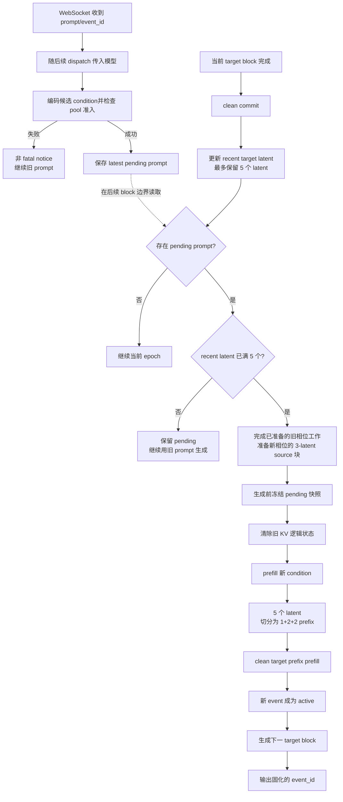

# Zing WebSocket prompt 切换的滚动 latent prefix 设计

本文描述 Zing H3 realtime 会话如何在 WebSocket prompt 切换时，使用会话常态保留的
最近 target latent，在新 prompt 下重建连续的历史 KV。设计直接基于当前 `main` 的
source-ready 视频会话、packing、sampling 和 KV cache 边界，不依赖其他功能分支。
本文核对的代码基线是 `origin/main@47c41dc43bf70431bd82cf161a42e2c1d3cfd3ef`。

最终行为是：每个会话常态维护一个最近 target latent 的滚动窗口，容量由
`prompt_switch_prefix_latent_frames` 控制。配置默认为 `5`，无需额外配置即可启用滚动
prefix；显式设为 `None`（配置 JSON 中为 `null`）可保持旧的 prompt 更新行为。
新 prompt 只有在已经积累满这段固定长度
历史后，才会在完整 block 边界生效，并使用它做 clean prefix prefill；输出块用既有
`event_id` 标明实际使用的 prompt 版本。

## 1. 用户怎么用

### 1.1 使用场景

目标用户是通过 Zing realtime WebSocket 连续生成视频的调用方。例如游戏引擎继续提供
角色运动和镜头 source，客户端发送新 prompt，把画面从晴朗白天改成霓虹雨夜。prompt
只改变天气、光照、材质等渲染表现；角色转向和运动仍由游戏引擎/source 控制。服务不能
中断当前去噪块，也不能要求客户端把已经播放的视频重新上传。

服务启动时默认使用以下固定的滚动 prefix 长度，无需重复配置：

```text
prompt_switch_prefix_latent_frames=5
```

这个值是 **VAE temporal latent 的时间步数量（张量 T 维）**，不是输出视频的像素帧数。
虽然配置名沿用 `latent_frames`，这里的一个单位指一个 latent，不指一帧解码后的视频。
它是部署级、会话内不可变配置，因为它参与 session 显存预算、KV pool 容量和 prefix
block 几何。

如果已有模型导出不满足下文的 `[3,2]` + `split_first_latent=True` 分块要求，或需要
保留旧的“只替换条件 KV、保留 target 历史 KV”行为，在服务的 pipeline 配置 JSON 中
显式设置 `"prompt_switch_prefix_latent_frames": null`。已有配置文件中的显式 `null`
仍然优先于新默认值；省略该字段才采用默认 `5`。此默认值变更不代表已验证 H100/L20Z
上的切换显存峰值或解决 OOM，需要在对应部署配置下复测。

客户端沿用现有 WebSocket prompt update 协议，发送 prompt 和单调递增的 `event_id`。
本文不新增第二套控制协议。示意消息如下，准确 envelope 以现有 realtime 协议为准：

```json
{
  "type": "event",
  "kind": "prompt",
  "event_id": 11,
  "payload": "Render the scene at night with neon reflections in the rain"
}
```

服务不会中断正在生成的 block。**WebSocket 收到事件，不等于模型会话已经收到新 prompt。**
控制事件先经过调度，再随推理任务（dispatch）传给模型进程；模型在 dispatch 开始时编码并
接纳候选。一次 dispatch 可以连续处理多个 block，执行期间不会在每个 block 边界重新读取
WebSocket 最新事件。因此，本实现不保证网络收到更新后的紧邻下一 block 就使用新 prompt。

模型会话接纳候选后，需完成已经准备好的旧相位工作，历史满 5 个 latent，并准备好新相位
的下一 source 块，才在生成前重建 KV、激活候选。后续分块相位从 `3,2,3,2...` 开始。
若历史不足 5 个 latent，则继续使用旧 prompt 补足。每个输出块的 header 已包含 `event_id`；
第一个携带 `event_id=11` 的输出块才是该事件实际生效的位置，不能用发送时刻推断。

### 1.2 可观察行为

假设当前 prompt 的事件为 `10`，WebSocket 收到事件 `11`。以下流程区分网络接收、
模型接纳和生成生效三个时刻；解码与传输还会使客户端更晚收到新版本画面：

```text
WebSocket 收到 event 11
  → 更新待调度的控制信息；正在执行的 dispatch 不被中断
  → 当前 dispatch 可能继续生成多个 event 10 的 block
  → 后续 dispatch 将 event 11 传给模型
  → 编码并检查 pool 准入，保存模型会话的 pending condition

完成已准备的旧相位工作，每次 clean commit 后更新最近 5 个 latent
  → 不足 5 个时继续使用 event 10 生成
  → 满 5 个且可以开始新相位后，source bridge 准备 3-latent 首块

新块开始生成前的完整 block 边界
  → 冻结 event 11 的 pending condition
  → 清除旧 prompt 下的 KV
  → prefill 新 condition
  → 用最近 5 个 latent 做 clean prefix prefill

  → 使用 event 11 生成
  → 输出 event_id=11
  → 解码、传输后，客户端收到 event_id=11 的画面
```

切换过程中不会重新输出 prefix 对应的旧帧，也不会重置全局 `chunk_index`、
`output_frame_start`、`pts_us`、`source_alignment` 或 `source_dependency_end`。切换后的第一块
固定取 3 个 latent，因此它可以改变后续全局 chunk 的 latent 边界；边界仍连续且绝对值
单调递增。

### 1.3 基线行为与功能缺口

当前 `main` 的持续 `SourceReadySession` 在 prompt 更新时替换 condition prefix KV，但
已经提交的 target KV 仍保留原来的条件上下文。目标行为是在同一个完整 block 边界，将
新 condition 与常态保存的最近 target latent 一起 prefill，建立一致的新 prompt 阶段。

## 2. 目标与非目标

### 2.1 目标

- prompt 只在完整 block 边界切换；
- 会话始终保留最近固定数量的干净 target latent；
- 新 prompt 下重新计算这段 latent 的 clean KV；
- 切换不经过视频解码或 VAE 重编码；
- 切换不消耗 denoise RNG，不重复输出历史帧；
- `event_id` 准确标记每个输出块实际使用的 prompt；
- 会话长度增加时，prefix 内存和切换 forward 数保持有界；
- pooled KV、SP 和既有 source/provenance 时间线继续由原模块管理。

### 2.2 非目标

- 不保证切换后仍能直接访问最近 5 个 latent 之外的语义历史；
- 不重放完整会话历史；
- 不为所有 diffusion 模型建立通用 prompt-switch cache API；
- 不在一个 block 的 diffusion timestep 中途替换 prompt；
- 不保证 WebSocket 收到事件后的紧邻下一 block 生效，也不保证固定毫秒数的切换延迟；
- 不允许 WebSocket 事件动态修改 prefix 长度；
- 本期不扩展到 audio target；当前 source-ready 入口只接受 video-only static prefix；
- 不改变 reference、condition、source 的既有公开含义。

## 3. 关键名词和数据契约

| 名称 | 含义 | 生命周期 |
| --- | --- | --- |
| active prompt | 当前生成 block 真正使用的 condition 和 `event_id` | 从成功应用边界持续到下次成功切换 |
| pending prompt | 已收到、等待“历史满 5 个”的完整 block 边界应用的最新 prompt/event | latest-wins，可被更新事件覆盖 |
| recent target latent | 已成功生成并 clean commit 的最近 target latent | 每个 block 完成后更新，session 关闭时释放 |
| prompt epoch | 一次 prompt 生效后形成的模型内部局部时间阶段 | prompt 切换时重建，外部时间轴不重置 |
| clean prefix prefill | 用已知 latent 在 `t=1` 写入 target KV | 只在 prompt 切换时执行，不去噪、不输出 |
| `event_id` | 生成该输出块时实际采用的 prompt 事件 | block 开始/提交时固化，随输出传递 |

滚动视频 latent 的张量契约沿用 Zing H3 visual latent：`[B, C, T, H, W]`。缓冲区
持有已经 `detach` 的 session-owned storage，`T <= prompt_switch_prefix_latent_frames`；
不能保留指向后续会被覆盖的工作 tensor 的 view。

## 4. 主流程



候选 condition 在控制事件被会话接受时编码，但只在合格 block 边界激活。编码必须发生在
清除旧 cache 之前。编码失败时旧 prompt 和旧 KV 都保持可用；一旦
开始清除 cache，后续 prefill 失败就关闭 session，因为无法证明半重建 cache 可以继续
使用。

## 5. 关键设计决策

### 5.1 Latent 窗口常态维护，不在事件到达时临时截取

每次 target block 成功 commit 后立即把新 latent 加入有界窗口并淘汰旧 latent：

```text
完成第 1 个 latent： [L0]
再完成 2 个 latent： [L0 L1 L2]
再完成 2 个 latent： [L0 L1 L2 L3 L4]
再完成 3 个 latent： [L3 L4 L5 L6 L7]
```

窗口只保存 latent，不在正常 block 路径重复建立 prefix KV。会话早期窗口不足 5 个 latent 时，
prompt 可以先进入 pending，但不能生效；旧 prompt 继续生成并补足窗口。窗口满 5 个 latent 后，
每个后续 block 边界都具备完整、最新且与正式输出一致的切换历史。

考虑过直接从有限会话的完整 `state.visual` 切片，但持续 source-ready 会话不会永久持有
完整 target，且 view 可能绑住大 storage。由 session 显式拥有有界窗口可以统一有限和
持续路径的内存语义。

### 5.2 固定 5 个 latent，而不是全历史 replay 或直接保留旧 target KV

保留旧 target KV 会把“新 condition KV”和“旧 prompt 下计算的 target KV”混在一起。
全历史 replay 语义完整，但切换成本随会话长度增加，不符合 realtime 延迟目标。

最终选择固定最近 5 个 latent：

- 切换 forward 数和常驻内存与会话长度无关；
- 最近动作、人物姿态和局部画面仍作为连续性锚点；
- 最近 5 个 latent 之外的信息只可能通过窗口内 latent 的内容间接保留，这是明确接受的代价。

### 5.3 五个 latent 按 `1+2+2` 切分

本期目标运行配置的 prompt epoch 入口 block 长度是 `1,2,2`。固定 5 个 latent 按下面
三块做 clean prefix prefill：

```text
[L0] [L1 L2] [L3 L4]
```

这里的“切分”不改变 latent 的顺序或数值，只决定三次 clean commit 的 block 边界。服务
启用功能的 source session 初始化时必须严格核验原始配置为
`num_frame_per_block=[3,2]` 且 `split_first_latent=True`，再读取未截断的入口三块
`1,2,2`。不能用 `chunks(5)` 验证：它会把 `[3,7]` 的实际入口 `1,2,7`
截断成 `1,2,2`，掩盖下一块实际从 latent 10 开始的相位错误。不匹配时
直接拒绝启用 prompt-switch prefix，不能静默使用另一种切法。本期不扩展到其他 chunk
计划。启用值 `5` 同时是滚动窗口上限和 prompt 生效所需的**固定历史长度**，不允许用
1 个或 3 个 latent 提前切换。默认启用后，不支持该几何的既有 export 需要显式设置
`null` 才能沿用旧路径；几何校验仍只在启用功能并创建 source session 时执行。

会话开头接纳新 prompt 时，需要继续用旧 prompt 生成，直到严格凑齐 5 个 latent。下表
使用本期支持的入口 block 长度 `1,2,2` 说明模型会话内的等待过程；假设候选已经进入模型
会话，且没有已准备的旧相位块需要先完成，不能把表中时刻直接理解为网络接收时刻：

| 模型处理候选的边界 | 已完成的历史 | 后续动作 | 新 prompt 生效点 |
| --- | --- | --- | --- |
| 第一个 1-latent block 完成后 | 1 个 latent | pending 保留；旧 prompt 再生成 `2+2` | 累积到 5 个后的下一 block |
| 第二个 2-latent block 完成后 | 3 个 latent | pending 保留；旧 prompt 再生成 `2` | 累积到 5 个后的下一 block |
| 第三个 2-latent block 完成后 | 5 个 latent | source bridge 下一块取 3 个 latent；生成前按 `1+2+2` 重建 prefix | 新 epoch 的 3-latent 首块 |
| 稳态中的任意完整 block | 窗口仍为 5 个 latent | 更新为最新 5 个 latent，重建 prefix，并重置分块相位 | 新 epoch 的 3-latent 首块 |

例如模型会话在第一个 block 完成后接纳 P2：历史只有 1 个 latent，第二、第三个 block
仍由 P1 生成，窗口依次为 3、5；准备好新相位 source 后，在第四个 block 生成前重建 P2
prefix，第四个 block 携带 P2 的 `event_id`。如果网络早已收到 P2，但尚未调度给模型，
则不能保证第四个 block 就生效。等待期间模型接纳更新的 P3 时，P3 取代 P2。

“完整 block 边界”同时承担两个条件：当前 block 已完成去噪，且已经存在固定 5 个干净 latent
历史。会话进入稳态后第二个条件常态满足；但仍需等待控制事件调度，并完成已准备的旧相位
工作。source bridge 必须按新 epoch 的首块长度凑齐 3 个 latent 后才重建 KV 并启动去噪。若旧相位原本下一块
是 2 个 latent，这会多等待 1 个 source latent，换取与 checkpoint/Native 完全一致的块相位。

### 5.4 每次切换建立模型内部局部 epoch

最近 5 个 latent 可能从旧 block 中间开始，不能把旧 block id 原样导入。切换时保持 latent
顺序不变，从局部位置 0 按 `1+2+2` 重新划分 block：

```text
旧全局历史： ... [L4 L5] [L6 L7] [L8 L9]
最近 5 个 latent： L5 L6 L7 L8 L9
新局部 epoch：   [L5] [L6 L7] [L8 L9] → next target
```

模型内部 position/block 编号在 epoch 内重新连续排列，后续长度从本地 chunk 3 开始按
`3,2,3,2...` 推进；对外 `chunk_index`、播放时间、source provenance 和输出 cursor 继续
使用全局绝对值。source bridge 按模型会话请求的下一块长度切出连续 latent，因此全局范围
可以从原相位改为 3-latent 边界，但不会重叠、跳过或重编号。这样既避免为 cache 引入带
空洞的非连续历史导入接口，也不会把旧全局相位错误套到新的模型 epoch。

### 5.5 Prompt 采用 latest-wins，并在边界形成原子快照

控制路径采用事件层面的 latest-wins。模型会话接纳新事件、开始 condition
编码前就淘汰旧 pending 候选，编码成功且通过 pool 准入后保存新候选。例如接纳事件 13 后，
若窗口尚未满 5 个 latent，13 继续 pending；具备切换条件时读取其 condition、`event_id`
和 `prompt_version`，形成不可变快照。这里指模型会话已接纳的候选，不是网络层刚收到的
所有事件。正在执行的 dispatch 不会被新事件打断，网络层的新事件须经后续调度才能参与切换。

如果 12 已经 pending，而更新的 13 编码失败，13 仍然 supersede 12：发送 13 的非 fatal
notice，12 不会恢复，旧 active prompt 和 KV 保持不变。这与客户端按单调 event 顺序提交
最新意图的语义一致，也避免失败后静默应用已被更新事件取代的旧意图。

`event_id` 不应在媒体发送时从 session 当前状态读取。生成完成后立即把实际使用的
`event_id` 固化进 `ChunkResult`/block metadata，避免解码或发送积压导致旧 block 被错误
标成新 prompt。

### 5.6 Prompt 切换不改变 RNG 和输出进度

滚动窗口更新、condition prefill 和 target prefix clean prefill 都不调用 diffusion
scheduler，也不抽取随机数。新 target 从会话原有 RNG 状态继续。历史 latent 不重新进入
decoder，已输出帧不会重复，decoder overlap 和全局 PTS 继续前进。

### 5.7 配置属于 runtime，不属于 WebSocket 事件

`prompt_switch_prefix_latent_frames` 影响每 session tensor 常驻量、KV pool reserve rows 和
prefix forward 数，因此在部署启动时确定。本期关闭值为 `None`，唯一启用值为 `5`；其他
值在部署配置校验阶段明确拒绝，不能暗示任意长度都能按合法 block 几何重建。`1+2+2`
几何在启用功能的 source session 初始化时校验，因此普通 Zing stage 和未启用该功能的
既有 export 不受限制。底层 sampler 接收已经校验的整数，不依赖 HTTP/WebSocket 配置
对象，也不在热循环重复做 host/device 同步校验。

### 5.8 状态只属于单个活跃会话

部署沿用仓库约定的单活跃会话模型。滚动 latent、active/pending prompt、prompt epoch、
KV lease 和 RNG 都属于当前会话；不新增多 owner 状态或并发会话调度。已有活跃会话时，
第二个会话应在 admission 层被拒绝，且不能读取、覆盖或释放当前会话的状态。断连、取消、
故障或 EOS 后必须释放上述资源，随后新会话从空窗口和自己的初始 prompt 开始。

## 6. 模块职责与依赖方向

### 6.1 状态所有者

| 状态 | 所有者 | 更新时机 |
| --- | --- | --- |
| prompt 事件的接收、校验和 pending slot | realtime API / Zing source adapter | 收到事件时 |
| active condition、active `event_id` 和边界快照 | `SourceReadySession` | 完整 block 边界 |
| condition 错误通知 | source session → realtime 输出层 | 候选编码失败时 |
| 最近 visual latent | `SourceReadySession` | target clean commit 成功后 |
| prompt epoch 的局部 chunk/position | `SourceReadySession` + `ZingH3Packer` | prompt 成功切换时 |
| 待生成块长度 | `SourceReadySession` | 正常提交后推进；prompt epoch 切换时重置到局部 chunk 3 |
| 连续 source latent 的实际切片 | `SourceChunkBridge` | 按 session 请求长度转移，不解释 prompt/KV |
| KV storage、window、pool slot | `ZingH3KVCache` | sampler prefill/commit；session 关闭时释放 |
| RNG、scheduler 进度 | sampling state | 仅正常生成步骤推进 |
| 全局 chunk/frame/PTS/provenance | realtime source session/ledger | 正常输出提交时持续递增 |

### 6.2 实现文件边界

| 文件 | 当前职责 | 不应承担的职责 |
| --- | --- | --- |
| `source_session.py` | 编码候选 condition、桥接 runtime session、返回错误 notice，并从 `ChunkResult` 写输出 metadata | 不直接操作 KV tensor |
| `source_bridge.py` | 保存连续 source latent，按 session 请求的下一模型块长度切片，并维护绝对 latent/pixel/provenance | 不决定 prompt 是否生效或模型 epoch 编号 |
| `incremental.py` | `SourceReadySession` 持有滚动 latent、pending/active prompt、局部 epoch 和边界切换事务 | 不解析 URI、WebSocket envelope 或输出像素 |
| `sampling.py` | `rebuild_prompt_prefix` 清空逻辑 KV，prefill 新 condition 和内部 latent prefix | 不理解 `event_id`、source ledger 或网络状态 |
| `_sampling_helpers.py` | `_commit_clean_prefix` 以 active/final 两阶段提交已知干净 latent | 不决定切换时机或保存历史 |
| `packing.py` | 把固定 5 个 latent 按 `1+2+2` 打包成新 epoch 的合法 prefix rows/position，并校验 `ChunkPlan` | 不拥有 session 生命周期 |
| `zing_h3_cache.py` | 沿用 KV pool、prefix/target commit 和清理事务 | 不知道 prompt 文本或 latent 保存策略 |
| `stage.py` / Zing pipeline config | 默认 `5` 交给 source session 启用；显式 `None` 保持旧路径 | 不在全局 stage 构造时限制既有 chunk plan，不在 WebSocket 事件中动态修改 |

依赖方向保持：

```text
WebSocket/source session
  → SourceReadySession
    → ZingH3Packer / ZingH3Sampler
      → ZingH3KVCache / ZingH3 model
```

底层 model/cache 不反向依赖服务协议。滚动窗口先放在 Zing H3 的 session 模块中，不建立
跨模型 manager；只有有限和持续两条 Zing 路径都实际需要时才提取同模块内的小型私有
helper。

## 7. Prompt 切换事务

候选进入 pending 之前，`ZingSourceStreamState._update_prompt` 先编码新条件，
再由 `_admit_prompt_update` 复用 `stage.kv_request` 和 `kv_pool.plan.admit` 检查
当前池的准入条件。prefix rows 按真实 packing 中 `block_idx == 0` 的行数计算，
包含文本 context 和参考媒体 token；它不是字符数，也不是最近 5 个 target latent。
为复用布局计数，只构造一个零值 target latent 作为占位，不执行模型、不消耗 RNG，
也不重新申请 slot。未启用 KV pool 时不增加容量限制。

超过 `max_prefix_rows` 的候选返回带该事件 ID 的非 fatal `CONDITION_INVALID` notice，
旧 active prompt、KV 和 lease 保留，会话继续生成，后续合法更新仍可生效。
按既有 latest-wins 规则，失败的新事件也会淘汰更旧的 pending。检查只发生在收到
新 prompt 时，普通生成块不重复执行。

通过准入后，一次成功切换按以下顺序执行：

1. 当前 target block 使用旧 active prompt 完成 denoise 和 clean commit；
2. 将该 block 的 visual latent 追加到滚动窗口并裁剪到配置上限；
3. 检查模型会话是否已有编码并通过准入的 pending prompt；没有时继续，不在此处轮询 WebSocket；
4. 若滚动窗口还不足配置的固定长度，保留 pending，继续用旧 active prompt 生成；
5. 完成已准备的旧相位工作，按新 epoch 的局部 chunk 3 从 source bridge 准备 3 个 latent；
6. 在该块生成前冻结候选快照、检查 prefix 布局；保留原有 RNG、全局输出 cursor 和 decoder 进度，不额外复制或恢复这些状态；
7. 清除当前 cache 的逻辑内容，但保留 pooled storage 所有权；
8. prefill 新 condition prefix；
9. 将固定 5 个滚动 latent 按新 epoch 的 `1+2+2` 三块逐块 clean commit；
10. 将候选 prompt/event 标记为 active，清空对应 pending；
11. 使用已经准备好的 source 块生成新 target，随后从 `3,2,3,2...` 相位推进；
12. 输出 block 固化新的 `event_id`，全局时间线继续递增。

候选编码或 pool 准入失败时，旧 active prompt 和 cache 不变，并返回非 fatal notice；
不能把其他布局、运行时或 source 错误也理解为可恢复。第 7 步之后重建失败则关闭 session、
释放 cache/RNG/latent 窗口并报告 fatal error。第一版不申请第二套完整 KV 做回滚，避免
pooled session 显存翻倍。

## 8. 需要保持的不变量

1. `recent_visual.shape[2] <= prompt_switch_prefix_latent_frames`；
2. 窗口中的 latent 全部来自成功 clean commit 的 target；
3. 只有 `recent_visual.shape[2] == prompt_switch_prefix_latent_frames` 时才能应用 pending prompt；
4. 历史不足时 pending 保留、active prompt 不变；更新事件到达即按 latest-wins 淘汰旧 pending，即使新事件编码失败也不恢复旧 pending；
5. 对外输出帧不因 prefix prefill 重复、丢失或倒退；
6. prompt 切换前后 RNG state 只由正常采样推进；
7. 输出 `event_id` 等于该 block 生成时的 active event；
8. condition 编码失败不推进 active event；
9. 新 epoch prefix 和下一 target 的 block/position 连续，下一块固定为局部 chunk 3 的
   3 个 latent，后续按 `3,2` 循环；
10. 全局 source/provenance 时间线不随 epoch 重置；
11. session 关闭后 ready queue、rolling latent、KV、RNG 和临时布局都不再持有 tensor；
12. pooled cache 的主 storage 地址和容量不因 prompt 切换增长；
13. SP 各 rank 走相同的切换分支和 collective 顺序；
14. 第二个会话被拒绝时，当前活跃会话的状态和输出不受影响。
15. 边界快照后到达的新事件不能被本次切换消费或被失败清理误删。

## 9. 正确性与性能验证

实现已补充 CPU contract，完成三例真实 WebSocket/SP2 推理，结果见第 12 节。
SP1/SP2 数值对照、分阶段性能及更多连续切换仍待验证；计划标准不代表已经通过。

### 9.1 正确性测试

| 不变量/风险 | 测试方法 | 通过标准 | 当前状态 |
| --- | --- | --- | --- |
| 窗口始终最新且有界 | 用可识别值连续提交 `1,2,2,3,3,2` latent | 每次结果后窗口等于全部正式输出的最后 5 个 latent | CPU 已通过（见 12.2） |
| 启动期严格等待 5 个 latent | 在第二个 block 前连续注入事件 | 前三块保持旧 event；达到 5 个后的下一输出使用新 event | CPU 已覆盖 |
| 稳态切换重置分块相位 | 窗口已满、旧相位刚完成 3-latent block 后再注入事件 | source bridge 不再取旧相位的 2，而是为新 epoch 凑齐 3；下一输出使用新 event | CPU 已通过（见 12.2） |
| latest-wins | 历史不足期间注入 11/12/13 | 只有 13 成为 active 并出现在输出 | CPU 已覆盖 |
| 更新事件编码失败 | 12 已 pending 后注入编码失败的 13 | 12 被淘汰，active prompt/KV 不变，13 返回非 fatal notice | CPU 已覆盖 |
| prefix 包含刚完成 block | 每块后对比 `recent_visual` 与正式 `ChunkResult.visual` | 两者最后 5 个 latent 完全一致 | CPU 已覆盖 |
| 不消耗 RNG | 在 `rebuild_prompt_prefix` 前后比较 session CPU RNG | 两次连续切换前后逐字节一致 | CPU 已覆盖 |
| 不重复输出 | 检查对外 `TemporalChunk` 与内部局部 epoch | 对外 chunk ID 和绝对 latent 范围连续；第二次切换后内部仍从 target block 8 继续 | CPU 已覆盖；三例单次切换完整解码通过，真实连续两次切换待测 |
| epoch 几何正确 | 检查固定 5 个 latent 的 row/block/position 及后续长度 | prefix 形成完整 `1+2+2`，下一 target 为 3 latent，随后为 2 latent | CPU 已通过（见 12.2） |
| bridge 相位切换 | 已缓存 source latent 时请求连续 `...,3,3` 两块 | 第二个 3-latent 块跨旧边界取值，但绝对 latent、像素和 provenance 无重叠或丢失 | CPU 已通过（见 12.2） |
| chunk 配置不匹配 | 使用 `[3,7]+split`、`[1,2,7]`、`[1,2,2]` 或未 split 的 `[3,2]` 创建会话 | 显式关闭时普通会话可创建；启用时（包括默认值）明确拒绝 | CPU 已覆盖 |
| prefix 长度不匹配 | 配置 `prompt_switch_prefix_latent_frames` 为非 5 值启动 | config/session 初始化明确拒绝 | CPU 已覆盖 |
| prompt 超过 pool 预算 | 16-row pool 收到 40-row 更新；另测文本+reference 的总计边界 | 拒绝新事件且 KV/RNG/storage 不变；继续超过第 18 块；恰好 16 rows 的后续候选可生效 | 本次新增 CPU 回归，执行结果见下文 |
| condition 失败可恢复 | 注入 condition worker 错误 | 返回非 fatal notice，已有输出仍携带原 event/version | 既有 RPC contract 已覆盖 |
| cache 重建失败清理 | 在各 prefill 阶段注入异常 | session 关闭，所有 owned tensor/KV lease 释放 | 待补故障注入 |
| 单活跃会话隔离 | 活跃会话生成时尝试建立第二会话 | 第二会话被拒绝，首会话 event、窗口和输出连续 | 沿用既有 admission contract；待真实流程复核 |
| 生命周期释放 | 完成后检查 rolling latent、pending prompt 和 cache | session dispose 后均释放 | CPU 已覆盖正常完成；异常/EOS 待扩展 |
| pooled/growing 等价 | 相同 latent/prompt/噪声跑两种 cache | 输出完全一致，pool storage 指针不变且不扩容 | CPU 已覆盖 |
| SP 一致 | SP1/SP2 固定输入、seed、prompt 事件 | 无 deadlock，event/输出/latent 一致 | 待 GPU/SP |

CPU contract 覆盖连续两次 prompt 切换和第二次相位重置，`4e24d76e` 的 Linux CI 已通过
13 项检查。当前新增的预算和原始分块校验回归另行记录于文末；真实流程的更多连续
切换仍需按相同顺序复测：

```text
P1 生成若干 block
  → block 中途发送 P2
  → P2 生效并生成至少一块
  → block 中途发送 P3
  → P3 生效并继续生成
```

验收要同时保存输出 header、latent 范围、event 变化、RNG hash、KV counter 和可播放视频，
不能只靠单元测试的 mock 调用次数判断正确。

### 9.2 计划性能测试

性能敏感点包括每 block 的滚动窗口维护，以及 prompt 边界的 condition encode 和三次
prefix clean commit。计划在固定 checkpoint、分辨率、seed、source 和并行配置下比较：

| 指标 | A/B 方法 | 计划通过标准 |
| --- | --- | --- |
| 无 prompt 更新时的稳态 block latency | 功能关闭基线 vs 常态保留 5 latent | 预热后 p50/p95 回退不超过 5% |
| retained session memory | 生成 5、50、200 个 block 后读取 owned tensor/KV counter | recent latent bytes 固定；KV 受既有 window/pool 上限约束 |
| prompt switch 模型工作量 | 在第 5 和第 100 个 block 切换 | prefix clean commit 数都等于 3，不随历史长度增长 |
| prompt switch 延迟 | 分开记录 condition encode、cache rebuild、下一块首帧延迟 | 报告 p50/p95；扣除 encoder 后，长会话与短会话差异不超过 10% |
| 相位重置的 source 等待 | 分别在旧 3-latent 与 2-latent block 后切换 | 记录为凑齐新 3-latent 首块新增的 source 等待；不归因到 DiT 回退 |
| GPU 峰值显存 | 开关功能、prompt 切换前后采样 | 不申请第二个完整 session KV slot；峰值在预估 ring/prefill workspace 内 |

真实 GPU 验证使用当时 PR head、固定 checkpoint SHA、相同初始噪声和至少 SP1/SP2。硬件、
镜像、分辨率、FPS、solver、steps、guidance、重复次数和冷热状态必须记录。未经真实测量，
本文不宣称功能已达到实时延迟或画质等价。

## 10. SGLang 社区实践与合入考虑

本设计遵循 SGLang diffusion 的现有分层：模型特有 condition/packing/sampling/cache 逻辑
留在 Zing H3 stage，WebSocket 协议留在 realtime/session 层，不把服务对象传给 model。
参考：

- [Support New Diffusion Models](https://github.com/sgl-project/sglang/blob/main/docs/docs/sglang-diffusion/support_new_models.mdx)
  强调复用现有 pipeline/stage/model 边界，并为 cache、prompt/reference 变化补准确性与
  性能证据；
- [Session-Aware Radix Cache](https://github.com/sgl-project/sglang/blob/main/docs/docs/advanced_features/session_radix_cache.mdx)
  虽然是 LLM radix cache，不是 Zing causal KV，但它同样把 session 状态身份和上下文
  重建责任分开；
- [Realtime Diffusion RFC #19421](https://github.com/sgl-project/sglang/issues/19421)
  把历史帧、rolling window 和 reset 视为 realtime diffusion session 状态。该 RFC 是
  已归档的早期提案，只作为方向参考，不代表社区已经提供本功能的通用 API。

官方仓库目前没有通用的“prompt 切换时用最近生成 latent 重建 causal target KV”接口。
因此本 PR 先保持 Zing H3 专属，不新增跨模型抽象。上游 reviewer 预计会重点关注：

1. `event_id` 是否在生成时快照，而非在延迟发送时读取；
2. rolling latent 是否让每 session 显存有界，是否影响 KV pool sizing；
3. prompt 更新、source append 和 SP collective 的顺序是否确定，第二会话拒绝是否不影响当前会话；
4. clean prefix 是否完全跳过 denoise、scheduler 和 RNG；
5. epoch 内部位置重排是否破坏 source/target RoPE；
6. 正常无更新热路径是否增加 tensor copy 或同步；
7. CPU CI、GPU/SP、长会话和失败清理证据是否足够复现。

本 PR 已按本文实现 Zing H3 source-ready 视频会话的 prompt-switch latent prefix，并在本文
保留已执行 CPU、三例端到端证据及待执行的 SP 数值对照、分阶段性能项目。功能仍保持 Zing 专属，没有为
其他 diffusion 模型新增通用 cache 接口。

## 11. Reviewer 阅读指南

推荐先确认状态和时序，再看张量打包和 cache；不需要先阅读整个 DiT 模型。

| 顺序 | 文件、类/方法 | Reviewer 需要确认的问题 |
| --- | --- | --- |
| 1 | 本文 | 外部行为、兼容变化、边界和验收是否合理 |
| 2 | `source_session.py`：`ZingSourceStreamState._update_prompt`、`_admit_prompt_update`、`run`、`_generate_ready` | 是否在候选进入 pending 前检查 pool 预算；候选失败是否非 fatal；是否按 session 的新相位长度取 source；metadata 是否读取生成时固化的 event/version |
| 3 | `source_bridge.py`：`ready_for`、`pop` | 3/2 相位改变时是否只改变切片边界，并保持绝对 latent、pixel 和 provenance 连续 |
| 4 | `incremental.py`：`next_chunk_size`、`update_prompt`、`_activate_pending_prompt`、`_remember_visual`、`_step`、`dispose` | active/pending prompt、rolling latent 和局部 epoch 何时更新/释放，切换后是否从 3-latent 块继续 |
| 5 | `packing.py`：`prompt_switch_prefix_chunks`、`pack_prompt_switch_prefix` | 固定 5 个 latent 是否形成 `1+2+2` 新 epoch，position/block 是否连续 |
| 6 | `sampling.py`：`rebuild_prompt_prefix` | 是否只重建新 condition 和 5-latent prefix，并保留 pooled storage |
| 7 | `_sampling_helpers.py`：`_commit_clean_prefix` | 已知 latent 是否走合法 active/final cache 事务，不经过 denoise/scheduler |
| 8 | `zing_h3_cache.py`：`ZingH3KVCache.clear`、`prepare_chunk`、`update` | pooled storage 是否复用，事务顺序和 window 是否仍合法 |
| 9 | `server_args.py` 与 Zing pipeline config | 默认是否为 5、显式 `null` 是否保留旧路径、其他数值是否拒绝，并正确计入 session/KV 预算 |
| 10 | realtime admission 与 session cleanup 路径 | 第二会话拒绝、断连/取消/故障/EOS 释放是否保持单活跃会话契约 |
| 11 | 对应 unit/integration/GPU 测试 | event、RNG、latent、显存和失败路径是否有真实证据 |

快速 review 可以先盯住五个不变量：

- 最近 latent 在每个成功 block 后常态更新，始终有界；
- prompt 历史不足 5 个 latent 时保持 pending，满 5 个 latent 后才在完整 block 边界生效；
- 新 prompt 使用最近 latent 重建 KV，不保留旧 prompt 的 target KV；
- prefix prefill 不消耗 RNG、不重复输出；
- 输出 `event_id` 精确对应实际生成该 block 的 prompt。

## 12. 当前状态

当前 PR 已实现运行时代码和 CPU contract：会话常态保留最近 5 个 target latent，prompt
在完整 block 边界以 `1+2+2` 局部 epoch 重建 KV，source bridge 随后从 3-latent 块重新
开始 `3,2` 相位；连续切换保持 RNG 与全局输出时间线，输出 block 固化实际
`event_id`/`prompt_version`，pooled cache storage 不扩容。

推理实测代码为 `8bd5aef2b01ebd059e604fc9028a3ebfb912a0e2`；后续文档同步不改变这个测试版本。
该版本删除冗余的 `SourceReadySession.model_latent` 和
`ZingSourceStreamState.effective_prompt_version`，输出版本由 `ChunkResult` 快照提供。
其 [CPU CI](https://github.com/seedleap/sglang/actions/runs/38528893268) 中 conditioning suite
及汇总失败：`test_t24_source_block_metadata_preserves_old_version_then_switches_on_success`
夹具仍读写已删除的状态字段。本次已把该夹具同步为 sampler 持有 prompt 快照，并从生成时
快照填写输出 event/version；保留失败更新使用旧版本、成功更新使用新版本的断言，未恢复
生产代码的冗余状态。修复后的回归状态见 [PR 最新 CI](https://github.com/seedleap/sglang/pull/303/checks)，
旧版本 CI 和下面的 CPU 回归不能替代修复版本验收。

### 12.1 PR302 events 三例顺序实测（2026-10-14）

[三例原速对照、切换慢放与指标](https://review-cdn.loopit.com.cn/world-model/sglang/evals/pr303-prompt-switch-20261014/r3-pr302-events-all/review-three-r2/index.html)

同一服务连续执行三例，暴雪作为预热，夜雨与室内各一次。数据版本为 PR302
`8bb8e9f5f4b8a993562afccd0e8c583c1ebc6056`，更新逐字使用其
`metadata.prompt_switch.event.payload`：保留原 prompt，仅追加 events 内容；source、参考图
和 conditions 不变。这是客户端构造新 prompt 的方式，服务端不会自动拼接 event 文本。

| 指标 | 荒原暴雪 | 街区夜雨 | 室内白色 / 青蓝 |
| --- | ---: | ---: | ---: |
| 测试角色 | 首例预热 | 预热后单次测量 | 预热后单次测量 |
| 首帧等待 TTFF（秒） | 124.92 | 4.84 | 5.31 |
| 全程平均交付速度（FPS） | 3.84 | 10.87 | 10.80 |
| 首批后平均交付速度（FPS） | 11.50 | 11.71 | 11.72 |
| prompt 切换交付延迟（秒） | 6.19 | 6.10 | 6.69 |

表中数值保留两位小数，原始精度见报告。TTFF 为客户端开始计时至收到首批画面；
全程速度包含首帧等待，首批后速度排除首批等待但仍包含切换开销；切换延迟为发送更新至
收到第一批新 `event_id` 画面的实际等待时间。FPS 是交付速度，视频播放帧率为 24 fps。

配置：H3 DMD step1600，4步 `[1000,750,500,250]`，guidance 1，seed 42，2GPU/SP2
（实际设备 NVIDIA L20D，275040 MiB/卡），FA4、AdaLN cache ON、TAEH3 FP16，无 CPU offload。
`warmup_mode=off`，由第一个完整案例预热；每例720帧、832×480、24fps，无音频。
权重 SHA-256：`9f46876c1a7cb22ce94da0993781319d11d2914ce35581ec56f12ab20591d2d6`。

三例都在收到362帧后发送更新，第400帧（从0计数，16.667秒）开始携带新 `event_id=435`。
38帧是旧版本画面的交付数量，按24fps播放约1.58秒；表中6秒左右是实际墙钟等待时间，
不能互相换算，也不能把全部等待归因于 prefix 重建。调度、编码、重建、生成、解码和传输
尚未逐阶段归因。FPS为未按播放速度限流的客户端交付速度，包含准备、生成、解码、传输与写盘。

有效GPU任务 `dlc1v639xn7iyv8p`，导出 `dlc1iypcsrr14hsm`，独立只读回验
`dlcv3pogbfdbm134`。48个对象SHA、12个视频完整解码、3个payload与数据逐字一致均通过。
三例输出帧和时间戳连续；协议与媒体检查通过不等于视觉效果通过，视觉效果仍由视频评审。
第二、三例不同输入可能仍有特有首次开销，各只测一次，不作为稳定性能统计。

### 12.2 P1/P2 修复验证（2026-10-14）

- P1：新条件在进入 pending 之前重新检查 pool 准入；超预算返回非 fatal notice，
  保留 active prompt、KV、RNG 和 slot。
- P2：检查原始 `[3,2] + split_first_latent=True`，不再用截断后的 `chunks(5)` 判断。
- 新增回归包含文本+reference 总预算、16-row 上限拒绝 40-row 更新、旧会话继续超过
  第 18 个输出块、后续恰好达到上限的更新生效，以及四种不支持的分块配置。
- 本次验证使用阿里云 0GPU CPU 任务；Windows 本地只运行已有格式/静态工具，未安装依赖。
- 阿里云任务 `dlch781sblpsvykt`（0GPU、4CPU，现成 SGLang 镜像）实测：
  **749 passed，14 warnings，42.21 秒**。执行 `test_zing_h3_chunks.py`、
  `test_zing_kv_pool_runtime.py`、`realtime/test_zing_progressive_source_session.py`、
  `realtime/test_zing_conditioning_lifecycle.py`，包括本次新增的 6 个参数化用例。
- 云端仅补齐 CI 指定的 `pytest==8.4.2`、`pytest-asyncio==1.4.0`。
  前一轮为 746 passed、3 个异步用例因缺插件未执行；补齐后原样复跑通过。
  首次夹具的 CRLF 补丁失败未计入功能结果。
- 证据：`/cpfs/world-model/sglang/evals/pr303-prompt-switch-20261014/r1/budget-fix-cpu-r3/pytest.log`
  和 `status.json`；源代码为 `4e24d76e` 加本次补丁。
- 本地 Python 语法、仓库选择的 Ruff 规则、Ruff format、isort 和 `git diff --check` 通过。
  本次未新增 GPU 推理或性能测试，不以 CPU 回归替代画质及分布式验收。
